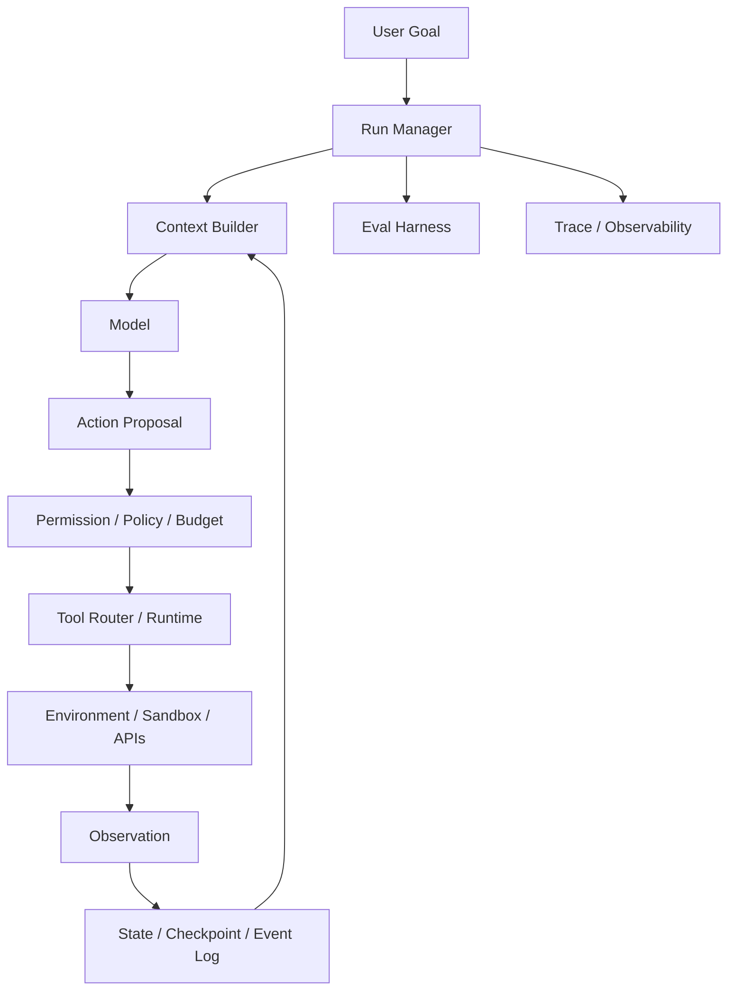
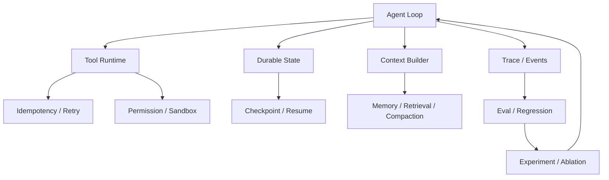

# Agent Harness 总体知识地图

## 核心心智模型

> **LLM 是概率策略，Harness 是控制系统与运行环境。**

## 三根主轴

| 主轴 | 核心问题 | 典型 Harness Primitive |
|---|---|---|
| Intelligence Amplification | 怎样让同一模型更会做事？ | context、tools、planning、environment、feedback |
| Reliability Engineering | 怎样把概率行为工程化？ | state、checkpoint、idempotency、retry、eval、trace |
| Capability Containment | 怎样限制真实世界影响？ | permission、sandbox、identity、credential、audit |

## 10 个能力域

1. [第一章 Agent Loop 与 Harness 基础](questions/01-agent-loop-harness/README.md) - 控制循环、状态、终止条件与 Model × Harness 共设计
2. [第二章 Tool / ACI / MCP 与执行接口](questions/02-tools-aci-mcp/README.md) - 把工具视作 Agent 的 action space，而不是附属 API
3. [第三章 Context Engineering 与 Memory](questions/03-context-memory/README.md) - 把上下文视作有限预算，并区分记忆、任务状态与可重建信息
4. [第四章 Planning / Orchestration / Multi-Agent](questions/04-planning-orchestration/README.md) - 用任务结构决定编排复杂度，并量化多 Agent 的真实增益
5. [第五章 Long-Horizon / Durable Agent](questions/05-long-horizon-durable/README.md) - 让长任务可分解、可验证、可交接、可恢复
6. [第六章 Permission / Sandbox / Security](questions/06-permission-sandbox-security/README.md) - 缩小 blast radius，让授权、身份与执行边界成为系统原语
7. [第七章 Evaluation / Observability](questions/07-evaluation-observability/README.md) - 以 task/trial/trace/outcome/grader 建模，并建立生产回归闭环
8. [第八章 Reliability / Distributed Agent Systems](questions/08-reliability-distributed/README.md) - 用分布式系统语义处理重试、幂等、取消、并发与一致性
9. [第九章 Cost / Latency / Performance](questions/09-cost-latency-performance/README.md) - 在 Quality × Reliability × Latency × Cost × Safety 上做 Pareto 优化
10. [第十章 System Design / Coding / Debugging](questions/10-system-design-debugging/README.md) - 把前九章组合成可落地、可评测、可运维的完整 Agent 系统

## Control Plane / Data Plane / Evidence Plane

生产 Agent 建议至少分三类平面理解：

| 平面 | 责任 | 典型组件 | 错误示例 |
|---|---|---|---|
| Control Plane | 决定下一步、预算、权限、路由、终止 | Run Manager、Context Builder、Policy、Scheduler | 无限循环、错误授权、错误路由 |
| Data / Execution Plane | 真正读取或改变环境 | Sandbox、Tool Runtime、Browser、API、DB | partial failure、重复副作用、环境漂移 |
| Evidence Plane | 证明发生了什么、是否成功 | Event Log、Trace、Checkpoint、Audit、Eval | 无法归因、grader 漂移、恢复无依据 |

关键原则是：**模型可以影响 Control Plane 的建议，但不能绕过 Data Plane 的 enforcement，也不能伪造 Evidence Plane 的事实。**

## 一次 Agent Run 的五类状态

1. **Goal state**：用户真正要求的结果，通常相对稳定；
2. **Cognitive state**：模型当前理解、计划、假设，可随时被推翻；
3. **Runtime state**：run/turn/budget/pending operations，由 Harness 持有；
4. **Environment state**：文件、数据库、浏览器、外部服务的真实状态；
5. **Evidence state**：tests、grader、trace、audit，用来证明 outcome。

系统设计时最常见的错误，是把 2 当成 3/4/5：例如模型说“已经修好”就把 run 标成成功。

## Harness Primitive 的依赖关系

这张图表达一个重要 know-why：**可靠性机制不是独立 feature，而是相互依赖的协议。** 例如没有 operation id 的 checkpoint 无法安全 resume；没有 trace 的 eval 无法归因；没有 environment verifier 的 stop condition 无法证明完成。
