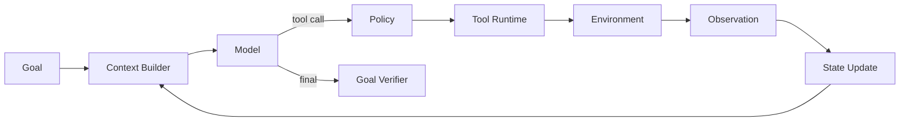

# 第一章 Agent Loop 与 Harness 基础

> 控制循环、状态、终止条件与 Model × Harness 共设计。

## 本章工程目标（v1.1）

本章建立 Agent Harness 的控制论视角：模型不是应用本身，而是 runtime 中一个提出动作的概率策略。

**学习结果：** 完成后应能手写最小 loop、定义 Run/Turn/Event/StopReason，并通过 ablation 区分 model 与 harness failure。

### 章节级设计审查

读完本章后，尝试在不看答案的情况下完成四件事：

1. 用一张图标出本章的 **source of truth、control point、failure boundary**；
2. 给出至少一个可序列化的数据结构，而不是只讲概念；
3. 写出一个 fault-injection case，说明系统如何检测与恢复；
4. 设计一个只改变单一 Harness 变量的 eval/ablation。

### 面试训练建议

- **第一遍**：90 秒回答每题，只讲结论、Why、核心机制；
- **第二遍**：5 分钟回答，加入数据结构、failure、trade-off、metrics；
- **第三遍**：把本章 10 题串成一套系统设计，解释各 primitive 如何互相约束；
- **第四遍**：反向练习——给一个生产 incident，判断它属于模型、Harness、环境、权限还是 eval 问题。

## PDF 原稿：本章定位

本章核心 理解“模型之外的系统”：控制循环、状态、终止条件、Model × Harness 共设计。
真正的 Agent 工程不是“让模型多想几步”，而是把一个概率策略放进可约束、可观测、可恢复的软件运行时。
本章面试目标
- 能自己写 Agent Loop，而不是只会框架。
- 能区分 Model failure 与 Harness failure。
- 能解释 stop condition、state machine 与 environment verification。

## 本章必须掌握的工程不变量

1. 模型输出不是事实状态；关键完成条件必须由环境或结构化验证器确认。
2. 所有循环都必须有硬预算与可解释的 stop reason。
3. 任何新增 Harness 机制都应能通过 trace 和 eval 证明价值。

## 题目索引

| 题号 | 题目 | 难度 | 高频 |
|---|---|---:|---:|
| [Q01](q01-agent-harness-vs-framework.md) | 什么是 Agent Harness？它和 Agent Framework 有什么区别？ | ★★★☆☆ | ★★★★★ |
| [Q02](q02-minimal-agent-loop.md) | 请从零写出一个最小 Agent Loop。 | ★★★☆☆ | ★★★★★ |
| [Q03](q03-agent-stop-conditions.md) | Agent Loop 有哪些 Stop Condition？ | ★★★☆☆ | ★★★★★ |
| [Q04](q04-react-vs-production-runtime.md) | 为什么 ReAct 不是一个完整的 Agent 架构？ | ★★★☆☆ | ★★★★☆ |
| [Q05](q05-agent-vs-workflow.md) | Agent 和普通 Workflow 的本质区别是什么？ | ★★★☆☆ | ★★★★☆ |
| [Q06](q06-when-not-to-use-agents.md) | 什么问题根本不应该使用 Agent？ | ★★★☆☆ | ★★★☆☆ |
| [Q07](q07-model-vs-harness-failures.md) | Model 能力和 Harness 能力如何区分？ | ★★★★☆ | ★★★★★ |
| [Q08](q08-why-harness-changes-benchmarks.md) | 为什么同一个模型换一个 Harness，Benchmark 可能差很多？ | ★★★★☆ | ★★★★☆ |
| [Q09](q09-agent-runtime-abstractions.md) | Agent Runtime 最重要的抽象是什么？ | ★★★☆☆ | ★★★☆☆ |
| [Q10](q10-build-agent-without-framework.md) | 如果不用 LangChain/LangGraph，你如何自己实现 Agent？ | ★★★☆☆ | ★★★★☆ |

## 本章训练方法

1. 先不看答案，90 秒口述结论与 Why。
2. 选 2 道题画数据结构/状态机/调用链。
3. 每题至少写 3 个 failure modes，并说明 trace 证据。
4. 给本章设计一个 20-30 task 的最小 eval suite。
5. 最后比较一个“简单 baseline”和一个“复杂 Harness”方案，确认复杂度换来了可测量收益。

## 本章重点指标

- `task success rate`
- `turns per task`
- `stop-reason distribution`
- `tool-selection error rate`
- `model-vs-harness failure share`

## 资料

- [W8] SWE-agent / ACI
- [W9] Anthropic Building Effective Agents
- [W10] OpenAI Agents SDK

## PDF 原稿：本章复盘

> 从 Agent Loop 出发，加入 stop condition 和 state，再用 failure taxonomy 区分 Model 与Harness，最终形成可独立于框架实现的 Runtime Kernel。
