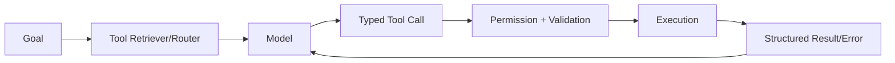

# 第二章 Tool / ACI / MCP 与执行接口

> 把工具视作 Agent 的 action space，而不是附属 API。

## 本章工程目标（v1.1）

本章把 Tool/ACI/MCP 视作 Agent 的 action language 和 side-effect boundary。

**学习结果：** 完成后应能设计 tool contract、error taxonomy、idempotency、dynamic discovery 与 tool-selection eval。

### 章节级设计审查

读完本章后，尝试在不看答案的情况下完成四件事：

1. 用一张图标出本章的 **source of truth、control point、failure boundary**；
2. 给出至少一个可序列化的数据结构，而不是只讲概念；
3. 写出一个 fault-injection case，说明系统如何检测与恢复；
4. 设计一个只改变单一 Harness 变量的 eval/ablation。

### 面试训练建议

- **第一遍**：90 秒回答每题，只讲结论、Why、核心机制；
- **第二遍**：5 分钟回答，加入数据结构、failure、trade-off、metrics；
- **第三遍**：把本章 10 题串成一套系统设计，解释各 primitive 如何互相约束；
- **第四遍**：反向练习——给一个生产 incident，判断它属于模型、Harness、环境、权限还是 eval 问题。

## PDF 原稿：本章定位

本章核心 工具不是附属 API，而是 Agent 的 action space。接口设计会直接改变模型行为分布。
工具接口是给模型使用的“人机接口”。接口语义、错误结构和结果长度会直接决定模型能否稳定采取正确动作。
本章面试目标
- 能把工具当模型接口设计，而不是普通 REST 封装。
- 理解 schema、error、idempotency 与 tool retrieval。
- 知道 API/GUI/MCP 的边界和风险。

## 本章必须掌握的工程不变量

1. 工具调用必须有稳定 contract：输入、输出、错误与副作用语义都要显式。
2. 高风险副作用必须可审计、可去重、可恢复。
3. 工具目录应控制选择歧义和上下文成本。

## 题目索引

| 题号 | 题目 | 难度 | 高频 |
|---|---|---:|---:|
| [Q11](q11-llm-friendly-tool-design.md) | 怎样设计一个 LLM-friendly Tool？ | ★★★☆☆ | ★★★★★ |
| [Q12](q12-too-many-tools.md) | Tool 越多 Agent 能力是不是越强？ | ★★★☆☆ | ★★★☆☆ |
| [Q13](q13-overlapping-tools.md) | 两个 Tool 功能重叠应该怎么办？ | ★★★☆☆ | ★★★★☆ |
| [Q14](q14-tool-schema-design.md) | Tool Schema 为什么比 Prompt 更容易被低估？ | ★★★☆☆ | ★★★★☆ |
| [Q15](q15-tool-error-contract.md) | Tool Error 应该怎样返回给 Agent？ | ★★★☆☆ | ★★★☆☆ |
| [Q16](q16-tool-idempotency.md) | 为什么 Tool 必须考虑 Idempotency？ | ★★★★☆ | ★★★★★ |
| [Q17](q17-mcp-resources-prompts-tools.md) | MCP 中 Resources、Prompts、Tools 应如何理解？ | ★★★☆☆ | ★★★★☆ |
| [Q18](q18-too-many-mcp-servers.md) | MCP Server 越多越好吗？ | ★★★☆☆ | ★★★☆☆ |
| [Q19](q19-api-tool-vs-computer-use.md) | API Tool 和 Computer Use 如何选择？ | ★★★☆☆ | ★★★★☆ |
| [Q20](q20-thousand-tool-selection.md) | 如果有 1000 个 Tools，怎么设计 Tool Selection？ | ★★★★☆ | ★★★★☆ |

## 本章训练方法

1. 先不看答案，90 秒口述结论与 Why。
2. 选 2 道题画数据结构/状态机/调用链。
3. 每题至少写 3 个 failure modes，并说明 trace 证据。
4. 给本章设计一个 20-30 task 的最小 eval suite。
5. 最后比较一个“简单 baseline”和一个“复杂 Harness”方案，确认复杂度换来了可测量收益。

## 本章重点指标

- `tool-selection accuracy`
- `invalid-argument rate`
- `tool error recovery rate`
- `tool-result tokens`
- `side-effect duplicate rate`

## 资料

- [W8] SWE-agent / ACI
- [W9] Anthropic Writing effective tools
- MCP Specification

## PDF 原稿：本章复盘

> 从单个 Tool 的语义与 schema，扩展到错误恢复、幂等和 tool retrieval，最后把 MCP/API/ComputerUse 统一到 action registry 与 policy 层。
