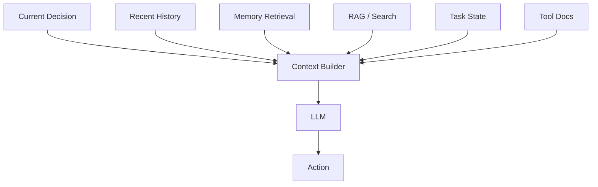

# 第三章 Context Engineering 与 Memory

> 把上下文视作有限预算，并区分记忆、任务状态与可重建信息。

## 本章工程目标（v1.1）

本章把 Context 看成有限推理预算，把 Memory 看成带生命周期和 provenance 的外部状态。

**学习结果：** 完成后应能设计 context builder、compaction/reset、memory write policy、cross-session recovery 与 cache invalidation。

### 章节级设计审查

读完本章后，尝试在不看答案的情况下完成四件事：

1. 用一张图标出本章的 **source of truth、control point、failure boundary**；
2. 给出至少一个可序列化的数据结构，而不是只讲概念；
3. 写出一个 fault-injection case，说明系统如何检测与恢复；
4. 设计一个只改变单一 Harness 变量的 eval/ablation。

### 面试训练建议

- **第一遍**：90 秒回答每题，只讲结论、Why、核心机制；
- **第二遍**：5 分钟回答，加入数据结构、failure、trade-off、metrics；
- **第三遍**：把本章 10 题串成一套系统设计，解释各 primitive 如何互相约束；
- **第四遍**：反向练习——给一个生产 incident，判断它属于模型、Harness、环境、权限还是 eval 问题。

## PDF 原稿：本章定位

本章核心 把上下文视为有限预算：选择、压缩、外置状态、跨 Session 恢复。
上下文是有限资源。稳定 Harness 会把长期事实、任务状态和临时观察分开，并让每一轮只携带对当前决策最有价值的信息。
本章面试目标
- 能设计 context budget 与 memory policy。
- 理解 compaction/reset/cross-session state。
- 能把 RAG 从静态检索升级为 agentic retrieval。

## 本章必须掌握的工程不变量

1. Context 是预算，不是仓库；只放当前决策真正需要的信息。
2. Memory 不是 task state；任务真相必须放在可持久化、可版本化状态中。
3. 压缩、检索、缓存都必须处理陈旧与信息损失。

## 题目索引

| 题号 | 题目 | 难度 | 高频 |
|---|---|---:|---:|
| [Q21](q21-prompt-vs-context-engineering.md) | Prompt Engineering 和 Context Engineering 有什么区别？ | ★★★☆☆ | ★★★★★ |
| [Q22](q22-more-context-is-not-better.md) | 为什么“上下文越多越好”是错误的？ | ★★★☆☆ | ★★★★☆ |
| [Q23](q23-context-rot-pollution.md) | 什么是 Context Rot / Context Pollution？ | ★★★☆☆ | ★★★★☆ |
| [Q24](q24-compaction-vs-reset.md) | Context Compaction 和 Context Reset 有什么区别？ | ★★★★☆ | ★★★★★ |
| [Q25](q25-short-vs-long-term-memory.md) | Short-term Memory 和 Long-term Memory 应如何设计？ | ★★★☆☆ | ★★★★☆ |
| [Q26](q26-memory-write-policy.md) | Agent 应该什么时候写 Memory？ | ★★★☆☆ | ★★★★☆ |
| [Q27](q27-rag-vs-agentic-search.md) | RAG 和 Agentic Search 有什么区别？ | ★★★☆☆ | ★★★☆☆ |
| [Q28](q28-conversation-history-selection.md) | Conversation History 应全部发送给模型吗？ | ★★★☆☆ | ★★★★☆ |
| [Q29](q29-cross-session-agent-state.md) | 如何让 Agent 跨 Session 工作？ | ★★★★☆ | ★★★★★ |
| [Q30](q30-context-cache-design.md) | Context Cache 应怎样设计？ | ★★★☆☆ | ★★★☆☆ |

## 本章训练方法

1. 先不看答案，90 秒口述结论与 Why。
2. 选 2 道题画数据结构/状态机/调用链。
3. 每题至少写 3 个 failure modes，并说明 trace 证据。
4. 给本章设计一个 20-30 task 的最小 eval suite。
5. 最后比较一个“简单 baseline”和一个“复杂 Harness”方案，确认复杂度换来了可测量收益。

## 本章重点指标

- `context tokens per successful task`
- `retrieval precision/recall proxy`
- `stale-context rate`
- `compaction loss rate`
- `memory retrieval hit rate`

## 资料

- [W6] Anthropic Context Engineering
- [B1][B2] Agent memory materials
- [B4] RAG practice handbook

## PDF 原稿：本章复盘

> 从单轮 prompt 走向 context budget，再将 working memory、long-term memory、RAG 和durable state 分层，解决跨 Session 与长上下文退化。
