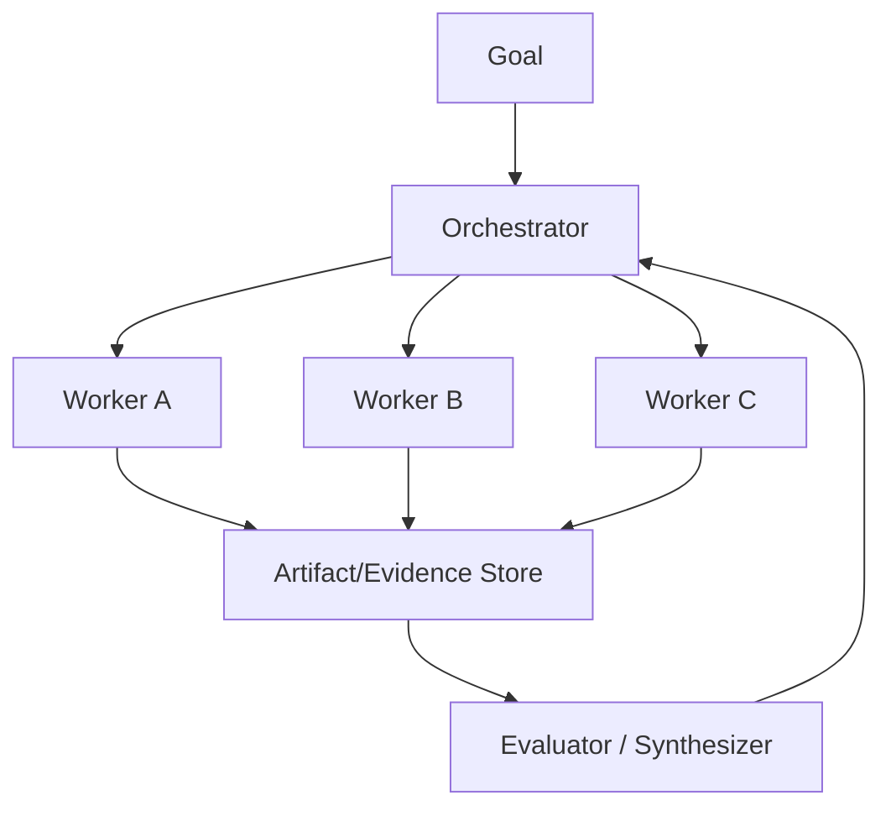

# 第四章 Planning / Orchestration / Multi-Agent

> 用任务结构决定编排复杂度，并量化多 Agent 的真实增益。

## 本章工程目标（v1.1）

本章关注 orchestration complexity 的收益条件，而不是追求 Agent 数量。

**学习结果：** 完成后应能判断 single/multi-agent、设计 orchestrator-worker、共享状态、fan-out budget 与 evaluator loop。

### 章节级设计审查

读完本章后，尝试在不看答案的情况下完成四件事：

1. 用一张图标出本章的 **source of truth、control point、failure boundary**；
2. 给出至少一个可序列化的数据结构，而不是只讲概念；
3. 写出一个 fault-injection case，说明系统如何检测与恢复；
4. 设计一个只改变单一 Harness 变量的 eval/ablation。

### 面试训练建议

- **第一遍**：90 秒回答每题，只讲结论、Why、核心机制；
- **第二遍**：5 分钟回答，加入数据结构、failure、trade-off、metrics；
- **第三遍**：把本章 10 题串成一套系统设计，解释各 primitive 如何互相约束；
- **第四遍**：反向练习——给一个生产 incident，判断它属于模型、Harness、环境、权限还是 eval 问题。

## PDF 原稿：本章定位

本章核心 先判断是否需要 Agent，再判断是否需要多 Agent；复杂编排必须换来可测量收益。
编排的价值来自任务分解与并行，而不是 Agent 数量本身。任何增加的 Agent 都必须证明它抵消了协调和 token成本。
本章面试目标
- 能判断何时不用 multi-agent。
- 掌握 manager、handoff、orchestrator-worker、evaluator。
- 能讨论并发、共享状态和 fan-out 预算。

## 本章必须掌握的工程不变量

1. 先有单 Agent baseline，再证明复杂编排的增益。
2. 并行只对独立或弱耦合子任务有收益。
3. handoff 必须传结构化事实，而不是只传自然语言印象。

## 题目索引

| 题号 | 题目 | 难度 | 高频 |
|---|---|---:|---:|
| [Q31](q31-single-vs-multi-agent.md) | Single Agent 和 Multi-Agent 怎么选？ | ★★★★☆ | ★★★★★ |
| [Q32](q32-routing-vs-agent-loop.md) | Routing 和 Agent 有什么区别？ | ★★★☆☆ | ★★★★☆ |
| [Q33](q33-orchestrator-worker-pattern.md) | 什么是 Orchestrator-Worker Pattern？ | ★★★★☆ | ★★★★★ |
| [Q34](q34-manager-as-tool-vs-handoff.md) | Manager-as-Tool 和 Handoff 有什么区别？ | ★★★☆☆ | ★★★★☆ |
| [Q35](q35-agent-parallelization.md) | Agent 并行化最大的问题是什么？ | ★★★☆☆ | ★★★★☆ |
| [Q36](q36-evaluator-optimizer.md) | Evaluator-Optimizer 为什么有效？ | ★★★★☆ | ★★★★★ |
| [Q37](q37-subagent-context-windows.md) | Subagent 的独立 Context Window 有什么价值？ | ★★★★☆ | ★★★★☆ |
| [Q38](q38-multi-agent-shared-state.md) | Multi-Agent 怎么共享状态？ | ★★★☆☆ | ★★★★☆ |
| [Q39](q39-control-agent-fanout.md) | 如何控制 Agent Fan-out？ | ★★★★☆ | ★★★☆☆ |
| [Q40](q40-when-multi-agent-is-worse.md) | 为什么 Multi-Agent 有时比 Single Agent 更差？ | ★★★★☆ | ★★★★☆ |

## 本章训练方法

1. 先不看答案，90 秒口述结论与 Why。
2. 选 2 道题画数据结构/状态机/调用链。
3. 每题至少写 3 个 failure modes，并说明 trace 证据。
4. 给本章设计一个 20-30 task 的最小 eval suite。
5. 最后比较一个“简单 baseline”和一个“复杂 Harness”方案，确认复杂度换来了可测量收益。

## 本章重点指标

- `solve-rate uplift vs single-agent`
- `fan-out depth/width`
- `duplicate-work rate`
- `handoff loss rate`
- `cost per successful task`

## 资料

- [W9] Anthropic Building Effective Agents / Multi-agent Research
- [W10] OpenAI Agents SDK orchestration

## PDF 原稿：本章复盘

> 从 single agent baseline 开始，只在独立性与并行收益明确时引入 worker；用manager/handoff/evaluator 等模式控制分工和质量。
