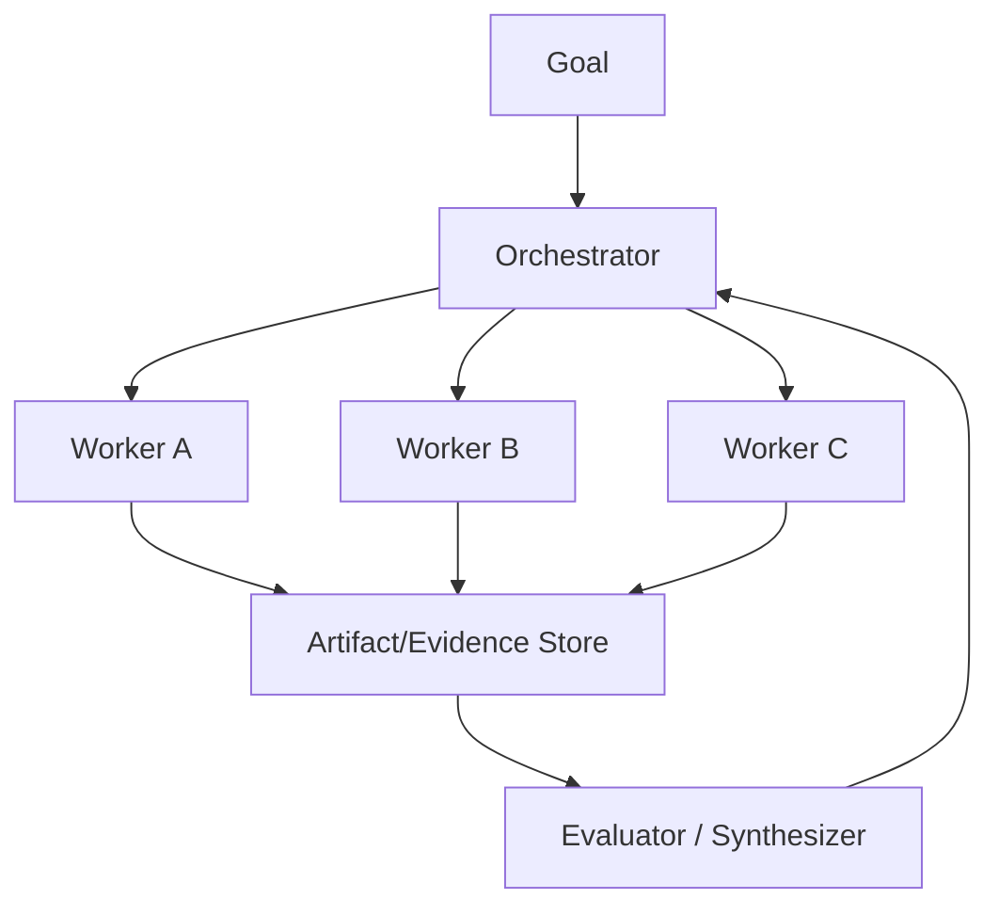

# Q36. Evaluator-Optimizer 为什么有效？

> **一句话结论**：生成与判断分离可以降低自我宽容，并把模糊质量要求转成明确可评分标准。
>
> **难度**：★★★★☆　**高频**：★★★★★　**岗位**：Agent / Harness　**PDF**：第 36 页起

[← Q35](q35-agent-parallelization.md) · [章节目录](README.md) · [Q37 →](q37-subagent-context-windows.md)

> **内容分层**：第 1–13 节以 PDF 原稿为主并做结构化整理；第 14 节是 Repo v1.1 的工程扩展，结合公开一手资料与系统设计方法补强。


## 1. 面试官真正想考什么

你是否能控制 orchestration complexity，并用任务结构而不是流行概念决定架构。

**更深一层：** Evaluator-Optimizer 有效的前提是 evaluator 使用独立 rubric/contract，而不是重复 generator 的偏好。

## 2. Know-Why：为什么这是 Harness 问题

编排的价值来自任务分解与并行，而不是 Agent 数量本身。任何增加的 Agent 都必须证明它抵消了协调和 token成本。针对本题，关键不是记住术语，而是识别系统中的“控制点”：生成与判断分离可以降低自我宽容，并把模糊质量要求转成明确可评分标准。 这类控制点一旦缺失，模型即使单次推理正确，也可能因为重试、上下文污染、环境状态、权限或错误反馈而在真实任务中失败。

### 三条工程不变量

1. 先有单 Agent baseline，再证明复杂编排的增益。
2. 并行只对独立或弱耦合子任务有收益。
3. handoff 必须传结构化事实，而不是只传自然语言印象。

这些不变量不是“最佳实践口号”，而是用来约束设计空间的。面试时如果方案违反其中一条，应主动解释为什么值得承担风险，以及如何用实验和监控把风险显式化。

## 3. Know-How：怎样落到生产系统

- 先定义 rubric/contract，再 generator -> evaluator -> targeted revision。

- 把这一机制做成可配置、可追踪、可评测的 runtime primitive。

### 推荐的工程 Artifact

写 generator/evaluator rubric，比较 self-review 与 independent evaluator 的 false-accept rate。

### 本章参考架构



> 图是本章公共心智模型；回答本题时只展开与题目相关的节点，避免把所有组件一次性画满。

## 3A. Production Deep Dive：把概念变成系统协议

### 3A.1 核心机制

Evaluator-Optimizer 把生成与判断角色分离，通过独立 rubric 减少 self-evaluation leniency

**Source of Truth：** Artifact + grader state。在面试中主动指出这一点很重要，因为 Agent 的自然语言状态只是“认知状态”，真正能决定是否继续、是否重试、是否完成的通常是外部持久状态或环境。

### 3A.2 推荐状态 / 数据模型

```text
TaskNode { task_id, parent_id, objective, dependencies, status, budget }
WorkerRun { worker_id, task_id, context_ref, result_ref, cost }
Handoff { from_agent, to_agent, contract, state_ref, acceptance }
Dependency { upstream, downstream, type, version }
```

这不是要求所有系统都使用同一 schema；重点是把本题涉及的**身份、版本、状态、结果引用和恢复语义**从自然语言中提取出来，变成可验证 contract。

### 3A.3 具体故障场景

> **Scenario**：生成器自己判定完成，持续放宽标准

排查时不要只看最终回答。建议从 `goal/version → model decision → policy → tool/action → environment mutation → persisted state → grader` 顺序追踪，确认“模型认为发生了什么”与“环境实际发生了什么”在哪一步分叉。

### 3A.4 可证伪实验

**Experiment：** 同任务比较 self-check 与 independent evaluator。

一个好的 Harness 改动必须能写成可证伪假设，例如：“如果这个机制解决了目标 failure mode，那么在固定 model/task/env 后，专项指标应改善；如果没有改善，就不应把复杂度长期留在 runtime。”

**Success criterion / SLO：** verified quality 提升。

### 3A.5 Production Checklist

- [ ] 先证明任务可分解再 fan-out
- [ ] 依赖与共享写入必须显式建模
- [ ] handoff 有 contract 与 acceptance
- [ ] 全局 budget/并发限制能覆盖子 Agent
- [ ] 聚合阶段能追踪每个结论的 provenance

## 4. Failure Modes：低分答案与真实故障

- 没有明确标准就无限自我批评

### 生产环境再多想三层

- **Detectability**：这个失败在 trace / state diff / tool result / grader 中留下什么证据？
- **Recoverability**：失败后是 retry、replan、compensate、rollback、ask human，还是 terminate？
- **Blast Radius**：错误最多影响一次 tool call、一个 run、一个 tenant，还是外部真实世界？

## 5. Trade-offs：不要只讲“最佳方案”

并行和专门化可以提升 breadth，但会增加 token、协调、冲突和 handoff 损耗。

面试中建议明确给出 baseline，并说明新机制增加了什么复杂度、成本或延迟。只有当它针对一个可观测 failure mode，并带来可测量收益时，才值得进入 Harness。

## 6. 最小 Eval：怎样证明设计有效

一个可复用的最小实验框架：

1. 固定 task set、model version、environment version。
2. 只改变本题讨论的一个 Harness 变量。
3. 每个 task 运行多 trial，记录 outcome + trace。
4. 按 failure taxonomy 聚类，不只比较平均分。
5. 同时报告质量、稳定性、延迟、token/cost 和安全指标。

### 建议观测指标

- `solve-rate uplift vs single-agent`
- `fan-out depth/width`
- `duplicate-work rate`
- `handoff loss rate`
- `cost per successful task`

**本题专项 Eval：** 写 generator/evaluator rubric，比较 self-review 与 independent evaluator 的 false-accept rate。

## 7. 面试追问

- 如果这个机制失败，你会在 Trace 中看到什么证据？

- 如何构造一个最小 Eval 来证明你的设计真的比 baseline 更好？

- 如果要求成本下降 40%，你会优先移除或简化哪一层？

建议继续自问：

- 这个设计里**谁拥有最终真相**：模型、数据库、环境、grader，还是人工？
- 如果请求在任意一步 crash，**恢复点**在哪里？
- 如果模型能力提升一代，这个 Harness 机制还需要吗？怎样做 ablation？

## 8. 90 秒回答版本

先给结论：生成与判断分离可以降低自我宽容，并把模糊质量要求转成明确可评分标准。 Evaluator-Optimizer 有效的前提是 evaluator 使用独立 rubric/contract，而不是重复 generator 的偏好。 写 generator/evaluator rubric，比较 self-review 与 independent evaluator 的 false-accept rate。

## 9. 5 分钟深挖版本

5 分钟展开时，按 `结论 → failure mode → 最小设计 → 数据/状态语义 → trade-off → eval/metrics` 六步回答。本题的关键工程焦点是：Evaluator-Optimizer 有效的前提是 evaluator 使用独立 rubric/contract，而不是重复 generator 的偏好。 具体落地时，优先产出：写 generator/evaluator rubric，比较 self-review 与 independent evaluator 的 false-accept rate。

## 10. PDF 原稿中的工程证据 / 研究结论

Evidence 2026 的 long-running application harness 实验采用 planner-generator-evaluator，并把主观质量转成可评分 criteria，说明 evaluator 的价值来自独立标准而不是“再问一次模型”。[W5]

> 本节只整理 PDF 原稿已有证据；下面“扩展阅读”是本仓库新增的外部资料，不与 PDF 原始内容混淆。

## 11. Offer 级回答结构

建议用 4 段式回答：①先给结论和适用边界；②解释 failure mode，也就是“为什么需要它”；③给出最小实现和关键数据结构；④主动给出 trade-off + eval 指标。这样能把概念答案升级为工程答案。

可以进一步升级为 6 段：`结论 → Why/Failure → How/Data Model → Recovery/Security → Trade-off → Eval/SLO`。

## 12. 扩展阅读（Repo 增补）

- [Anthropic - Building effective agents](https://www.anthropic.com/engineering/building-effective-agents)
- [Anthropic - Multi-agent research system](https://www.anthropic.com/engineering/multi-agent-research-system)
- [OpenAI Agents SDK - orchestration](https://openai.github.io/openai-agents-python/multi_agent/)

## 13. 关联题

- 本章：[第四章 Planning / Orchestration / Multi-Agent](README.md)
- [Q35. Agent 并行化最大的问题是什么？](q35-agent-parallelization.md)
- [Q37. Subagent 的独立 Context Window 有什么价值？](q37-subagent-context-windows.md)
- [Q44. 什么是 Sprint Contract / Definition of Done？](../05-long-horizon-durable/q44-sprint-contract-definition-of-done.md)
- [Q63. 为什么应该优先 Eval Outcome，而不是 Tool Trajectory？](../07-evaluation-observability/q63-outcome-vs-trajectory-eval.md)
- [Q68. 怎样校准 LLM-as-Judge？](../07-evaluation-observability/q68-llm-judge-calibration.md)

## 14. 专业深挖：把“会回答”升级为“会设计”

### 14.1 核心判断与边界

**核心判断：** Evaluator-Optimizer 有效是因为把生成与批判分离，降低 self-evaluation leniency，并提供可操作反馈。

**必须讲清的边界：** Evaluator 必须独立、可校准、rubric 明确；否则只是多花一次模型调用。

这意味着面试时不能只描述一个 happy path。应先明确 **source of truth、可接受的错误语义、不可违反的不变量、恢复策略**，再谈具体框架。增加 Agent 数量只有在分解、隔离或并行收益超过协调成本时才有意义。

### 14.2 设计审查：上线前必须回答的问题

- [ ] 子任务是否真正独立
- [ ] ownership 是否清晰
- [ ] 共享状态一致性
- [ ] fan-out 是否有全局预算
- [ ] aggregation 是否可验证

对于本题，还要额外确认：

1. **最坏情况下会错成什么样？** 不只问“会不会失败”，而是问错误是否会变成重复副作用、状态漂移、越权、成本爆炸或不可恢复。
2. **系统如何知道自己错了？** 至少需要一个环境信号、结构化状态、grader 或 trace 证据，而不是模型自我反省。
3. **失败后下一步是否确定？** retry、repair、reconcile、compensate、rollback、ask-human、terminate 应尽量由错误类型和策略决定。
4. **模型升级后是否仍需要这层机制？** 若答案无法用 ablation 验证，Harness 很容易累积成永久技术债。

### 14.3 推荐的实现接口 / 状态语义

```python
class TaskNode:
    task_id: str
    parent_id: str | None
    dependencies: list[str]
    budget: dict
    status: str
    artifact_ref: str | None
```

本题最值得落到白板或代码里的 Artifact 是：**定义 rubric dimensions 与 stop threshold。**

建议所有关键对象都带 `run_id / version / timestamp / provenance`；涉及副作用时再加入 `operation_id / idempotency_key`，涉及安全时加入 `principal / tenant / policy_version`。这样 trace、checkpoint、audit 和 eval 才能关联成同一条因果链。

### 14.4 Fault Injection：如何主动证明系统能扛住坏情况

**故障注入场景：** 让 generator 评分自己 vs 独立 evaluator，比较偏差。

专业的 Harness 测试不应该只做“模型有没有回答对”，而应把故障点插到**状态提交边界、网络边界、权限边界、上下文转换边界**。测试成功的标准不是“不报错”，而是：

- 最终状态可解释；
- 不产生不可接受的重复副作用；
- trace 能定位失败阶段；
- recovery 不依赖人工猜测；
- 若无法自动恢复，系统能安全停在可人工处理的状态。

### 14.5 可证伪实验 / Ablation

**实验：** generator-only、self-refine、independent-evaluator 三组。

建议用 paired trials：固定 task set、model、environment、seed policy 和 grader，只改变本题对应的 Harness primitive。至少运行足够多 trial 以看到方差，并同时报告均值与分位数/置信区间。若方案只提升平均 solve-rate，却显著恶化尾延迟、成本或高风险错误率，应明确写成 trade-off，而不是宣布“全面提升”。

### 14.6 指标：至少同时看质量、稳定性和系统代价

| 指标 | Why | 建议切片 |
|---|---|---|
| `quality_gain` | 衡量本题设计是否真的改善，而不是只增加 Harness 复杂度 | 建议按 task type / risk / model version 分桶 |
| `judge_bias` | 衡量本题设计是否真的改善，而不是只增加 Harness 复杂度 | 建议按 task type / risk / model version 分桶 |
| `iteration_cost` | 衡量本题设计是否真的改善，而不是只增加 Harness 复杂度 | 建议按 task type / risk / model version 分桶 |

除了专项指标，建议保留四个全局指标：`verified_success_rate`、`cost_per_success`、`p95_end_to_end_latency`、`human_intervention_rate`。安全敏感题再增加 `unsafe_action_rate` 或 `policy_escape_rate`。

### 14.7 Debugging Playbook

遇到失败时按以下顺序缩小范围：

1. **重放输入与版本**：确认 model / prompt / tools / harness / environment / grader 是否完全一致；
2. **定位第一个分叉点**：从 trace 中找出预期轨迹与失败轨迹首次不同的 model decision、tool result 或 state transition；
3. **区分认知错误与系统错误**：模型“想错了”与工具实际执行失败必须分开；
4. **检查状态提交窗口**：尤其关注 action 已发生但 result/checkpoint 未持久化的窗口；
5. **构造最小复现**：删掉无关上下文和工具，把 failure 固化成 regression case；
6. **做单变量修复**：修改 schema/context/policy/runtime 中最小的一项，再跑原始失败集。

### 14.8 Senior / Staff 级回答信号

高级回答会处理 evaluator overfitting、reward hacking 和 disagreement escalation。

面试官通常会继续追问“为什么不是更简单的方案”。因此答案中应主动给出 **baseline → failure evidence → mechanism → measurable gain → added complexity → rollback/ablation plan**，这比只列组件更能体现 Agent Systems 能力。

### 14.9 进一步阅读（Repo 研究层，不等同 PDF 原稿）

- [Anthropic - Building effective agents](https://www.anthropic.com/engineering/building-effective-agents)
- [Anthropic - Multi-agent research system](https://www.anthropic.com/engineering/multi-agent-research-system)
- [OpenAI Agents SDK - Agent orchestration](https://openai.github.io/openai-agents-python/multi_agent/)

---

[← Q35](q35-agent-parallelization.md) · [章节目录](README.md) · [Q37 →](q37-subagent-context-windows.md)
