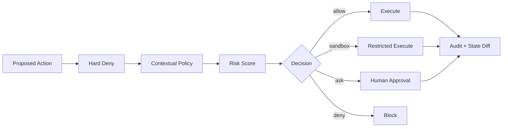

# 第六章 Permission / Sandbox / Security

> 缩小 blast radius，让授权、身份与执行边界成为系统原语。

## 本章工程目标（v1.1）

本章的核心是 capability containment：模型可以提出高权限动作，但授权与执行边界必须由系统强制。

**学习结果：** 完成后应能设计 permission engine、sandbox、secret broker、HITL、risk tier 和 audit chain。

### 章节级设计审查

读完本章后，尝试在不看答案的情况下完成四件事：

1. 用一张图标出本章的 **source of truth、control point、failure boundary**；
2. 给出至少一个可序列化的数据结构，而不是只讲概念；
3. 写出一个 fault-injection case，说明系统如何检测与恢复；
4. 设计一个只改变单一 Harness 变量的 eval/ablation。

### 面试训练建议

- **第一遍**：90 秒回答每题，只讲结论、Why、核心机制；
- **第二遍**：5 分钟回答，加入数据结构、failure、trade-off、metrics；
- **第三遍**：把本章 10 题串成一套系统设计，解释各 primitive 如何互相约束；
- **第四遍**：反向练习——给一个生产 incident，判断它属于模型、Harness、环境、权限还是 eval 问题。

## PDF 原稿：本章定位

本章核心 安全的核心是缩小 blast radius，并让授权、身份、凭证和执行边界成为系统原语。
安全的核心不是相信模型，而是把可造成的伤害范围工程化地限制在最小边界，并对越界动作做显式授权。
本章面试目标
- 能从 blast radius 视角设计权限。
- 理解 sandbox 与 approval 的互补。
- 能设计 secret/identity/audit。

## 本章必须掌握的工程不变量

1. Prompt 不是安全边界；真正边界必须由 runtime enforce。
2. 权限默认最小化，并绑定身份、资源、动作、时间与额度。
3. 审计记录必须能还原谁在什么授权下造成了什么状态变化。

## 题目索引

| 题号 | 题目 | 难度 | 高频 |
|---|---|---:|---:|
| [Q51](q51-permission-system-design.md) | 设计 Agent Permission System。 | ★★★★☆ | ★★★★★ |
| [Q52](q52-permission-vs-sandbox.md) | Permission Prompt 和 Sandbox 有什么区别？ | ★★★★☆ | ★★★★★ |
| [Q53](q53-approval-fatigue.md) | 什么是 Approval Fatigue？ | ★★★★☆ | ★★★★☆ |
| [Q54](q54-tool-risk-classification.md) | Tool Risk 如何分级？ | ★★★★☆ | ★★★☆☆ |
| [Q55](q55-prompt-injection-agent-risk.md) | Prompt Injection 为什么对 Agent 比 Chatbot 更危险？ | ★★★★★ | ★★★★★ |
| [Q56](q56-secret-management.md) | Secret 应该怎么提供给 Agent？ | ★★★★☆ | ★★★★☆ |
| [Q57](q57-filesystem-network-sandbox.md) | 为什么 Sandbox 必须同时考虑 Filesystem 和 Network？ | ★★★★★ | ★★★★★ |
| [Q58](q58-least-privilege.md) | Least Privilege 在 Agent 中怎样实现？ | ★★★★☆ | ★★★★☆ |
| [Q59](q59-human-in-the-loop-policy.md) | 哪些动作应该 Human-in-the-loop？ | ★★★★☆ | ★★★★☆ |
| [Q60](q60-agent-audit-log.md) | Agent Audit Log 应记录什么？ | ★★★★☆ | ★★★☆☆ |

## 本章训练方法

1. 先不看答案，90 秒口述结论与 Why。
2. 选 2 道题画数据结构/状态机/调用链。
3. 每题至少写 3 个 failure modes，并说明 trace 证据。
4. 给本章设计一个 20-30 task 的最小 eval suite。
5. 最后比较一个“简单 baseline”和一个“复杂 Harness”方案，确认复杂度换来了可测量收益。

## 本章重点指标

- `unsafe-action escape rate`
- `false-deny/false-ask rate`
- `approval rate`
- `blast-radius proxy`
- `credential scope violations`

## 资料

- [W7] Anthropic evals + sandboxing
- MCP authorization/security guidance

## PDF 原稿：本章复盘

> 权限不是弹窗，而是 hard deny + contextual policy + sandbox + scoped credentials + audit 共同构成的 capability containment。
