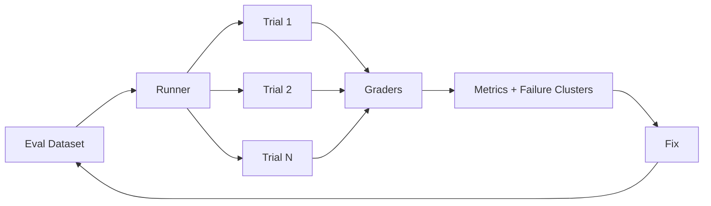

# 第七章 Evaluation / Observability

> 以 task/trial/trace/outcome/grader 建模，并建立生产回归闭环。

## 本章工程目标（v1.1）

本章把“好不好用”变成可重复实验：task/trial/trace/outcome/grader 是最小评测模型。

**学习结果：** 完成后应能设计 outcome-first eval、pass@k/pass^k、judge calibration、anti-hacking 与 production→regression 飞轮。

### 章节级设计审查

读完本章后，尝试在不看答案的情况下完成四件事：

1. 用一张图标出本章的 **source of truth、control point、failure boundary**；
2. 给出至少一个可序列化的数据结构，而不是只讲概念；
3. 写出一个 fault-injection case，说明系统如何检测与恢复；
4. 设计一个只改变单一 Harness 变量的 eval/ablation。

### 面试训练建议

- **第一遍**：90 秒回答每题，只讲结论、Why、核心机制；
- **第二遍**：5 分钟回答，加入数据结构、failure、trade-off、metrics；
- **第三遍**：把本章 10 题串成一套系统设计，解释各 primitive 如何互相约束；
- **第四遍**：反向练习——给一个生产 incident，判断它属于模型、Harness、环境、权限还是 eval 问题。

## PDF 原稿：本章定位

本章核心 Agent 评测必须面向 trajectory + outcome；生产 trace 要进入 eval 和 regression 闭环。
没有 eval 的 Agent 优化不可重复。Agent 的随机轨迹决定了评测必须同时记录过程、结果和多次试验的稳定性。
本章面试目标
- 能用 task/trial/trace/outcome/grader 语言讨论 eval。
- 理解多 trial、pass@k/pass^k、judge calibration。
- 能把生产失败沉淀为 regression。

## 本章必须掌握的工程不变量

1. 评测对象是 Model × Harness × Environment，而不只是模型。
2. Outcome 优先，Trajectory 只约束真正必须约束的安全/合规路径。
3. 线上失败必须转化为可重复的 regression case。

## 题目索引

| 题号 | 题目 | 难度 | 高频 |
|---|---|---:|---:|
| [Q61](q61-agent-harness-vs-eval-harness.md) | Agent Harness 和 Eval Harness 有什么区别？ | ★★★★★ | ★★★★★ |
| [Q62](q62-task-trial-trace-outcome-grader.md) | Task、Trial、Trace、Outcome、Grader 分别是什么？ | ★★★★☆ | ★★★★☆ |
| [Q63](q63-outcome-vs-trajectory-eval.md) | 为什么应该优先 Eval Outcome，而不是 Tool Trajectory？ | ★★★★★ | ★★★★★ |
| [Q64](q64-code-llm-human-graders.md) | Code Grader、LLM Grader、Human Grader 怎么选？ | ★★★★☆ | ★★★★☆ |
| [Q65](q65-pass-at-k-vs-pass-power-k.md) | pass@k 和 pass^k 区别是什么？ | ★★★★★ | ★★★★★ |
| [Q66](q66-why-multiple-eval-trials.md) | Agent Eval 为什么一定要多 Trial？ | ★★★★☆ | ★★★☆☆ |
| [Q67](q67-capability-vs-regression-eval.md) | Capability Eval 和 Regression Eval 有什么不同？ | ★★★★☆ | ★★★★☆ |
| [Q68](q68-llm-judge-calibration.md) | 怎样校准 LLM-as-Judge？ | ★★★★★ | ★★★★☆ |
| [Q69](q69-eval-hacking.md) | Agent 会不会 Hack Eval？ | ★★★★★ | ★★★☆☆ |
| [Q70](q70-production-traces-to-evals.md) | Production Trace 应如何变成 Eval Dataset？ | ★★★★★ | ★★★★★ |

## 本章训练方法

1. 先不看答案，90 秒口述结论与 Why。
2. 选 2 道题画数据结构/状态机/调用链。
3. 每题至少写 3 个 failure modes，并说明 trace 证据。
4. 给本章设计一个 20-30 task 的最小 eval suite。
5. 最后比较一个“简单 baseline”和一个“复杂 Harness”方案，确认复杂度换来了可测量收益。

## 本章重点指标

- `task success`
- `pass^k`
- `grader-human agreement`
- `eval variance/confidence interval`
- `regression escape rate`

## 资料

- [W7] Anthropic Agent Evals
- [W10] OpenAI Agents SDK tracing

## PDF 原稿：本章复盘

> 把 Agent 行为拆成 Task/Trial/Trace/Outcome/Grader，并让生产失败持续进入 regression，才能建立真正的 eval-driven development。
