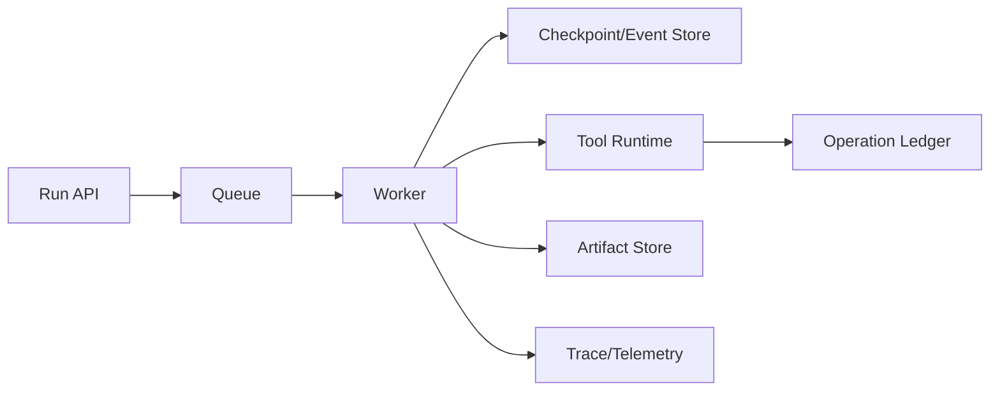

# 第八章 Reliability / Distributed Agent Systems

> 用分布式系统语义处理重试、幂等、取消、并发与一致性。

## 本章工程目标（v1.1）

本章把 Agent Runtime 放回分布式系统语境，重点是副作用语义、并发和故障恢复。

**学习结果：** 完成后应能解释 retry/idempotency/exactly-once、cancellation、lease/fencing、partial failure 与 durable worker。

### 章节级设计审查

读完本章后，尝试在不看答案的情况下完成四件事：

1. 用一张图标出本章的 **source of truth、control point、failure boundary**；
2. 给出至少一个可序列化的数据结构，而不是只讲概念；
3. 写出一个 fault-injection case，说明系统如何检测与恢复；
4. 设计一个只改变单一 Harness 变量的 eval/ablation。

### 面试训练建议

- **第一遍**：90 秒回答每题，只讲结论、Why、核心机制；
- **第二遍**：5 分钟回答，加入数据结构、failure、trade-off、metrics；
- **第三遍**：把本章 10 题串成一套系统设计，解释各 primitive 如何互相约束；
- **第四遍**：反向练习——给一个生产 incident，判断它属于模型、Harness、环境、权限还是 eval 问题。

## PDF 原稿：本章定位

本章核心 Agent Harness 本质上会遭遇分布式系统问题：重试、幂等、取消、并发、一致性和故障恢复。
一旦 Agent 能执行真实副作用，它就继承了分布式系统的经典难题：重复、丢失、乱序、并发、部分失败和恢复。
本章面试目标
- 能把 retry/idempotency/cancellation/concurrency 讲到分布式系统级别。
- 能处理 partial failure 与 shared state。
- 能设计 durable worker。

## 本章必须掌握的工程不变量

1. 网络、超时和进程崩溃意味着重复与乱序是常态，而不是异常。
2. 副作用操作优先设计成幂等或可补偿。
3. worker 不应该是 durable state 的唯一持有者。

## 题目索引

| 题号 | 题目 | 难度 | 高频 |
|---|---|---:|---:|
| [Q71](q71-run-thread-turn-model.md) | Run、Thread、Turn 应该怎么建模？ | ★★★★☆ | ★★★★☆ |
| [Q72](q72-tool-retry-design.md) | Tool Retry 应该怎么设计？ | ★★★★☆ | ★★★☆☆ |
| [Q73](q73-exactly-once-agent-tools.md) | Agent Tool 能实现 Exactly Once 吗？ | ★★★★★ | ★★★★★ |
| [Q74](q74-cancellation-design.md) | Cancellation 怎么设计？ | ★★★★☆ | ★★★★☆ |
| [Q75](q75-multi-agent-concurrency-control.md) | Multi-Agent 并发怎么控制？ | ★★★★☆ | ★★★☆☆ |
| [Q76](q76-shared-state-consistency.md) | Shared Agent State 怎么保证一致性？ | ★★★★★ | ★★★★☆ |
| [Q77](q77-tool-partial-failure.md) | Tool Partial Failure 怎么处理？ | ★★★★★ | ★★★★☆ |
| [Q78](q78-agent-rate-limiting.md) | 如何设计 Agent Rate Limiting？ | ★★★★☆ | ★★★☆☆ |
| [Q79](q79-durable-agent-worker.md) | Durable Agent Worker 怎么设计？ | ★★★★★ | ★★★★★ |
| [Q80](q80-brain-hands-decoupling.md) | 什么叫 Brain 与 Hands 解耦？ | ★★★★★ | ★★★★☆ |

## 本章训练方法

1. 先不看答案，90 秒口述结论与 Why。
2. 选 2 道题画数据结构/状态机/调用链。
3. 每题至少写 3 个 failure modes，并说明 trace 证据。
4. 给本章设计一个 20-30 task 的最小 eval suite。
5. 最后比较一个“简单 baseline”和一个“复杂 Harness”方案，确认复杂度换来了可测量收益。

## 本章重点指标

- `retry success`
- `duplicate side effects`
- `cancellation latency`
- `state conflict rate`
- `queue/worker saturation`

## 资料

- Distributed systems fundamentals: retry/idempotency/leases/consistency
- [W9] Managed Agents

## PDF 原稿：本章复盘

> 工具副作用使 Agent 进入 distributed systems 世界；幂等、lease、concurrency control、partial
