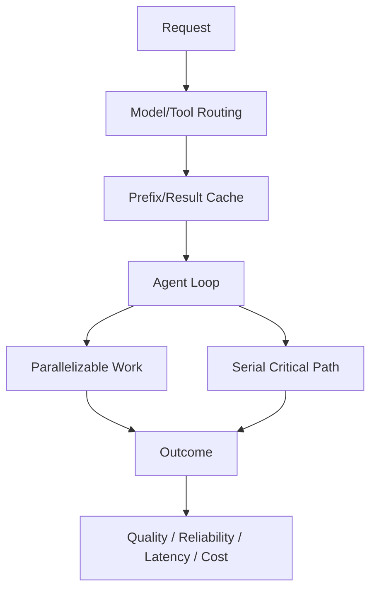

# 第九章 Cost / Latency / Performance

> 在 Quality × Reliability × Latency × Cost × Safety 上做 Pareto 优化。

## 本章工程目标（v1.1）

本章不追求单一“更快”，而是优化 Quality×Reliability×Latency×Cost×Safety 的 operating point。

**学习结果：** 完成后应能拆 latency critical path、做 model routing/cache/parallelism/budget，并用 Pareto frontier 判断优化。

### 章节级设计审查

读完本章后，尝试在不看答案的情况下完成四件事：

1. 用一张图标出本章的 **source of truth、control point、failure boundary**；
2. 给出至少一个可序列化的数据结构，而不是只讲概念；
3. 写出一个 fault-injection case，说明系统如何检测与恢复；
4. 设计一个只改变单一 Harness 变量的 eval/ablation。

### 面试训练建议

- **第一遍**：90 秒回答每题，只讲结论、Why、核心机制；
- **第二遍**：5 分钟回答，加入数据结构、failure、trade-off、metrics；
- **第三遍**：把本章 10 题串成一套系统设计，解释各 primitive 如何互相约束；
- **第四遍**：反向练习——给一个生产 incident，判断它属于模型、Harness、环境、权限还是 eval 问题。

## PDF 原稿：本章定位

本章核心 优化目标不是“最强模型”，而是 Quality × Reliability × Latency × Cost 的 Pareto 前沿。
Agent 性能优化是多目标优化。最强模型不一定是最佳系统，减少串行回合和无效上下文通常比单纯换模型更划算。
本章面试目标
- 能拆解 agent latency critical path。
- 会做 model routing、cache、parallelism、budget。
- 能用 Pareto 而不是单指标判断优化。

## 本章必须掌握的工程不变量

1. 优化目标必须是多目标函数，而不是单一模型分数。
2. 减少串行 round-trip 往往比微调单次模型延迟更有效。
3. 任何缓存和路由都要同时度量质量回退与陈旧风险。

## 题目索引

| 题号 | 题目 | 难度 | 高频 |
|---|---|---:|---:|
| [Q81](q81-agent-latency-breakdown.md) | Agent Latency 怎么拆？ | ★★★☆☆ | ★★★★★ |
| [Q82](q82-model-routing.md) | 怎样做 Model Routing？ | ★★★☆☆ | ★★★★☆ |
| [Q83](q83-parallel-agent-cost-latency.md) | Parallel Agent 为什么可能更快但更贵？ | ★★★☆☆ | ★★★★☆ |
| [Q84](q84-prompt-caching.md) | Prompt Caching 在 Agent 中为什么特别重要？ | ★★★☆☆ | ★★★☆☆ |
| [Q85](q85-token-efficient-tool-results.md) | Tool Result 为什么必须 Token Efficient？ | ★★★☆☆ | ★★★★☆ |
| [Q86](q86-agent-streaming.md) | Streaming 对 Agent 有什么价值？ | ★★★☆☆ | ★★★★☆ |
| [Q87](q87-model-upgrade-harness-ablation.md) | 模型升级后 Harness 一定应该保持不变吗？ | ★★★★☆ | ★★★★★ |
| [Q88](q88-sandbox-cold-start.md) | Sandbox Cold Start 怎么优化？ | ★★★☆☆ | ★★★★☆ |
| [Q89](q89-agent-cost-budget.md) | 怎样给 Agent 设置 Cost Budget？ | ★★★☆☆ | ★★★★☆ |
| [Q90](q90-measure-agent-optimization.md) | 如何判断 Agent Optimization 是否真的有效？ | ★★★★☆ | ★★★★★ |

## 本章训练方法

1. 先不看答案，90 秒口述结论与 Why。
2. 选 2 道题画数据结构/状态机/调用链。
3. 每题至少写 3 个 failure modes，并说明 trace 证据。
4. 给本章设计一个 20-30 task 的最小 eval suite。
5. 最后比较一个“简单 baseline”和一个“复杂 Harness”方案，确认复杂度换来了可测量收益。

## 本章重点指标

- `p50/p95 E2E latency`
- `TTFT`
- `tokens per success`
- `cost per success`
- `quality under budget`

## 资料

- [W9] Managed Agents / tool engineering
- Provider tracing + token/cost telemetry

## PDF 原稿：本章复盘

> 性能优化先看 critical path，再看 tokens/cost/quality；缓存、并行、模型路由和预算控制都必须通过 Eval 比较 Pareto。
