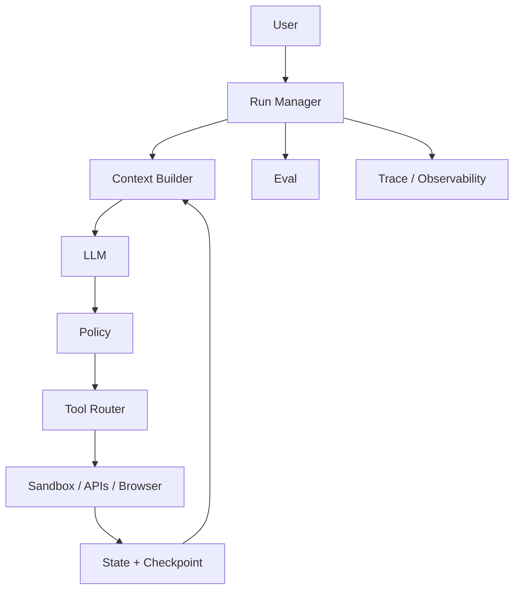

# 第十章 System Design / Coding / Debugging

> 把前九章组合成可落地、可评测、可运维的完整 Agent 系统。

## 本章工程目标（v1.1）

本章把前九章组合成完整系统设计与调试能力，是 Senior/Staff 面试的综合检验。

**学习结果：** 完成后应能在 45–60 分钟内完成 Coding/Research/Support/Multi-tenant Agent 设计，并给出数据模型、SLO、failure injection 与 eval。

### 章节级设计审查

读完本章后，尝试在不看答案的情况下完成四件事：

1. 用一张图标出本章的 **source of truth、control point、failure boundary**；
2. 给出至少一个可序列化的数据结构，而不是只讲概念；
3. 写出一个 fault-injection case，说明系统如何检测与恢复；
4. 设计一个只改变单一 Harness 变量的 eval/ablation。

### 面试训练建议

- **第一遍**：90 秒回答每题，只讲结论、Why、核心机制；
- **第二遍**：5 分钟回答，加入数据结构、failure、trade-off、metrics；
- **第三遍**：把本章 10 题串成一套系统设计，解释各 primitive 如何互相约束；
- **第四遍**：反向练习——给一个生产 incident，判断它属于模型、Harness、环境、权限还是 eval 问题。

## PDF 原稿：本章定位

本章核心 把前九章组合成完整系统设计：Coding Agent、Research Agent、平台、多租户、Trace、Checkpoint与回归定位。
系统设计题考查的是把模型能力、后端可靠性、安全边界和评测闭环统一起来，而不是画一个“LLM +Tools”的方框。
本章面试目标
- 能画完整 Coding/Research/Support/Platform 架构。
- 能写 checkpoint/trace/permission schema。
- 能从 solve-rate regression 做证据驱动调试。

## 本章必须掌握的工程不变量

1. 先画最小闭环，再添加横切能力；不要一上来画“微服务宇宙”。
2. 每个系统设计必须给出核心数据模型、关键 API、SLO 和 failure recovery。
3. 优化与调试必须通过对照实验/消融建立因果证据。

## 题目索引

| 题号 | 题目 | 难度 | 高频 |
|---|---|---:|---:|
| [Q91](q91-design-coding-agent.md) | 系统设计：设计一个 Coding Agent。 | ★★★★★ | ★★★★★ |
| [Q92](q92-design-deep-research-agent.md) | 系统设计：设计一个 Deep Research Agent。 | ★★★★☆ | ★★★★☆ |
| [Q93](q93-design-customer-support-agent.md) | 系统设计：设计 Customer Support Agent。 | ★★★★☆ | ★★★☆☆ |
| [Q94](q94-design-multi-tenant-agent-platform.md) | 系统设计：设计 Multi-Tenant Agent Platform。 | ★★★★★ | ★★★★☆ |
| [Q95](q95-production-agent-loop.md) | Coding：实现 Production Agent Loop，你会加哪些机制？ | ★★★★★ | ★★★★★ |
| [Q96](q96-permission-engine.md) | Coding：设计 Permission Engine。 | ★★★★☆ | ★★★☆☆ |
| [Q97](q97-checkpoint-data-model.md) | Coding：设计 Agent Checkpoint Schema。 | ★★★★★ | ★★★★☆ |
| [Q98](q98-trace-schema.md) | Coding：Agent Trace Schema 应怎么设计？ | ★★★★★ | ★★★★☆ |
| [Q99](q99-debug-solve-rate-regression.md) | Debug：Agent Solve Rate 从 72% 掉到 58%，怎么查？ | ★★★★★ | ★★★★★ |
| [Q100](q100-improve-agent-performance-30-percent.md) | 给你一个 Agent，你如何系统地提升 30% Performance？ | ★★★★★ | ★★★★★ |

## 本章训练方法

1. 先不看答案，90 秒口述结论与 Why。
2. 选 2 道题画数据结构/状态机/调用链。
3. 每题至少写 3 个 failure modes，并说明 trace 证据。
4. 给本章设计一个 20-30 task 的最小 eval suite。
5. 最后比较一个“简单 baseline”和一个“复杂 Harness”方案，确认复杂度换来了可测量收益。

## 本章重点指标

- `solve rate`
- `reliability`
- `p95 latency`
- `cost/success`
- `human intervention rate`
- `incident/debug MTTR`

## 资料

- [W1][W2][W3] OpenAI Agent/Codex role requirements
- [W4]-[W10] system practices

## PDF 原稿：本章复盘

> 系统设计题最终考的是闭环：Context -> Reason -> Policy -> Execute -> Verify -> Persist -> Observe
-> Eval，而不是画框架 Logo。
