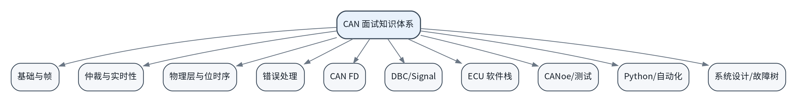

# CAN 通信面试 100 题：从协议位级到 ECU 端到端验证

> 面向车载嵌入式、车载测试、AUTOSAR/BSW、车机/IVI 与自动化测试岗位的原创题解库。v2.0 将 100 道题全部升级为“定义—机制—工程—证据—追问”的深度题解。



## 为什么做这个仓库

很多 CAN 面试资料有两个极端：要么只有“CAN ID 越小优先级越高”这种一句话结论，要么直接堆协议细节，无法迁移到 ECU 调试和测试。本仓库希望把下列知识连成一条链：

```text
CAN Frame / Bit Timing
        ↓
Arbitration / Error Confinement / CAN FD
        ↓
DBC / Signal / Counter / Checksum
        ↓
Controller / Filter / FIFO / Driver / AUTOSAR
        ↓
CANoe / Restbus / Python / SocketCAN
        ↓
Trace / ECU Log / HMI / End-to-End Verdict
```

## v2.0 的题解结构

每个 `Qxxx.md` 都固定包含：

1. 面试题；
2. 30 秒标准回答；
3. 面试官真正考什么；
4. 深入原理；
5. 概念边界；
6. 工程场景；
7. 工程证据；
8. 常见错误答案；
9. 安全的实战练习；
10. 连续追问；
11. 3 分钟深度回答模板；
12. 设计/调试检查表；
13. 一句话速记；
14. 关联题目；
15. 分层参考资料。

因此它更接近一本可以持续维护的技术题解书，而不是静态题库。

## 十章导航

| 章 | 主题 | 题号 | 能力目标 |
|---:|---|---|---|
| 01 | [CAN 基础与数据帧](chapters/01-01-fundamentals.md) | Q001~Q010 | 正确解释 frame、ID、DLC、ACK、标准/扩展格式 |
| 02 | [仲裁、优先级与实时性](chapters/02-02-arbitration-realtime.md) | Q011~Q020 | 从逐位仲裁讲到 worst-case latency |
| 03 | [物理层、终端与位时序](chapters/03-03-physical-bit-timing.md) | Q021~Q030 | 差分、终端、TQ、Sample Point、SJW、拓扑 |
| 04 | [错误检测、错误隔离与 Bus-Off](chapters/04-04-error-handling.md) | Q031~Q040 | 错误检测、TEC/REC、Bus-Off、恢复 |
| 05 | [CAN FD](chapters/05-05-can-fd.md) | Q041~Q050 | FDF/BRS/ESI、DLC、双 bit timing、迁移 |
| 06 | [DBC 与信号编解码](chapters/06-06-dbc-signals.md) | Q051~Q060 | Raw/Physical、大小端、Motorola、Multiplex |
| 07 | [ECU 软件收发链路](chapters/07-07-ecu-stack.md) | Q061~Q070 | Controller→Driver→AUTOSAR→Application |
| 08 | [CANoe、CAPL 与 ECU 测试](chapters/08-08-canoe-testing.md) | Q071~Q080 | Restbus、Trace、Counter/Checksum/Timeout |
| 09 | [Python、SocketCAN 与自动化](chapters/09-09-python-automation.md) | Q081~Q090 | 可维护自动化分层与证据采集 |
| 10 | [系统设计与故障定位](chapters/10-10-system-debug-design.md) | Q091~Q100 | Bus Load、Gateway、ISO-TP/UDS、E2E 平台 |

完整导航见 **[INDEX.md](INDEX.md)**。

## 三种学习路线

### 车载测试 / HIL / IVI

```text
Q001~010 → Q051~060 → Q071~080 → Q081~090 → Q099~100
```

重点练习：DBC 解码、Restbus、异常/恢复、Trace + HMI 证据。

### ECU / 嵌入式 / AUTOSAR

```text
Q001~050 → Q061~070 → Q091~097
```

重点练习：bit timing、error confinement、Filter/FIFO、CanIf/PduR/Com、诊断分层。

### 自动化测试开发

```text
Q051~060 → Q071~090 → Q091/Q095/Q099/Q100
```

重点练习：codec/transport 分层、pytest fixture、timestamp、artifact collection。

## S 级必答题

`Q001 Q005 Q006 Q011 Q012 Q014 Q021 Q022 Q027 Q031 Q034 Q036 Q040 Q041 Q043 Q051 Q053 Q055 Q056 Q062 Q064 Q075 Q091 Q099 Q100`

目标：**30 秒给结论，3 分钟讲机制，5 分钟接工程追问。**

## 仓库结构

```text
can-interview-offer/
├── README.md
├── INDEX.md
├── BOOK.md
├── SAFETY.md
├── questions/                 # 100 题，一题一个 Markdown
├── chapters/                  # 10 章深度导读
├── examples/                  # DBC/Python/vcan/pytest 示例
├── scripts/                   # build / validate / analysis
├── references/
│   ├── SOURCES.md
│   └── source-notes/          # 项目学习笔记快照
├── templates/
└── .github/workflows/quality.yml
```

## 快速开始

```bash
python -m pip install -r requirements.txt
python scripts/validate_repo.py
python examples/python/encode_decode.py
```

Linux 环境可进一步使用 `vcan0`：

```bash
bash examples/socketcan/vcan_lab.sh
```

## 质量门禁

`validate_repo.py` 会检查：

- 恰好 100 个题目 Markdown；
- Q001~Q100 编号完整；
- v2.0 必需章节存在；
- 每题达到最低有效内容量；
- 关键仓库文档和示例存在。

这使题库扩写不会退回“一题一句话”的状态。

## 来源原则

来源分三层：

1. **协议/官方/工具文档**：技术事实依据；
2. **项目学习笔记**：工程案例和术语上下文；
3. **公开面经**：只用于确认高频方向，不作为协议事实来源。

详见 [references/SOURCES.md](references/SOURCES.md)。

## 安全范围

发送、重放、故障注入示例默认只面向 `vcan`、SIL/HIL 或隔离低风险台架。不要在行驶车辆、公共道路环境或未经授权的安全关键车载网络上注入/覆盖报文。详见 [SAFETY.md](SAFETY.md)。

## “真题”口径

- **公开面经高频原型**：公开资料可检索到同主题/高度相近问法；
- **工程追问重构**：从高频问题继续向协议、软件栈、测试和系统设计扩展；
- 不宣称任何内容为企业内部题库、泄露题或官方答案。

## License

MIT。仓库文字与示例为原创整理；外部资料版权归原作者/机构所有。
