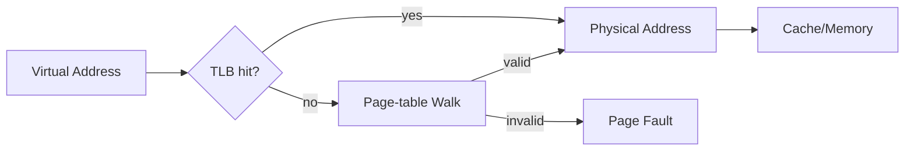

# 第 7 章｜MMU、页表与 TLB

> **本章目标**：虚拟内存把“程序使用的地址空间”与“物理存储布局”解耦；TLB 则缓存翻译结果，避免每次访存都进行昂贵的多级页表遍历。

## 能力阶梯

| 层级 | 你应该做到什么 |
|---|---|
| L1 定义 | 30 秒说清术语和目标 |
| L2 机制 | 能画出最小硬件/执行链 |
| L3 定量 | 能用公式、数量级或 PMU 指标分析 |
| L4 边界 | 能指出架构保证与微架构差异 |
| L5 工程 | 能设计 benchmark / profiling 验证假设 |

## 本章核心指标

关注 TLB reach、DTLB/ITLB miss、page-walk latency、page size、缺页成本与 shootdown 开销。

## 题目索引

| 题号 | 题目 | 难度 | 频率 | PDF 页 |
|---|---|---|---|---:|
| [Q061](q061-question.md) | 为什么现代系统需要虚拟地址？ | ★★★★★ | 必考 | 74 |
| [Q062](q062-mmu.md) | MMU 的核心工作是什么？ | ★★★★★ | 必考 | 75 |
| [Q063](q063-tlb.md) | TLB 是什么？为什么它对性能如此关键？ | ★★★★★ | 必考 | 76 |
| [Q064](q064-tlb-miss-page-fault.md) | TLB Miss 与 Page Fault 有何本质区别？ | ★★★★★ | 必考 | 77 |
| [Q065](q065-question.md) | 为什么页表通常设计成多级？ | ★★★★★ | 必考 | 78 |
| [Q066](q066-cpu-load.md) | 一次 CPU Load 从虚拟地址到数据返回经历什么？ | ★★★★★ | 必考 | 79 |
| [Q067](q067-cache-mmu.md) | Cache 和 MMU 到底谁先？ | ★★★★★ | 高频 | 80 |
| [Q068](q068-vivt-vipt-pipt-cache.md) | VIVT、VIPT、PIPT Cache 如何比较？ | ★★★★★ | 进阶 | 81 |
| [Q069](q069-huge-page.md) | Huge Page 为何能改善性能？有什么代价？ | ★★★★★ | 高频 | 82 |
| [Q070](q070-tlb-invalidation-shootdown.md) | 为什么修改页表后要做 TLB invalidation/shootdown？ | ★★★★★ | 进阶 | 83 |

## 学习要求

建议每题完成三轮：

1. **30 秒**：只答结论、机制、边界；
2. **2 分钟**：加入一个公式/最小例子；
3. **5 分钟**：加入架构差异、工程指标与反例。

完成本章后，不应只“认识名词”，而应能把 10 道题连接成一条因果链。
