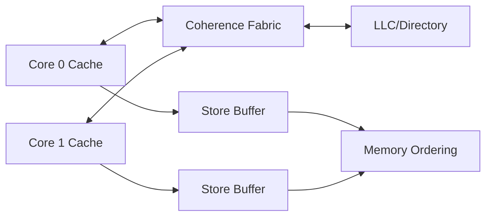

# 第 8 章｜多核一致性与内存模型

> **本章目标**：多核正确性有两个不同问题：同一 cache line 的副本如何保持 coherence，以及多个内存操作允许以什么顺序被其他核观察。前者不是后者的替代品。

## 能力阶梯

| 层级 | 你应该做到什么 |
|---|---|
| L1 定义 | 30 秒说清术语和目标 |
| L2 机制 | 能画出最小硬件/执行链 |
| L3 定量 | 能用公式、数量级或 PMU 指标分析 |
| L4 边界 | 能指出架构保证与微架构差异 |
| L5 工程 | 能设计 benchmark / profiling 验证假设 |

## 本章核心指标

关注 invalidation traffic、cache-line bouncing、atomic retry、barrier cost、scalability 与 NUMA/locality。

## 题目索引

| 题号 | 题目 | 难度 | 频率 | PDF 页 |
|---|---|---|---|---:|
| [Q071](q071-cpu-cache-coherence.md) | 为什么多核 CPU 需要 Cache Coherence？ | ★★★★★ | 必考 | 85 |
| [Q072](q072-mesi.md) | MESI 四个状态分别表示什么？ | ★★★★★ | 必考 | 86 |
| [Q073](q073-cache-coherence-memory-consistency.md) | Cache Coherence 与 Memory Consistency 有什么区别？ | ★★★★★ | 必考 | 87 |
| [Q074](q074-mesi-memory-barrier-fence.md) | 为什么有 MESI 还需要 Memory Barrier/Fence？ | ★★★★★ | 必考 | 88 |
| [Q075](q075-x86-arm-risc-v.md) | x86、Arm、RISC-V 内存模型为何不同？ | ★★★★★ | 进阶 | 89 |
| [Q076](q076-arm-dmb-dsb-isb.md) | Arm 中的 DMB、DSB、ISB 怎么区分？ | ★★★★★ | 进阶 | 90 |
| [Q077](q077-false-sharing.md) | 什么是 False Sharing？为什么逻辑上不同变量也会互相拖慢？ | ★★★★★ | 必考 | 91 |
| [Q078](q078-false-sharing.md) | 如何系统解决 False Sharing？ | ★★★★☆ | 高频 | 92 |
| [Q079](q079-cpu.md) | CPU 原子操作如何实现？ | ★★★★★ | 必考 | 93 |
| [Q080](q080-cas-aba.md) | CAS 的 ABA 问题是什么？如何缓解？ | ★★★★★ | 进阶 | 94 |

## 学习要求

建议每题完成三轮：

1. **30 秒**：只答结论、机制、边界；
2. **2 分钟**：加入一个公式/最小例子；
3. **5 分钟**：加入架构差异、工程指标与反例。

完成本章后，不应只“认识名词”，而应能把 10 道题连接成一条因果链。
