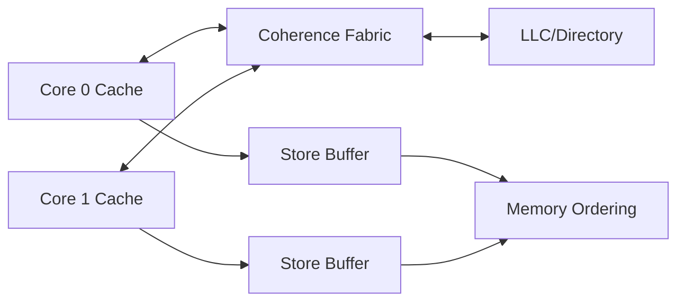

# Q078｜如何系统解决 False Sharing？

> **来源与边界**：`PDF 核心内容` 忠实保留原 PDF 第 92 页的结论、解析与易错点；从“第一性原理推导”开始属于 **GitHub v2 深度增强内容**，用于把题目扩展到现代 CPU/SoC、工程性能与连续追问。具体 ISA/微架构参数以目标处理器官方文档为准。  
> [查看原 PDF 对应页](../assets/pdf/计算机组成原理面试100题_专业详解版.pdf#page=92)

| 项目 | 内容 |
|---|---|
| 难度 | ★★★★☆ |
| 频率 | 高频 |
| 模块 | 多核一致性与内存模型 |
| PDF 页码 | 92 |
| 原 PDF 考察点 | 概念定义 · 设计动机 · 硬件机制 · 性能/正确性边界 |
| GitHub v2 目标 | 从“会背定义”升级到“能推导、能量化、能定位工程问题” |

## 0. 面试定位

这题的高分标准不是堆术语，而是完成下面四步：

1. **先给结论**：30 秒内明确对象是什么、解决什么问题。
2. **再讲机制**：指出关键数据结构/电路/执行阶段，以及信息如何流动。
3. **补充量化关系**：至少给一个公式、数量级或可测指标。
4. **最后讲边界**：明确哪些是架构保证，哪些只是常见微架构实现。

> **本题一句话心智模型**：解决 false sharing 的核心是改变数据布局或写入归属，让高频独立写落到不同 line；padding 只是其中一种方法。

---

## PDF 核心结论

### 原 PDF 一句话答案

> 先通过 profiling 确认 line bouncing，再通过数据布局、分片/线程私有化、padding 等减少不同核对同一 line 的并发写。

### PDF 深度解析要点

- 每线程 counter 最后归约通常优于共享 atomic counter。
- 将只读数据与频繁写元数据分离可减少无意义 invalidate。
- NUMA 系统还需考虑页面归属和远程 cache/home node。

### PDF 建议的回答组织

> 先诊断，再改布局；不要一上来所有 struct 都 alignas(64)。

### PDF 易错点

> 解决 false sharing 不是简单“加锁”。

---

## 深入扩展

### 第一性原理推导：为什么硬件需要这个机制？

多核正确性有两个不同问题：同一 cache line 的副本如何保持 coherence，以及多个内存操作允许以什么顺序被其他核观察。前者不是后者的替代品。

针对本题，更具体地说：**解决 false sharing 的核心是改变数据布局或写入归属，让高频独立写落到不同 line；padding 只是其中一种方法。**

面试时可以使用“压力 → 机制 → 代价”的推导链：

```text
原始问题 / 物理限制
        ↓
如果什么都不做，会产生的正确性或性能问题
        ↓
硬件/ISA 引入本题机制
        ↓
改善 latency / throughput / capacity / correctness 中的某一项
        ↓
付出面积、功耗、带宽、复杂度或软件约束
```

### 本题必须守住的抽象层级

语言内存模型、ISA 内存模型、cache coherence 是三层不同契约；跨层推理必须明确桥接关系。

一个专业回答通常会显式使用下面两句话之一：

- **“这是 architectural guarantee；具体如何做到属于 microarchitecture。”**
- **“这是常见实现，不是 ISA 必须如此。”**

这样可以避免把教材示意图、某一代 Intel/Arm/RISC-V 核心的参数，错误泛化成所有处理器的规则。

---

## 机制展开：从输入到结果

### 核心机制

解决 false sharing 的核心是改变数据布局或写入归属，让高频独立写落到不同 line；padding 只是其中一种方法。

### 原 PDF 要点如何落到完整执行链

- 每线程 counter 最后归约通常优于共享 atomic counter。
- 将只读数据与频繁写元数据分离可减少无意义 invalidate。
- NUMA 系统还需考虑页面归属和远程 cache/home node。

### 最小结构图



图的目的不是背结构，而是回答两个问题：

1. **信息/数据在哪里产生？**
2. **下一个消费者什么时候才能安全使用？**

只要把生产者、消费者、缓存/队列和提交点画清楚，大多数连续追问都会自然展开。

---

## 定量模型与最小例子

per-thread shard/local aggregation 常比简单 padding 更可扩展，最终再 reduce。

本章常用的量化视角是：关注 invalidation traffic、cache-line bouncing、atomic retry、barrier cost、scalability 与 NUMA/locality。

```cpp
// 语言级同步是首选接口；编译器再映射到目标 ISA 的原子/屏障。
std::atomic<int> flag{0};
```

### 面试中的定量回答套路

不要只说“更快”“更慢”，而要把影响投影到一个可观察量：

| 类型 | 更专业的指标 |
|---|---|
| 指令执行 | latency、throughput、IPC/CPI、dependency depth |
| Cache/内存 | hit rate、MPKI、AMAT、bandwidth、MLP |
| 地址翻译 | TLB miss、page-walk、TLB reach |
| 多核 | invalidation、HITM、cache-line bouncing、barrier cost |
| I/O | interrupt rate、DMA throughput、queue depth、outstanding |
| 存储 | IOPS、latency percentile、bandwidth、write amplification |

---

## 边界条件、反例与“不要说绝对”

**本题最重要的边界：** 盲目 alignas(64) 会增加 footprint，可能反而伤害 cache/TLB。

进一步回答时建议主动检查：

- 结论是否只对 **单核 / 多核** 中一种成立？
- 是否假设了 **cache hit / TLB hit / 无异常**？
- 是否把 **语言语义、ABI、ISA、微架构、OS** 混成一层？
- 是否把“常见值”说成“固定值”？例如 64B cache line、某级 cache latency、ROB 大小。
- 是否忽略了并发、带宽饱和、排队和 backpressure？

### 一个反例思维

如果一个结论是“机制 X 会更快”，立刻追问：

> 在工作集、并发度、访问模式或硬件资源发生什么变化时，它会失效甚至变慢？

能回答这个问题，通常已经从“背题”进入真正的体系结构分析。

---

## 工程连接

先定位热点 line，再决定 padding、AoS→SoA、分片或减少共享写。

### 推荐验证方法

```text
1. 建立 baseline：固定输入、绑核/记录频率、重复运行
2. 提出单一假设：例如 branch miss 或 DTLB miss 是主因
3. 找直接指标：PMU / trace / latency / bandwidth
4. 只改一个变量
5. 重测并检查副作用
6. 保留反例：优化是否只对某一数据规模有效？
```

### 常用工具思路

- Linux：`perf stat`、`perf record`、`perf c2c`、`numactl`、`vmstat`、`iostat`。
- 汇编/编译：Compiler Explorer、`objdump` / `llvm-objdump`。
- 微基准：Google Benchmark、自写 dependency-chain / pointer-chasing / streaming benchmark。
- 平台资料：Intel/AMD optimization manual、Arm TRM、RISC-V core vendor manual。

> 工具只是证据来源。真正重要的是：**每个指标都要对应一个可证伪的性能假设。**

---

## 架构实现差异：x86 / Arm / RISC-V 应怎么回答

本题若被追问到具体 ISA，建议使用“共性 + 差异”结构：

1. **共性机制**：先说明所有现代处理器为什么都面临同一设计压力。
2. **ISA 差异**：再说明指令、内存模型、页表、barrier 或 ABI 的规定不同。
3. **微架构差异**：最后强调 cache、predictor、ROB、端口等实现参数依具体 CPU。

语言内存模型、ISA 内存模型、cache coherence 是三层不同契约；跨层推理必须明确桥接关系。

不要在没有芯片手册或可靠测量时背具体周期数。面试官更看重你是否知道 **“哪些数字可以变化”**。

---

## 30–60 秒标准回答

### 30 秒版

> **结论：** 先通过 profiling 确认 line bouncing，再通过数据布局、分片/线程私有化、padding 等减少不同核对同一 line 的并发 写。
>
> **机制：** 解决 false sharing 的核心是改变数据布局或写入归属，让高频独立写落到不同 line；padding 只是其中一种方法。
>
> **边界：** 盲目 alignas(64) 会增加 footprint，可能反而伤害 cache/TLB。

### 2 分钟版

建议按下面顺序回答：

1. 重述本题对象与目标；
2. 用 2–3 个核心结构解释机制；
3. 给出一个最小公式/例子：**per-thread shard/local aggregation 常比简单 padding 更可扩展，最终再 reduce。**
4. 指出最重要的边界：**盲目 alignas(64) 会增加 footprint，可能反而伤害 cache/TLB。**
5. 用一句工程话收尾：**先定位热点 line，再决定 padding、AoS→SoA、分片或减少共享写。**

### 5 分钟深挖版

在 2 分钟版基础上继续加入：

- 与相邻机制的区别，例如 cache vs TLB、ROB vs RS、coherence vs consistency；
- 一个反例或 trade-off；
- x86 / Arm / RISC-V 中哪些是共性、哪些不同；
- 一个 PMU/微基准验证方案；
- 如果资源扩大 2×，性能是否也能 2×，为什么？

---

## 原 PDF 追问 + 二阶追问树

### 原 PDF 追问

> 回答方向 为什么 per-thread sharding 常比 atomic 更快？ 从“设计目标 → 硬件机制 → 性能/正确性代价”三层展开。 AoS 和 SoA 对 false sharing 有何影响？ 先给结论，再用一个最小例子验证，不做纯名词堆砌。

### GitHub v2 二阶追问

1. **设计动机**：如果完全移除这个机制，首先破坏的是正确性还是性能？为什么？
2. **资源上限**：如果把相关 buffer/cache/队列扩大 2×，收益会在哪个点开始递减？
3. **相邻机制**：它与本章前后题中的哪个机制最容易混淆？判定边界是什么？
4. **架构差异**：换到另一种 ISA，哪些结论仍成立，哪些必须查手册？
5. **性能验证**：你会观察哪 2–3 个硬件事件来证明它真的成为瓶颈？
6. **反例**：构造一个 workload，让这个机制几乎没有收益，甚至产生负收益。

---

## 常见错误表达 → 专业表达

| 不够专业 | 更专业的说法 |
|---|---|
| “CPU 就是这样做的” | “这是常见微架构实现；ISA 只保证最终可观察语义。” |
| “它会更快” | “它主要降低/隐藏某类 latency，或提高 throughput；收益取决于命中率、并行度和资源占用。” |
| “Cache/内存很慢” | “先看具体层级、MPKI、miss penalty 与 bandwidth 是否饱和。” |
| “加大 buffer 就行” | “窗口扩大只能覆盖更多独立工作；若受 true dependency 或带宽限制，收益会饱和。” |
| “某参数固定是 X” | “X 是常见实现值，目标平台应查官方手册或实测。” |

本题尤其要避免：**解决 false sharing 不是简单“加锁”。**

---

## 面试官评分标准

### 合格

- 定义正确；
- 能复述 PDF 核心结论；
- 不混淆最基本术语。

### 良好

- 能解释“为什么需要”；
- 能描述关键执行链；
- 能给出一个边界条件和一个量化关系。

### 优秀

- 主动区分 ISA / microarchitecture / OS / ABI；
- 能讨论 trade-off 而不是单向优点；
- 能提出 PMU 或微基准验证方法；
- 能把本题连接到相邻题形成完整系统模型。

---

## 自测

- [ ] 能在 30 秒内回答，不使用超过 5 个术语。
- [ ] 能画出最小数据/控制路径，并标出生产者和消费者。
- [ ] 能写出至少一个相关公式或数量级关系。
- [ ] 能给出一个反例，说明机制不是“永远更好”。
- [ ] 能说清 architectural guarantee 与 microarchitectural implementation。
- [ ] 能提出 2 个 PMU/实验指标来验证性能判断。
- [ ] 能把本题与本章相邻问题连接起来。

---

## 关联题目

- [Q076｜Arm 中的 DMB、DSB、ISB 怎么区分？](q076-arm-dmb-dsb-isb.md)
- [Q077｜什么是 False Sharing？为什么逻辑上不同变量也会互相拖慢？](q077-false-sharing.md)
- [Q079｜CPU 原子操作如何实现？](q079-cpu.md)
- [Q080｜CAS 的 ABA 问题是什么？如何缓解？](q080-cas-aba.md)

---

## 延伸阅读

以下资料用于 **GitHub 深度扩展的架构校准**，不代表原 PDF 逐字引用：

- [RISC-V RVWMO](https://docs.riscv.org/reference/isa/unpriv/rvwmo.html)
- [Arm Architecture](https://developer.arm.com/documentation)

全仓统一参考索引见：[参考资料与校准基线](../appendices/references.md)。

---

## 一句话复盘

> 先通过 profiling 确认 line bouncing，再通过数据布局、分片/线程私有化、padding 等减少不同核对同一 line 的并发 写。

---

[← Q077 什么是 False Sharing？为什么逻辑上不同变量也会互相拖慢？](q077-false-sharing.md) · [Q079 CPU 原子操作如何实现？ →](q079-cpu.md)
