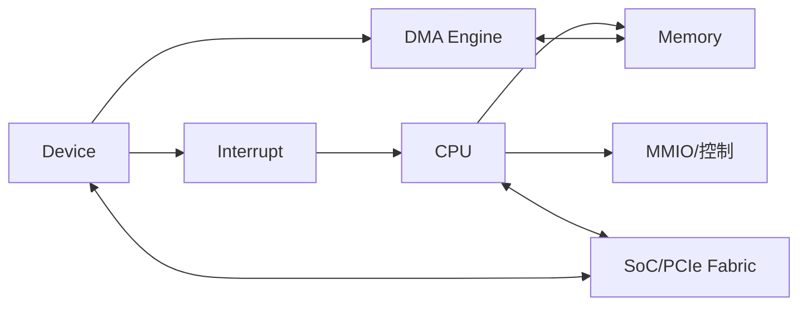

# 第 9 章｜I/O、DMA 与互连

> **本章目标**：I/O 的关键不是“CPU 会不会读设备”，而是如何在 CPU、设备、内存和互连之间高效且有序地移动控制信息与大块数据。

## 能力阶梯

| 层级 | 你应该做到什么 |
|---|---|
| L1 定义 | 30 秒说清术语和目标 |
| L2 机制 | 能画出最小硬件/执行链 |
| L3 定量 | 能用公式、数量级或 PMU 指标分析 |
| L4 边界 | 能指出架构保证与微架构差异 |
| L5 工程 | 能设计 benchmark / profiling 验证假设 |

## 本章核心指标

关注 interrupt rate、DMA throughput、descriptor depth、PCIe/AXI outstanding、IOMMU、cache maintenance 与 memory ordering。

## 题目索引

| 题号 | 题目 | 难度 | 频率 | PDF 页 |
|---|---|---|---|---:|
| [Q081](q081-polling.md) | 中断是什么？为什么比纯 Polling 高效？ | ★★★★★ | 必考 | 96 |
| [Q082](q082-interrupt-exception-trap.md) | Interrupt、Exception、Trap 如何区分？ | ★★★★★ | 高频 | 97 |
| [Q083](q083-question.md) | 中断向量表/异常向量的作用是什么？ | ★★★★☆ | 高频 | 98 |
| [Q084](q084-polling-interrupt.md) | Polling 与 Interrupt 如何选择？ | ★★★★★ | 高频 | 99 |
| [Q085](q085-dma.md) | DMA 是什么？完整工作流程是什么？ | ★★★★★ | 必考 | 100 |
| [Q086](q086-dma-cpu-cache.md) | DMA 与 CPU Cache 为何会产生一致性问题？ | ★★★★★ | 必考 | 101 |
| [Q087](q087-mmio.md) | MMIO 是什么？为什么设备寄存器不能当普通内存访问？ | ★★★★★ | 必考 | 102 |
| [Q088](q088-soc.md) | 地址线、数据线、控制线的教材模型在现代 SoC 中如何演化？ | ★★★☆☆ | 常见 | 103 |
| [Q089](q089-axi-ahb.md) | AXI 与 AHB 的主要区别是什么？ | ★★★★★ | 芯片岗 | 104 |
| [Q090](q090-pcie-packet.md) | PCIe 为什么采用点对点串行和 packet 事务模型？ | ★★★★★ | 高频 | 105 |

## 学习要求

建议每题完成三轮：

1. **30 秒**：只答结论、机制、边界；
2. **2 分钟**：加入一个公式/最小例子；
3. **5 分钟**：加入架构差异、工程指标与反例。

完成本章后，不应只“认识名词”，而应能把 10 道题连接成一条因果链。
