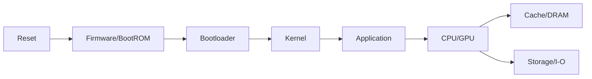

# 第 10 章｜存储、启动与综合性能

> **本章目标**：这一章把前面的部件重新串成系统：介质特性决定存储层设计，启动链决定可信执行起点，而性能定位要求把“慢”分解成可测量的硬件事件。

## 能力阶梯

| 层级 | 你应该做到什么 |
|---|---|
| L1 定义 | 30 秒说清术语和目标 |
| L2 机制 | 能画出最小硬件/执行链 |
| L3 定量 | 能用公式、数量级或 PMU 指标分析 |
| L4 边界 | 能指出架构保证与微架构差异 |
| L5 工程 | 能设计 benchmark / profiling 验证假设 |

## 本章核心指标

关注 IOPS/latency/bandwidth、write amplification、refresh、occupancy、SIMD/SIMT 利用率、PMU 事件与 roofline/瓶颈分类。

## 题目索引

| 题号 | 题目 | 难度 | 频率 | PDF 页 |
|---|---|---|---|---:|
| [Q091](q091-sram-dram-cache.md) | SRAM 与 DRAM 为什么一个做 Cache、一个做主存？ | ★★★★★ | 必考 | 107 |
| [Q092](q092-dram-refresh.md) | DRAM 为什么需要 Refresh？ | ★★★★☆ | 高频 | 108 |
| [Q093](q093-hdd-ssd.md) | HDD 与 SSD 的性能差异来自哪里？ | ★★★★☆ | 高频 | 109 |
| [Q094](q094-ssd-write-amplification.md) | SSD 为什么会产生 Write Amplification？ | ★★★★★ | 进阶 | 110 |
| [Q095](q095-cpu-gpu.md) | CPU 与 GPU 的架构目标有何根本不同？ | ★★★★★ | 必考 | 111 |
| [Q096](q096-simd-simt.md) | SIMD 与 SIMT 有什么区别？ | ★★★★★ | 高频 | 112 |
| [Q097](q097-reset-kernel.md) | 从上电 Reset 到操作系统 Kernel 开始执行发生了什么？ | ★★★★★ | 芯片岗 | 113 |
| [Q098](q098-hardware-prefetch.md) | Hardware Prefetch 如何工作？为什么有时反而变慢？ | ★★★★★ | 高频 | 114 |
| [Q099](q099-question.md) | 为什么顺序遍历数组比随机访问快很多？ | ★★★★★ | 必考 | 115 |
| [Q100](q100-cpu.md) | 给你一个‘CPU 很慢’的程序，如何从组成原理角度系统定位？ | ★★★★★ | 终局 | 116 |

## 学习要求

建议每题完成三轮：

1. **30 秒**：只答结论、机制、边界；
2. **2 分钟**：加入一个公式/最小例子；
3. **5 分钟**：加入架构差异、工程指标与反例。

完成本章后，不应只“认识名词”，而应能把 10 道题连接成一条因果链。
