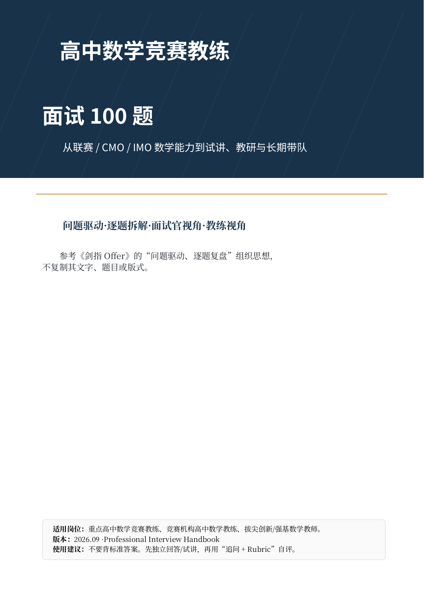

# 高中数学竞赛教练面试 100 题

> 面向重点高中、竞赛机构、拔尖创新/强基方向的高中数学竞赛教练岗位。  
> 组织思想：**问题驱动 · 逐题拆解 · 面试官视角 · 教练视角 · 可维护知识库**。



## 这个仓库有什么

- **100 道题，100 个 Markdown**：每题独立可链接、可复盘、可提交 issue。
- **完整包含原 PDF 内容**：原始 PDF 与 LaTeX 源稿均随仓库保留；每道题的 PDF 内容逐项迁移到对应 Markdown。
- **比 PDF 更详细**：在原有增强层之上，Q001-Q100 已全部加入题目特异的 **Professional v2 深化内容**；数学题补证明、反例、适用边界与方法比较，试讲题补分钟级脚本，教研/学生题补指标、决策规则与可交付物。
- **双主线能力模型**：既考代数/几何/数论/组合，也考试讲、课程研发、学情诊断、家校沟通与长期带队。
- **机器可读元数据**：`metadata/questions.json` 可用于题库网站、搜索、统计或二次生成。
- **可部署文档站**：提供 `mkdocs.yml`；也提供 GitHub Actions 内容完整性校验。

## Professional v2 深化规模

- **100 / 100** 题包含独立的 `专业版 v2` 深化段落；
- 100 道题正文合计约 **28 万中文/Markdown 字符**、**1.59 万行**；
- 9 个模块 README 均加入学习路径、面试重点、训练标准与产出物；
- 原 PDF 内容与仓库扩展内容继续严格分层，便于审计与后续版本迭代。

重点不在“把每题写长”，而在于减少通用模板：每个 v2 段落都围绕该题的具体数学结构、教学决策或教研场景展开。

## 原版 PDF

- [下载/查看 124 页 PDF](assets/pdf/high_school_math_olympiad_coach_interview_100.pdf)
- [LaTeX 源稿](source/high_school_math_olympiad_coach_interview_100.tex)

## 题库结构

| 模块 | 题数 | 范围 |
|---|---:|---|
| [竞赛体系与教练认知](questions/01-foundations/README.md) | 10 | Q001-Q010 |
| [代数](questions/02-algebra/README.md) | 15 | Q011-Q025 |
| [平面几何](questions/03-geometry/README.md) | 15 | Q026-Q040 |
| [数论](questions/04-number-theory/README.md) | 15 | Q041-Q055 |
| [组合数学](questions/05-combinatorics/README.md) | 15 | Q056-Q070 |
| [综合解题与证明](questions/06-problem-solving-proof/README.md) | 8 | Q071-Q078 |
| [试讲与教学能力](questions/07-demo-teaching/README.md) | 10 | Q079-Q088 |
| [课程研发与训练体系](questions/08-curriculum-research/README.md) | 7 | Q089-Q095 |
| [学生培养与职业素养](questions/09-student-development/README.md) | 5 | Q096-Q100 |

## 推荐阅读路径

### 目标 A：准备竞赛教练面试

1. Q001-Q010 建立岗位认知；
2. Q011-Q070 每天做“口述 + 板书”双训练；
3. Q071-Q078 专练陌生题与 proof critique；
4. Q079-Q088 录制试讲；
5. Q089-Q100 准备教研案例、学生案例和终面证据链。

### 目标 B：学校招聘方设计考核

先读 [出版说明与评分框架](docs/book-frontmatter.md)，再从每个数学模块抽 1-2 题、Q071-Q078 抽 1 题、Q079-Q088 抽 1 个试讲、Q089-Q100 抽 2 个案例题，可组成一套 60-90 分钟结构化面试。

## 文档入口

- [出版说明、内容边界、100 分评分表](docs/book-frontmatter.md)
- [面试实战手册](docs/interview-playbook.md)
- [100 题覆盖矩阵](docs/coverage-matrix.md)
- [30 天训练计划](docs/30-day-plan.md)
- [20 分钟试讲评分表](docs/demo-lesson-rubric.md)
- [作品集建议](docs/portfolio-guide.md)
- [核心参考与公开依据](docs/references.md)
- [内容模型与维护约定](docs/content-model.md)

## 每题 Markdown 的标准结构

```text
YAML metadata
题目 + 标签
├── PDF 核心内容（完整迁移）
│   ├── 面试官为什么问
│   ├── 高分答题框架
│   ├── 面试追问
│   ├── 常见失分
│   ├── 教练视角
│   └── 10 分 Rubric
└── 仓库增强
    ├── 深度解析
    ├── 技术补充（数学题）
    ├── 3 分钟口述组织法
    ├── 压力训练
    ├── 自检清单
    ├── Professional v2：题目特异深挖
    │   ├── 完整证明 / 公式推导 / 反例（数学题）
    │   ├── 分钟级试讲脚本（试讲题）
    │   ├── 诊断指标 / 决策规则（教研与学生题）
    │   └── 方法选择边界与迁移设计
    └── 关联题目
```

## 内容边界

“真题型”指贴合公开可核验的竞赛与招聘能力维度；本仓库**不声称**这些题来自学校或机构内部泄题。仓库中的“PDF 核心内容”与“仓库增强”明确分层，便于审计来源和后续扩展。

## 本地文档站

```bash
python -m pip install -r requirements-docs.txt
mkdocs serve
```

## 内容校验

```bash
python scripts/validate_repo.py
```

校验器会检查：100 个题目文件是否齐全、YAML 是否含核心字段、PDF/LaTeX 是否存在、内部相对链接是否指向真实文件。

## 版本

- `v1.1.0` - 2026-09-02：Professional v2 深化，100/100 题加入题目特异内容，9 个模块索引升级为专业学习导航。
- `v1.0.0` - 2026-09-02：从 124 页 PDF 构建 GitHub 知识库版，100 题全部拆分并增强。

## License

仓库没有替你选择公开许可证。发布到 GitHub 前请阅读 [LICENSE-NOTICE.md](LICENSE-NOTICE.md) 并根据你的用途选择内容/代码许可证。
