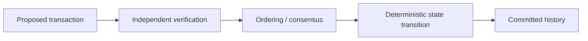

# Q03. Hash 在 Blockchain 中有哪些作用？

> **难度** ★★ | **高频度** ★★★★☆ | **岗位** 全岗位 | **PDF** 第 7 页
>
> 本文件以 PDF 中 Q03 为主干；“GitHub 扩展”部分是在原内容上增加的工程化学习材料。原 PDF：[Jianzhi_Web3_Offer_100_Interview_Questions_2026.pdf](../../assets/pdf/Jianzhi_Web3_Offer_100_Interview_Questions_2026.pdf).

## 1. 面试官为什么问这题

考察密码学基础是否能连接到区块、交易、Merkle commitment、地址和确定性部署。

### 高分回答的层级

- **L1 - 定义正确**：术语不混淆，先给一到两句话结论。
- **L2 - 原理可推导**：能解释为什么，以及底层状态/数据/执行路径。
- **L3 - Failure Mode**：主动说明什么时候结论不成立、常见攻击或工程故障。
- **L4 - Invariant / Trade-off**：能给出不变量、信任假设或系统设计取舍。

## 2. 30 秒标准回答

> Hash 是把任意长度输入映射为固定长度摘要的单向承诺工具。链上常见用途包括区块链接、交易标识、Merkle root、状态承诺、签名前消息摘要、CREATE2 地址计算和 PoW。

## 3. 原理深挖（PDF 主干）

### 3.1 关键推导

面试中要区分 collision resistance、preimage resistance 和 second-preimage resistance。区块链通常不是“用 hash 加密数据”，而是用 hash 做内容承诺与完整性检测。

### 3.2 关键推导

Merkle root 的意义尤其重要：它把大量叶子压缩成一个固定长度 commitment，随后可以用对数规模的 proof 证明某个叶子的成员关系。

## 4. 白板模型



在面试中不必追求图漂亮；图的作用是让**状态、信任边界、调用方向或资产流**一眼可见。

## 5. 必须说出的关键点

- 不要说“hash 可逆解密”
- Keccak-256 与 SHA-256 不是同一个算法
- commitment 的核心是变更任意输入都会改变摘要
- 地址推导与函数 selector 都依赖 hash

## 6. GitHub 扩展：工程化理解

下面内容是在 PDF 主干之上增加的生产/审计视角，用于把“知道概念”升级为“能落地”。

- 先说明信任假设：谁可能作恶、谁需要验证、系统依赖什么资源或多数假设。
- 把概念落到状态机：输入是什么、状态如何转移、冲突如何裁决、何时视为最终。
- 区分密码学保证、共识保证、经济保证和社会层保证，避免把它们混成“不可篡改”。
- 回答系统问题时主动指出业务层还需要确认策略、reorg 处理和数据来源治理。

### 6.1 面试推导顺序

1. **先下定义**：用本题 30 秒回答建立边界。
2. **再给机制**：把对象、输入、状态变化或执行上下文说清楚。
3. **主动给失败模式**：从本题常见误区反推“哪里会出问题”。
4. **给 mitigation / 工程做法**：说明如何测试、监控或限制 blast radius。
5. **用 invariant 收尾**：让面试官看到你能从局部 API 上升到系统正确性。

### 6.2 验证 / 测试清单

- [ ] 用小型状态机例子验证定义是否一致。
- [ ] 构造 adversarial/partition/reorg 场景检查信任假设。
- [ ] 明确哪些结论来自密码学，哪些来自共识/经济假设。

<!-- PROFESSIONAL_ENRICHMENT_START -->
### 6.3 前置知识与概念边界

这题属于 **Blockchain / 密码学 / 共识**。以下 6.3–6.12 属于 **GitHub 专业深化（通用工程知识与推导）**，并非 PDF 原文；PDF 主干仍以上文第 1–5 节为准。

在进入细节前，建议先确认下面三个前置层次：

- 分布式状态机与复制
- 密码学 hash / signature 的基本安全性质
- 共识、最终性与网络分区的区别

本题已有关键点可以进一步拆成：

1. **不要说“hash 可逆解密”**：面试中需要把它从关键词展开成“定义 → 机制 → 边界 → 工程后果”，不能只念术语。
2. **Keccak-256 与 SHA-256 不是同一个算法**：面试中需要把它从关键词展开成“定义 → 机制 → 边界 → 工程后果”，不能只念术语。
3. **commitment 的核心是变更任意输入都会改变摘要**：面试中需要把它从关键词展开成“定义 → 机制 → 边界 → 工程后果”，不能只念术语。
4. **地址推导与函数 selector 都依赖 hash**：面试中需要把它从关键词展开成“定义 → 机制 → 边界 → 工程后果”，不能只念术语。

> **边界原则**：能回答“它是什么”只能达到基础分；高级回答必须继续回答“它不是什么、依赖什么假设、失败时会怎样”。

### 6.4 形式化模型 / 白板推导

先把协议抽象成 `S_{t+1}=F(S_t, T_t)`：节点需要对输入交易的有效性、排序以及最终采用的历史达成一致。随后再标注哪些性质来自密码学、哪些来自共识、哪些来自经济激励。

白板时建议固定使用以下推导顺序：

1. **对象**：列出参与者、状态、资产或数据结构；
2. **输入**：哪些交易/消息/价格/签名会驱动状态变化；
3. **规则**：哪些条件决定有效、排序、授权或价格；
4. **状态变化**：写出成功路径和失败/回滚路径；
5. **Invariant**：任何正常或恶意输入下必须保持什么；
6. **Trust assumption**：哪些条件不是代码能独立保证的。

### 6.5 本题最值得深挖的一层：Hash 的语义边界

Hash 提供的是摘要/承诺，不提供保密性。签名通常对 hash 后的结构化消息做认证，而 encryption 解决 confidentiality；三者不要混用。

如果面试官继续追问，不要立刻换新术语。先从上述核心模型推出一个**具体后果**，再给一个**反例或边界条件**，最后说明**生产系统如何验证/缓解**。

### 6.6 生产工程决策

- 任何“已确认”都要转换成业务确认策略：确认深度、finalized 标记、最大可接受 reorg、回滚方式。
- 系统不能只存交易哈希；至少保存 block number/hash、parent hash、链 ID 和处理版本，才能在 reorg 或多链环境下恢复。
- 把协议安全假设写成显式文档，例如诚实多数、弱主观性检查点、可信启动参数或外部数据源。
- 对密码学对象做 domain separation，避免同一字节串在不同业务语义中被复用。

对本题而言，工程答案最好至少包含一个“**正常路径**”和一个“**故障路径**”。前者证明你理解功能，后者证明你理解系统。

### 6.7 Threat Model / Failure Modes

把失败模式分成三类会更专业：

- **语义错误**：概念或状态模型理解错，导致实现从根上错误；
- **对抗性输入**：攻击者利用排序、回调、价格、签名、权限等主动破坏假设；
- **系统性故障**：RPC、节点、sequencer、oracle、数据库或管理员路径异常。

本题重点检查：

- 把 encryption、signature、hash 三者混为一谈。
- 认为 hash 碰撞“理论存在”就等同于“工程可利用”。
- 错误地把“复制很多份”当成拜占庭容错
- 把最终性当固定等待时间而非协议/经济保证
- 忽视分区、重组与节点视图不一致
- 把 hash、签名、加密的安全性质混为一谈

> 面试时最好把“风险”改写成可验证句式：**在条件 A 下，攻击者/故障 B 可以让状态 C 违反 invariant D，影响资产/可用性 E。**

### 6.8 测试策略：Unit → Fuzz → Invariant → Integration

- [ ] 状态机确定性测试：同一状态和交易序列必须得到同一结果
- [ ] reorg/partition 仿真：验证业务层能回滚或延迟确认
- [ ] 跨链/跨域重放测试：chainId、domain、nonce 必须进入安全边界

进一步建议：

- **Unit test**：验证局部 API 与边界输入；
- **Fuzz test**：搜索你没有手工枚举的输入组合；
- **Invariant test**：验证任意调用序列下核心关系仍成立；
- **Integration/Fork test**：验证真实 token、oracle、RPC、链状态或跨合约行为；
- **Failure injection**：主动让依赖超时、重组、停机、返回异常，验证恢复路径。

### 6.9 可观测性与线上排障

如果这道题变成线上事故，不要只说“看日志”。先定义你要观察的**链上事实、派生状态与外部依赖**。本章常用信号包括：

- `tip height / finalized height 差值`
- `reorg 深度与频率`
- `peer/validator 可用性`
- `不同 RPC 对 canonical head 的分歧`

排障顺序建议固定为：

```text
用户现象
  ↓
确认 chain / tx / block / request identity
  ↓
确认 source of truth
  ↓
定位状态机停在哪一步
  ↓
查看依赖与权限变化
  ↓
复现 / simulate / trace
  ↓
决定 retry / rollback / pause / compensate
```

### 6.10 不同岗位如何回答同一道题

- **通用工程视角**：先给定义，再给机制、边界、失败模式、测试与生产取舍。
- **高级面试升级**：最后补一句“这个结论依赖哪些假设、线上怎样观测、出现异常如何回滚/降级”，通常能明显区分 Senior 与纯知识型回答。

### 6.11 面试官评分 Rubric

| 层级 | 候选人表现 | 典型判断 |
|---|---|---|
| **0 - 术语记忆** | 只能给一句定义，追问就断 | 不足以独立处理生产问题 |
| **1 - 机制理解** | 能解释核心流程和关键对象 | 基础工程能力 |
| **2 - 边界意识** | 能主动指出前提、反例和 Failure Mode | 中高级候选人信号 |
| **3 - 工程闭环** | 能给测试、监控、回滚、兼容性与成本取舍 | Senior 信号 |
| **4 - 系统推导** | 能用 invariant / trust model 串起上下游并提出替代设计 | Staff / Protocol 信号 |

### 6.12 关联题：把知识连成网络

- [Q02 UTXO 模型与 Account Model 有什么区别？](q02.md)：建议用“相同底层机制 / 不同应用边界”方式对比复习。
- [Q04 Merkle Tree 为什么特别适合 Blockchain？](q04.md)：建议用“相同底层机制 / 不同应用边界”方式对比复习。
- [Q01 Blockchain 到底解决了什么问题？](q01.md)：建议用“相同底层机制 / 不同应用边界”方式对比复习。
- [Q05 什么是区块链 Finality？](q05.md)：建议用“相同底层机制 / 不同应用边界”方式对比复习。
- [Q06 PoW 与 PoS 的本质差异是什么？](q06.md)：建议用“相同底层机制 / 不同应用边界”方式对比复习。

不要把 100 题当成 100 个孤立答案。真正的面试常从当前题连续跳到 storage、signature、oracle、reorg、upgrade、MEV 或 system design；建立跨题连接比继续背更多定义更重要。
<!-- PROFESSIONAL_ENRICHMENT_END -->

## 7. 高频追问与回答方向

### 追问 1：Hash collision 是否意味着可以直接偷币？

**回答方向：** 通常还需要具体协议利用路径。

进一步展开时应回扣：`不要说“hash 可逆解密”`，并至少补一个边界条件或反例。

### 追问 2：为什么不能用普通 checksum 替代密码学 hash？

**回答方向：** 回答时回到本题的核心定义，并补充一个 failure mode 与工程边界。

进一步展开时应回扣：`Keccak-256 与 SHA-256 不是同一个算法`，并至少补一个边界条件或反例。

### 追问 3：什么是 domain separation？

**回答方向：** 避免同一字节串在不同语义域被混用。

进一步展开时应回扣：`commitment 的核心是变更任意输入都会改变摘要`，并至少补一个边界条件或反例。

## 8. 常见错误回答 / Gotchas

- **错误模式：** 把 encryption、signature、hash 三者混为一谈。
- **错误模式：** 认为 hash 碰撞“理论存在”就等同于“工程可利用”。
- **面试修正方式：** 不要只换一个更专业的名词；要明确指出错误假设、给出正确模型，并说明该错误在生产环境可能造成的后果。

## 9. 记忆锚点

> Hash 不是加密，而是廉价、确定、难伪造的内容指纹与承诺。

## 10. 自测题

1. 不看本文，用 30 秒重新回答：**Hash 在 Blockchain 中有哪些作用？**
2. 给出一个“定义正确但工程上会失败”的反例。
3. 给出至少一个可以自动化验证的 invariant / test。
4. 如果这是线上事故，你最先观察哪 3 个信号或状态？
5. 如果面试官要求把答案提升到 Staff 级，你会补哪一张状态机/信任边界图？

<!-- PROFESSIONAL_LAB_START -->
### 10.1 实战训练：把这题变成可展示的工程证据

**场景任务**：你在做一个需要处理 **Hash 在 Blockchain 中有哪些作用** 的交易平台/协议服务。请分别写出“协议保证”“应用层仍需自行保证”的内容，并给出一次 reorg 或节点分歧时的恢复方案。

建议输出物：

1. 一张状态机 / 资产流 / 调用图；
2. 一份 10～30 行的最小代码、伪代码或数据结构；
3. 3 个 happy-path 测试 + 3 个 adversarial/failure-path 测试；
4. 至少 1 个 invariant；
5. 一段 2 分钟口述答案，要求不看稿；
6. 与 **Q02、Q04、Q01** 做一次对比复盘，说明相同底层机制与不同工程边界。

### 10.2 反向面试：你可以问面试官什么

为了判断团队真实工程成熟度，可以围绕本题反问：

- 这个系统当前最关键的 invariant / SLO 是什么？
- 过去出现过哪类与本题相关的线上事故或审计问题？
- 团队如何做 fork/invariant/failure-injection 测试？
- 协议升级或依赖变更时，谁负责 compatibility review 和 rollback plan？
- 哪些安全/可靠性判断是链上强制，哪些依赖 off-chain service 或人工流程？

这些问题既能帮助你了解岗位，也能体现你关注**长期正确性和运行质量**，而不只是完成一次编码任务。
<!-- PROFESSIONAL_LAB_END -->

## 11. 参考资料

### PDF 原始引用 / 对应官方资料
- 本题在 PDF 中未单独列出外部引用；其内容来自书内主干整理。

### GitHub 扩展阅读（2026-09 核验）

> 注：协议和文档会更新；面试前应核验目标链、compiler、OpenZeppelin 与协议版本。

---

[← Q02](q02.md) · [本章目录](index.md) · [总目录](../index.md) · [Q04 →](q04.md)
