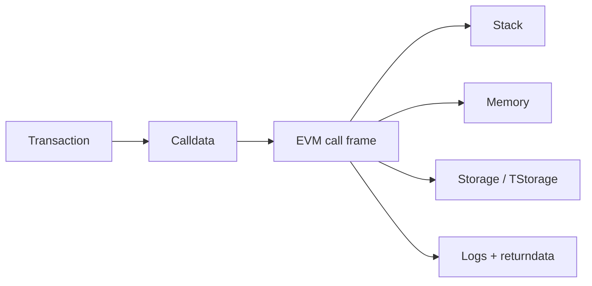

# Q15. ABI Function Selector 和 calldata 如何编码？

> **难度** ★★ | **高频度** ★★★★☆ | **岗位** Solidity/后端/安全 | **PDF** 第 20 页
>
> 本文件以 PDF 中 Q15 为主干；“GitHub 扩展”部分是在原内容上增加的工程化学习材料。原 PDF：[Jianzhi_Web3_Offer_100_Interview_Questions_2026.pdf](../../assets/pdf/Jianzhi_Web3_Offer_100_Interview_Questions_2026.pdf).

## 1. 面试官为什么问这题

检查你能否从函数签名追到原始 calldata。

### 高分回答的层级

- **L1 - 定义正确**：术语不混淆，先给一到两句话结论。
- **L2 - 原理可推导**：能解释为什么，以及底层状态/数据/执行路径。
- **L3 - Failure Mode**：主动说明什么时候结论不成立、常见攻击或工程故障。
- **L4 - Invariant / Trade-off**：能给出不变量、信任假设或系统设计取舍。

## 2. 30 秒标准回答

> 外部函数调用的前 4 bytes 通常是 `keccak256("name(type1,type2,...)")` 的前 4 bytes，后面按 ABI 规则编码参数。动态类型的 head 区存 offset，tail 区存实际长度与数据。

## 3. 原理深挖（PDF 主干）

### 3.1 关键推导

例如 `transfer(address,uint256)` 的 selector 固定为 4 bytes。因为 selector 只有 32 bit，理论上存在碰撞，所以 proxy / dispatcher 设计需要考虑 selector clash。

### 3.2 关键推导

理解 ABI 能让你排查低级 call、decode revert data、构建 multicall、分析 calldata gas 和安全工具输出。

### 3.3 公式 / 定量关系

```text
selector = first4(keccak256("f(type1,type2,...)"))
```

仅函数名不够，参数类型是签名的一部分

## 4. 白板模型



在面试中不必追求图漂亮；图的作用是让**状态、信任边界、调用方向或资产流**一眼可见。

## 5. 必须说出的关键点

- canonical type names 参与签名
- selector 只有 4 bytes
- static values inline, dynamic values use offset
- returndata / revert data 也遵循 ABI 约定

## 6. GitHub 扩展：工程化理解

下面内容是在 PDF 主干之上增加的生产/审计视角，用于把“知道概念”升级为“能落地”。

- 沿着 `transaction -> calldata -> call frame -> opcode -> storage/log -> receipt` 推导，尽量能落到字节级。
- 明确执行上下文：`msg.sender`、`msg.value`、`address(this)`、storage owner、delegatecall context。
- 对 gas 问题先区分执行成本、持久状态成本和 calldata/data-availability 成本。
- 调试时优先使用 trace、raw calldata、storage slot 与 revert data，而不是只看 Solidity 源码表象。

### 6.1 面试推导顺序

1. **先下定义**：用本题 30 秒回答建立边界。
2. **再给机制**：把对象、输入、状态变化或执行上下文说清楚。
3. **主动给失败模式**：从本题常见误区反推“哪里会出问题”。
4. **给 mitigation / 工程做法**：说明如何测试、监控或限制 blast radius。
5. **用 invariant 收尾**：让面试官看到你能从局部 API 上升到系统正确性。

### 6.2 验证 / 测试清单

- [ ] 用 Foundry/Hardhat 构造最小合约并检查 trace。
- [ ] 对关键 calldata/storage slot 做原始字节级验证。
- [ ] 比较成功、revert、out-of-gas 三种路径的状态与 receipt。

<!-- PROFESSIONAL_ENRICHMENT_START -->
### 6.3 前置知识与概念边界

这题属于 **Ethereum / EVM**。以下 6.3–6.12 属于 **GitHub 专业深化（通用工程知识与推导）**，并非 PDF 原文；PDF 主干仍以上文第 1–5 节为准。

在进入细节前，建议先确认下面三个前置层次：

- EVM call frame、stack/memory/storage
- ABI 编码与 calldata
- transaction、gas、receipt 与 state root

本题已有关键点可以进一步拆成：

1. **canonical type names 参与签名**：面试中需要把它从关键词展开成“定义 → 机制 → 边界 → 工程后果”，不能只念术语。
2. **selector 只有 4 bytes**：面试中需要把它从关键词展开成“定义 → 机制 → 边界 → 工程后果”，不能只念术语。
3. **static values inline, dynamic values use offset**：面试中需要把它从关键词展开成“定义 → 机制 → 边界 → 工程后果”，不能只念术语。
4. **returndata / revert data 也遵循 ABI 约定**：面试中需要把它从关键词展开成“定义 → 机制 → 边界 → 工程后果”，不能只念术语。

> **边界原则**：能回答“它是什么”只能达到基础分；高级回答必须继续回答“它不是什么、依赖什么假设、失败时会怎样”。

### 6.4 形式化模型 / 白板推导

本题已有公式/关系：`selector = first4(keccak256("f(type1,type2,...)"))`；`仅函数名不够，参数类型是签名的一部分`。不要只背公式，要逐个说明变量的物理/协议含义、单位、取值边界以及公式失效的前提。

在此基础上，把 EVM 看成带 gas 预算的确定性状态机：每个 opcode 同时更新机器状态（pc/stack/memory）和可能的世界状态；外部调用会创建新的 call frame，而 `DELEGATECALL` 等指令改变代码与存储上下文的组合方式。

白板时建议固定使用以下推导顺序：

1. **对象**：列出参与者、状态、资产或数据结构；
2. **输入**：哪些交易/消息/价格/签名会驱动状态变化；
3. **规则**：哪些条件决定有效、排序、授权或价格；
4. **状态变化**：写出成功路径和失败/回滚路径；
5. **Invariant**：任何正常或恶意输入下必须保持什么；
6. **Trust assumption**：哪些条件不是代码能独立保证的。

### 6.5 本题最值得深挖的一层：ABI 解析要以字节布局说话

高级回答应能解释 4-byte selector、32-byte word、head/tail dynamic encoding，以及 revert/custom error 同样走 ABI 编码。

如果面试官继续追问，不要立刻换新术语。先从上述核心模型推出一个**具体后果**，再给一个**反例或边界条件**，最后说明**生产系统如何验证/缓解**。

### 6.6 生产工程决策

- 定位问题时先区分 transaction-level state、call-frame-local state 与 persistent storage，不要把 memory/storage 生命周期混淆。
- 分析 gas 时先看 storage write、cold/warm access、external call、memory expansion，再看微小 opcode 优化。
- 涉及 proxy/CREATE2/raw storage 时必须画 storage layout 或 address derivation，避免仅凭 Solidity 表面语义推断。
- 对 ABI/calldata 问题使用真实编码向量做测试，尤其是 dynamic type、selector、fallback 与 custom error。

对本题而言，工程答案最好至少包含一个“**正常路径**”和一个“**故障路径**”。前者证明你理解功能，后者证明你理解系统。

### 6.7 Threat Model / Failure Modes

把失败模式分成三类会更专业：

- **语义错误**：概念或状态模型理解错，导致实现从根上错误；
- **对抗性输入**：攻击者利用排序、回调、价格、签名、权限等主动破坏假设；
- **系统性故障**：RPC、节点、sequencer、oracle、数据库或管理员路径异常。

本题重点检查：

- 把 selector 当成完整 hash，忽略 4-byte 碰撞。
- 在签名字符串里错误加入参数名或空格。
- storage context 理解错误导致 proxy/DELEGATECALL 漏洞
- 错误假设 EOA/contract 可通过 code.length 永久区分
- gas 估算只看均值，忽略 worst-case 与状态冷热差异
- ABI 编码歧义或 selector/call data 解析错误

> 面试时最好把“风险”改写成可验证句式：**在条件 A 下，攻击者/故障 B 可以让状态 C 违反 invariant D，影响资产/可用性 E。**

### 6.8 测试策略：Unit → Fuzz → Invariant → Integration

- [ ] Foundry/Hardhat 单元测试覆盖 call/revert/return data
- [ ] storage slot 断言与 upgrade layout diff
- [ ] gas snapshot 只作为回归信号，不作为安全证明
- [ ] fork test 验证真实主网依赖与边界条件

进一步建议：

- **Unit test**：验证局部 API 与边界输入；
- **Fuzz test**：搜索你没有手工枚举的输入组合；
- **Invariant test**：验证任意调用序列下核心关系仍成立；
- **Integration/Fork test**：验证真实 token、oracle、RPC、链状态或跨合约行为；
- **Failure injection**：主动让依赖超时、重组、停机、返回异常，验证恢复路径。

### 6.9 可观测性与线上排障

如果这道题变成线上事故，不要只说“看日志”。先定义你要观察的**链上事实、派生状态与外部依赖**。本章常用信号包括：

- `gas used / revert selector 分布`
- `trace 中外部调用深度`
- `storage slot 变化`
- `nonce / fee / inclusion latency`

排障顺序建议固定为：

```text
用户现象
  ↓
确认 chain / tx / block / request identity
  ↓
确认 source of truth
  ↓
定位状态机停在哪一步
  ↓
查看依赖与权限变化
  ↓
复现 / simulate / trace
  ↓
决定 retry / rollback / pause / compensate
```

### 6.10 不同岗位如何回答同一道题

- **安全 视角**：把攻击者能力、资产、不变量、可利用前提和 mitigation 说完整；不要止于 API 定义。
- **后端 视角**：强调幂等、reorg、RPC/节点一致性、数据模型、重试与可观测性。
- **Solidity 视角**：强调 EVM 语义、storage/call context、gas、安全测试与部署约束。
- **高级面试升级**：最后补一句“这个结论依赖哪些假设、线上怎样观测、出现异常如何回滚/降级”，通常能明显区分 Senior 与纯知识型回答。

### 6.11 面试官评分 Rubric

| 层级 | 候选人表现 | 典型判断 |
|---|---|---|
| **0 - 术语记忆** | 只能给一句定义，追问就断 | 不足以独立处理生产问题 |
| **1 - 机制理解** | 能解释核心流程和关键对象 | 基础工程能力 |
| **2 - 边界意识** | 能主动指出前提、反例和 Failure Mode | 中高级候选人信号 |
| **3 - 工程闭环** | 能给测试、监控、回滚、兼容性与成本取舍 | Senior 信号 |
| **4 - 系统推导** | 能用 invariant / trust model 串起上下游并提出替代设计 | Staff / Protocol 信号 |

### 6.12 关联题：把知识连成网络

- [Q14 CALL 与 DELEGATECALL 有什么区别？](q14.md)：建议用“相同底层机制 / 不同应用边界”方式对比复习。
- [Q13 Solidity 的 storage、memory、calldata 有什么区别？](q13.md)：建议用“相同底层机制 / 不同应用边界”方式对比复习。
- [Q16 Mapping 在 EVM Storage 中如何定位？](q16.md)：建议用“相同底层机制 / 不同应用边界”方式对比复习。
- [Q17 CREATE 与 CREATE2 有什么区别？](q17.md)：建议用“相同底层机制 / 不同应用边界”方式对比复习。
- [Q12 Stack / Memory / Storage / Transient Storage 有什么区别？](q12.md)：建议用“相同底层机制 / 不同应用边界”方式对比复习。

不要把 100 题当成 100 个孤立答案。真正的面试常从当前题连续跳到 storage、signature、oracle、reorg、upgrade、MEV 或 system design；建立跨题连接比继续背更多定义更重要。
<!-- PROFESSIONAL_ENRICHMENT_END -->

## 7. 高频追问与回答方向

### 追问 1：为什么 `uint` 在签名里 canonicalize 为 `uint256`？

**回答方向：** 回答时回到本题的核心定义，并补充一个 failure mode 与工程边界。

进一步展开时应回扣：`canonical type names 参与签名`，并至少补一个边界条件或反例。

### 追问 2：custom error selector 怎么算？

**回答方向：** 与函数 selector 类似。

进一步展开时应回扣：`selector 只有 4 bytes`，并至少补一个边界条件或反例。

### 追问 3：abi.encode 与 abi.encodePacked 有何差异？

**回答方向：** 回答时回到本题的核心定义，并补充一个 failure mode 与工程边界。

进一步展开时应回扣：`static values inline, dynamic values use offset`，并至少补一个边界条件或反例。

## 8. 常见错误回答 / Gotchas

- **错误模式：** 把 selector 当成完整 hash，忽略 4-byte 碰撞。
- **错误模式：** 在签名字符串里错误加入参数名或空格。
- **面试修正方式：** 不要只换一个更专业的名词；要明确指出错误假设、给出正确模型，并说明该错误在生产环境可能造成的后果。

## 9. 记忆锚点

> ABI 是“链上二进制协议”；selector 决定调用哪个入口，后续 bytes 决定参数。

## 10. 自测题

1. 不看本文，用 30 秒重新回答：**ABI Function Selector 和 calldata 如何编码？**
2. 给出一个“定义正确但工程上会失败”的反例。
3. 给出至少一个可以自动化验证的 invariant / test。
4. 如果这是线上事故，你最先观察哪 3 个信号或状态？
5. 如果面试官要求把答案提升到 Staff 级，你会补哪一张状态机/信任边界图？

<!-- PROFESSIONAL_LAB_START -->
### 10.1 实战训练：把这题变成可展示的工程证据

**场景任务**：给定一个包含多层 external call 的交易，围绕 **ABI Function Selector 和 calldata 如何编码** 画出 call frame、storage context、calldata/return data 和 gas 消耗边界；然后说明如何用 trace 证明你的判断。

建议输出物：

1. 一张状态机 / 资产流 / 调用图；
2. 一份 10～30 行的最小代码、伪代码或数据结构；
3. 3 个 happy-path 测试 + 3 个 adversarial/failure-path 测试；
4. 至少 1 个 invariant；
5. 一段 2 分钟口述答案，要求不看稿；
6. 与 **Q14、Q13、Q16** 做一次对比复盘，说明相同底层机制与不同工程边界。

### 10.2 反向面试：你可以问面试官什么

为了判断团队真实工程成熟度，可以围绕本题反问：

- 这个系统当前最关键的 invariant / SLO 是什么？
- 过去出现过哪类与本题相关的线上事故或审计问题？
- 团队如何做 fork/invariant/failure-injection 测试？
- 协议升级或依赖变更时，谁负责 compatibility review 和 rollback plan？
- 哪些安全/可靠性判断是链上强制，哪些依赖 off-chain service 或人工流程？

这些问题既能帮助你了解岗位，也能体现你关注**长期正确性和运行质量**，而不只是完成一次编码任务。
<!-- PROFESSIONAL_LAB_END -->

## 11. 参考资料

### PDF 原始引用 / 对应官方资料
- 本题在 PDF 中未单独列出外部引用；其内容来自书内主干整理。

### GitHub 扩展阅读（2026-09 核验）
- [R1] [Ethereum.org - Ethereum Virtual Machine (EVM)](https://ethereum.org/developers/docs/evm/)
- [R15] [Ethereum Improvement Proposals - EIP-1559: Fee market change](https://eips.ethereum.org/EIPS/eip-1559)
- [R16] [Solidity Documentation - Contract ABI Specification](https://docs.soliditylang.org/en/latest/abi-spec.html)
- [R4] [Ethereum Improvement Proposals - EIP-1153: Transient storage opcodes](https://eips.ethereum.org/EIPS/eip-1153)

> 注：协议和文档会更新；面试前应核验目标链、compiler、OpenZeppelin 与协议版本。

---

[← Q14](q14.md) · [本章目录](index.md) · [总目录](../index.md) · [Q16 →](q16.md)
