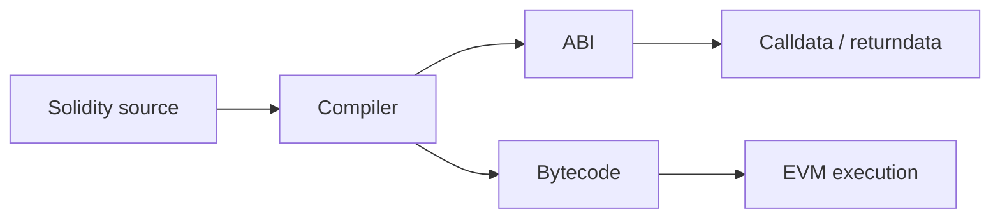

# Q25. immutable 与 constant 有什么区别？

> **难度** ★★ | **高频度** ★★★★☆ | **岗位** Solidity/Gas | **PDF** 第 31 页
>
> 本文件以 PDF 中 Q25 为主干；“GitHub 扩展”部分是在原内容上增加的工程化学习材料。原 PDF：[Jianzhi_Web3_Offer_100_Interview_Questions_2026.pdf](../../assets/pdf/Jianzhi_Web3_Offer_100_Interview_Questions_2026.pdf).

## 1. 面试官为什么问这题

考察部署期配置与 runtime storage 成本。

### 高分回答的层级

- **L1 - 定义正确**：术语不混淆，先给一到两句话结论。
- **L2 - 原理可推导**：能解释为什么，以及底层状态/数据/执行路径。
- **L3 - Failure Mode**：主动说明什么时候结论不成立、常见攻击或工程故障。
- **L4 - Invariant / Trade-off**：能给出不变量、信任假设或系统设计取舍。

## 2. 30 秒标准回答

> `constant` 的值在编译期已知并直接嵌入字节码；`immutable` 可以在 constructor 阶段根据部署参数赋值一次，之后同样不可修改，通常通过 code 中的 immutable data 读取而不占普通 storage slot。

## 3. 原理深挖（PDF 主干）

### 3.1 关键推导

如果某个地址每个部署实例不同，例如 token/oracle/factory，immutable 很合适；如果值是协议全局固定数学常数，constant 更自然。Upgradeability 场景需要格外注意 constructor 与 implementation/proxy 语义。

### 3.2 关键推导

“不可修改”并不自动代表不可替换：如果合约本身是 proxy，implementation 代码升级仍可能改变读取和使用这些值的逻辑。

## 4. 白板模型



在面试中不必追求图漂亮；图的作用是让**状态、信任边界、调用方向或资产流**一眼可见。

## 5. 必须说出的关键点

- constant compile-time
- immutable constructor-time
- both cheaper than repeated SLOAD in many cases
- upgradeable contract constructor caveat

## 6. GitHub 扩展：工程化理解

下面内容是在 PDF 主干之上增加的生产/审计视角，用于把“知道概念”升级为“能落地”。

- 先讲 Solidity 语言语义，再落到 ABI/EVM；面试官通常希望看到你知道“编译器帮你做了什么”。
- 每个优化都要给安全边界：是否改变可读性、外部行为、overflow 语义、token compatibility。
- 生产合约回答要带版本意识：compiler、OpenZeppelin major version、optimizer/via-IR 都可能影响行为与布局。
- 测试策略至少覆盖 unit、fuzz、invariant 和 fork integration。

### 6.1 面试推导顺序

1. **先下定义**：用本题 30 秒回答建立边界。
2. **再给机制**：把对象、输入、状态变化或执行上下文说清楚。
3. **主动给失败模式**：从本题常见误区反推“哪里会出问题”。
4. **给 mitigation / 工程做法**：说明如何测试、监控或限制 blast radius。
5. **用 invariant 收尾**：让面试官看到你能从局部 API 上升到系统正确性。

### 6.2 验证 / 测试清单

- [ ] 写 unit test 覆盖边界输入与访问控制。
- [ ] 使用 fuzz 验证输入空间；对 stateful 合约补 invariant test。
- [ ] 若涉及升级，加入 storage-layout diff 与 initializer 测试。

<!-- PROFESSIONAL_ENRICHMENT_START -->
### 6.3 前置知识与概念边界

这题属于 **Solidity / 合约工程**。以下 6.3–6.12 属于 **GitHub 专业深化（通用工程知识与推导）**，并非 PDF 原文；PDF 主干仍以上文第 1–5 节为准。

在进入细节前，建议先确认下面三个前置层次：

- Solidity data location 与 ABI
- ERC 标准及 token 行为差异
- compiler checks、revert 与 event

本题已有关键点可以进一步拆成：

1. **constant compile-time**：面试中需要把它从关键词展开成“定义 → 机制 → 边界 → 工程后果”，不能只念术语。
2. **immutable constructor-time**：面试中需要把它从关键词展开成“定义 → 机制 → 边界 → 工程后果”，不能只念术语。
3. **both cheaper than repeated SLOAD in many cases**：面试中需要把它从关键词展开成“定义 → 机制 → 边界 → 工程后果”，不能只念术语。
4. **upgradeable contract constructor caveat**：面试中需要把它从关键词展开成“定义 → 机制 → 边界 → 工程后果”，不能只念术语。

> **边界原则**：能回答“它是什么”只能达到基础分；高级回答必须继续回答“它不是什么、依赖什么假设、失败时会怎样”。

### 6.4 形式化模型 / 白板推导

回答 Solidity 题时把“语言表面规则”下沉到 EVM：参数最终如何编码、状态变量落在哪个 slot、external call 产生什么 call frame、失败时哪些状态会回滚。这样才能解释 gas 与安全后果。

白板时建议固定使用以下推导顺序：

1. **对象**：列出参与者、状态、资产或数据结构；
2. **输入**：哪些交易/消息/价格/签名会驱动状态变化；
3. **规则**：哪些条件决定有效、排序、授权或价格；
4. **状态变化**：写出成功路径和失败/回滚路径；
5. **Invariant**：任何正常或恶意输入下必须保持什么；
6. **Trust assumption**：哪些条件不是代码能独立保证的。

### 6.5 本题最值得深挖的一层：constant/immutable 的部署语义

`constant` 在编译期确定；`immutable` 在 constructor 设置并固化进部署后的 code 访问路径。二者都不是可升级配置。

如果面试官继续追问，不要立刻换新术语。先从上述核心模型推出一个**具体后果**，再给一个**反例或边界条件**，最后说明**生产系统如何验证/缓解**。

### 6.6 生产工程决策

- API 设计先定义权限、失败语义和事件，再写函数体；外部接口是协议的一部分。
- 优化前做 profiling，优先减少状态写入、重复 SLOAD、无意义拷贝和外部调用。
- 兼容 ERC20/721/1155 时要考虑非标准返回值、callback/hook、fee-on-transfer 等现实行为。
- 生产合约必须有 compiler/version pin、static analysis、fuzz/invariant tests 与部署脚本审计。

对本题而言，工程答案最好至少包含一个“**正常路径**”和一个“**故障路径**”。前者证明你理解功能，后者证明你理解系统。

### 6.7 Threat Model / Failure Modes

把失败模式分成三类会更专业：

- **语义错误**：概念或状态模型理解错，导致实现从根上错误；
- **对抗性输入**：攻击者利用排序、回调、价格、签名、权限等主动破坏假设；
- **系统性故障**：RPC、节点、sequencer、oracle、数据库或管理员路径异常。

本题重点检查：

- 把 immutable 当 storage 里的只读变量。
- 在 proxy 系统里忽略 implementation 部署期状态。
- 把 visibility 当隐私机制
- 只按 happy path 处理 token transfer/approve
- unchecked 或 assembly 缺少数学边界证明
- event 与 storage 的职责混用导致链上状态不可验证

> 面试时最好把“风险”改写成可验证句式：**在条件 A 下，攻击者/故障 B 可以让状态 C 违反 invariant D，影响资产/可用性 E。**

### 6.8 测试策略：Unit → Fuzz → Invariant → Integration

- [ ] 边界值：0、1、max、空数组、重复调用
- [ ] fuzz ABI 输入与权限边界
- [ ] event 与 state transition 一致性断言
- [ ] gas regression + stateful invariant testing

进一步建议：

- **Unit test**：验证局部 API 与边界输入；
- **Fuzz test**：搜索你没有手工枚举的输入组合；
- **Invariant test**：验证任意调用序列下核心关系仍成立；
- **Integration/Fork test**：验证真实 token、oracle、RPC、链状态或跨合约行为；
- **Failure injection**：主动让依赖超时、重组、停机、返回异常，验证恢复路径。

### 6.9 可观测性与线上排障

如果这道题变成线上事故，不要只说“看日志”。先定义你要观察的**链上事实、派生状态与外部依赖**。本章常用信号包括：

- `custom error/revert selector`
- `关键 event 与状态对账`
- `gas per action`
- `异常 allowance/transfer failure 比例`

排障顺序建议固定为：

```text
用户现象
  ↓
确认 chain / tx / block / request identity
  ↓
确认 source of truth
  ↓
定位状态机停在哪一步
  ↓
查看依赖与权限变化
  ↓
复现 / simulate / trace
  ↓
决定 retry / rollback / pause / compensate
```

### 6.10 不同岗位如何回答同一道题

- **Solidity 视角**：强调 EVM 语义、storage/call context、gas、安全测试与部署约束。
- **高级面试升级**：最后补一句“这个结论依赖哪些假设、线上怎样观测、出现异常如何回滚/降级”，通常能明显区分 Senior 与纯知识型回答。

### 6.11 面试官评分 Rubric

| 层级 | 候选人表现 | 典型判断 |
|---|---|---|
| **0 - 术语记忆** | 只能给一句定义，追问就断 | 不足以独立处理生产问题 |
| **1 - 机制理解** | 能解释核心流程和关键对象 | 基础工程能力 |
| **2 - 边界意识** | 能主动指出前提、反例和 Failure Mode | 中高级候选人信号 |
| **3 - 工程闭环** | 能给测试、监控、回滚、兼容性与成本取舍 | Senior 信号 |
| **4 - 系统推导** | 能用 invariant / trust model 串起上下游并提出替代设计 | Staff / Protocol 信号 |

### 6.12 关联题：把知识连成网络

- [Q24 Solidity 0.8 之后为什么还会使用 unchecked？](q24.md)：建议用“相同底层机制 / 不同应用边界”方式对比复习。
- [Q26 Event 为什么通常比 storage 便宜？什么时候不能用 Event 替代 Storage？](q26.md)：建议用“相同底层机制 / 不同应用边界”方式对比复习。
- [Q23 receive() 与 fallback() 有什么区别？](q23.md)：建议用“相同底层机制 / 不同应用边界”方式对比复习。
- [Q27 Custom Error 为什么比 revert string 更适合生产合约？](q27.md)：建议用“相同底层机制 / 不同应用边界”方式对比复习。
- [Q22 view 与 pure 有什么区别？](q22.md)：建议用“相同底层机制 / 不同应用边界”方式对比复习。

不要把 100 题当成 100 个孤立答案。真正的面试常从当前题连续跳到 storage、signature、oracle、reorg、upgrade、MEV 或 system design；建立跨题连接比继续背更多定义更重要。
<!-- PROFESSIONAL_ENRICHMENT_END -->

## 7. 高频追问与回答方向

### 追问 1：为什么 upgradeable implementation 常用 initializer 而不是 constructor？

**回答方向：** proxy storage 不会执行 implementation constructor。

进一步展开时应回扣：`constant compile-time`，并至少补一个边界条件或反例。

### 追问 2：immutable 能否每个 proxy 不同？

**回答方向：** 通常 implementation immutable 对共享 implementation 是相同的，需谨慎。

进一步展开时应回扣：`immutable constructor-time`，并至少补一个边界条件或反例。

### 追问 3：constant array/struct 有何限制？

**回答方向：** 看编译器支持。

进一步展开时应回扣：`both cheaper than repeated SLOAD in many cases`，并至少补一个边界条件或反例。

## 8. 常见错误回答 / Gotchas

- **错误模式：** 把 immutable 当 storage 里的只读变量。
- **错误模式：** 在 proxy 系统里忽略 implementation 部署期状态。
- **面试修正方式：** 不要只换一个更专业的名词；要明确指出错误假设、给出正确模型，并说明该错误在生产环境可能造成的后果。

## 9. 记忆锚点

> constant 在“编译时固定”，immutable 在“部署时固定”。

## 10. 自测题

1. 不看本文，用 30 秒重新回答：**immutable 与 constant 有什么区别？**
2. 给出一个“定义正确但工程上会失败”的反例。
3. 给出至少一个可以自动化验证的 invariant / test。
4. 如果这是线上事故，你最先观察哪 3 个信号或状态？
5. 如果面试官要求把答案提升到 Staff 级，你会补哪一张状态机/信任边界图？

<!-- PROFESSIONAL_LAB_START -->
### 10.1 实战训练：把这题变成可展示的工程证据

**场景任务**：把 **immutable 与 constant 有什么区别** 落成一段最小 Solidity 示例：先写最直观版本，再写生产版本，并用测试证明两者在功能、安全或 gas 上的差异。

建议输出物：

1. 一张状态机 / 资产流 / 调用图；
2. 一份 10～30 行的最小代码、伪代码或数据结构；
3. 3 个 happy-path 测试 + 3 个 adversarial/failure-path 测试；
4. 至少 1 个 invariant；
5. 一段 2 分钟口述答案，要求不看稿；
6. 与 **Q24、Q26、Q23** 做一次对比复盘，说明相同底层机制与不同工程边界。

### 10.2 反向面试：你可以问面试官什么

为了判断团队真实工程成熟度，可以围绕本题反问：

- 这个系统当前最关键的 invariant / SLO 是什么？
- 过去出现过哪类与本题相关的线上事故或审计问题？
- 团队如何做 fork/invariant/failure-injection 测试？
- 协议升级或依赖变更时，谁负责 compatibility review 和 rollback plan？
- 哪些安全/可靠性判断是链上强制，哪些依赖 off-chain service 或人工流程？

这些问题既能帮助你了解岗位，也能体现你关注**长期正确性和运行质量**，而不只是完成一次编码任务。
<!-- PROFESSIONAL_LAB_END -->

## 11. 参考资料

### PDF 原始引用 / 对应官方资料
- 本题在 PDF 中未单独列出外部引用；其内容来自书内主干整理。

### GitHub 扩展阅读（2026-09 核验）
- [R5] [Solidity Documentation - Security Considerations](https://docs.soliditylang.org/en/latest/security-considerations.html)
- [R16] [Solidity Documentation - Contract ABI Specification](https://docs.soliditylang.org/en/latest/abi-spec.html)
- [R22] [OpenZeppelin Contracts - Contracts 5.x](https://docs.openzeppelin.com/contracts/5.x/)

> 注：协议和文档会更新；面试前应核验目标链、compiler、OpenZeppelin 与协议版本。

---

[← Q24](q24.md) · [本章目录](index.md) · [总目录](../index.md) · [Q26 →](q26.md)
