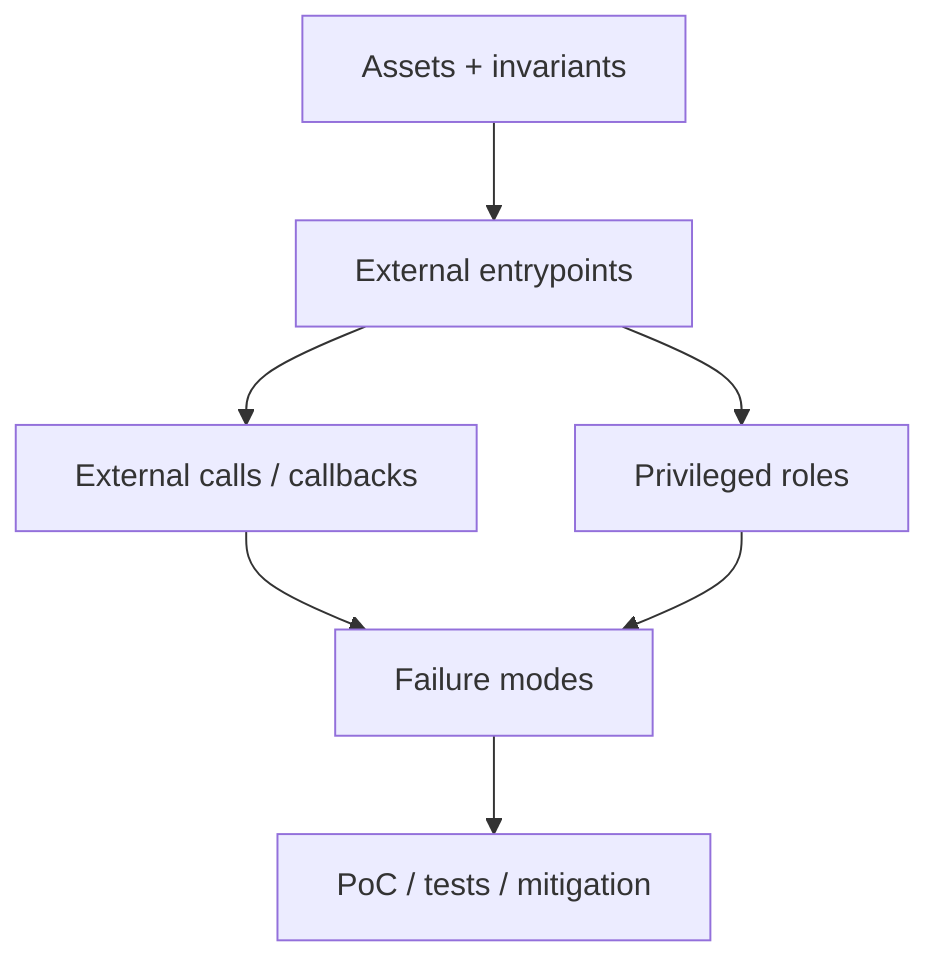

# Q40. 给你一份 200 行 Solidity 合约，如何系统做 Security Review？

> **难度** ★★★★★ | **高频度** ★★★★★ | **岗位** 安全/Senior/Protocol | **Core 30** | **PDF** 第 47 页
>
> 本文件以 PDF 中 Q40 为主干；“GitHub 扩展”部分是在原内容上增加的工程化学习材料。原 PDF：[Jianzhi_Web3_Offer_100_Interview_Questions_2026.pdf](../../assets/pdf/Jianzhi_Web3_Offer_100_Interview_Questions_2026.pdf).

## 1. 面试官为什么问这题

综合安全能力题，重点是方法论而非漏洞清单。

### 高分回答的层级

- **L1 - 定义正确**：术语不混淆，先给一到两句话结论。
- **L2 - 原理可推导**：能解释为什么，以及底层状态/数据/执行路径。
- **L3 - Failure Mode**：主动说明什么时候结论不成立、常见攻击或工程故障。
- **L4 - Invariant / Trade-off**：能给出不变量、信任假设或系统设计取舍。

## 2. 30 秒标准回答

> 先建立资产、角色、外部入口、状态机和不变量，再按每个外部调用路径分析权限、资金流、oracle、callback、算术、upgrade、DoS 和 token compatibility，最后用测试、静态工具和 fuzz 验证假设。

## 3. 原理深挖（PDF 主干）

### 3.1 关键推导

第一步不是跑 Slither，而是理解 specification：哪些资产必须永远守恒？哪些操作只能谁执行？哪个状态组合绝不能出现？如果不先写 invariant，工具输出只是噪声。

### 3.2 关键推导

第二步构造 threat model：攻击者可以控制 calldata、交易顺序、callback、临时资本、部分外部依赖和时间。第三步逐个 entrypoint 做状态转换表，特别标记 external calls 前后的中间状态。

### 3.3 关键推导

最后用工具增强人工审计：unit tests 覆盖正常路径，fuzz 覆盖边界，invariant tests 连续调用随机 action，static analyzer 找模式，fork tests 验证真实 token/oracle 兼容。

## 4. 白板模型



在面试中不必追求图漂亮；图的作用是让**状态、信任边界、调用方向或资产流**一眼可见。

## 5. 必须说出的关键点

- assets + trust boundaries
- invariants before vulnerabilities
- entrypoint/state-transition map
- external calls/oracles/upgrades are hotspots
- tooling validates hypotheses, not replaces reasoning

## 6. GitHub 扩展：工程化理解

下面内容是在 PDF 主干之上增加的生产/审计视角，用于把“知道概念”升级为“能落地”。

- 先列资产与不变量，再列可调用入口和 privileged roles；漏洞名称只是后续分类。
- 外部调用前后检查状态：可重入点、callback/hook、delegatecall、token fallback 都属于攻击面。
- 经济安全和代码安全一起看：oracle、liquidity、rounding、MEV、flash liquidity 都可能打破业务假设。
- 审计结论需要 severity、可利用前提、影响范围、PoC 思路和 mitigation，而不是只说“有风险”。

### 6.1 面试推导顺序

1. **先下定义**：用本题 30 秒回答建立边界。
2. **再给机制**：把对象、输入、状态变化或执行上下文说清楚。
3. **主动给失败模式**：从本题常见误区反推“哪里会出问题”。
4. **给 mitigation / 工程做法**：说明如何测试、监控或限制 blast radius。
5. **用 invariant 收尾**：让面试官看到你能从局部 API 上升到系统正确性。

### 6.2 验证 / 测试清单

- [ ] 先写 invariant，再让 fuzz handler 反复调用所有外部入口。
- [ ] 准备恶意 receiver/token/oracle/mock 合约验证 callback 与异常返回。
- [ ] 使用静态分析 + 手工 review + fork test，避免只依赖单一工具。

<!-- PROFESSIONAL_ENRICHMENT_START -->
### 6.3 前置知识与概念边界

这题属于 **Smart Contract Security**。以下 6.3–6.12 属于 **GitHub 专业深化（通用工程知识与推导）**，并非 PDF 原文；PDF 主干仍以上文第 1–5 节为准。

在进入细节前，建议先确认下面三个前置层次：

- 资产与不变量建模
- EVM external call / delegatecall
- oracle、token hook、upgradeability 基础

本题已有关键点可以进一步拆成：

1. **assets + trust boundaries**：面试中需要把它从关键词展开成“定义 → 机制 → 边界 → 工程后果”，不能只念术语。
2. **invariants before vulnerabilities**：面试中需要把它从关键词展开成“定义 → 机制 → 边界 → 工程后果”，不能只念术语。
3. **entrypoint/state-transition map**：面试中需要把它从关键词展开成“定义 → 机制 → 边界 → 工程后果”，不能只念术语。
4. **external calls/oracles/upgrades are hotspots**：面试中需要把它从关键词展开成“定义 → 机制 → 边界 → 工程后果”，不能只念术语。
5. **tooling validates hypotheses, not replaces reasoning**：面试中需要把它从关键词展开成“定义 → 机制 → 边界 → 工程后果”，不能只念术语。

> **边界原则**：能回答“它是什么”只能达到基础分；高级回答必须继续回答“它不是什么、依赖什么假设、失败时会怎样”。

### 6.4 形式化模型 / 白板推导

安全题统一使用 `Assets → Entry Points → State Transitions → External Interactions → Privileged Roles → Invariants` 六步模型。漏洞名称只是分类结果，真正目标是证明攻击者能让某个 invariant 失效。

白板时建议固定使用以下推导顺序：

1. **对象**：列出参与者、状态、资产或数据结构；
2. **输入**：哪些交易/消息/价格/签名会驱动状态变化；
3. **规则**：哪些条件决定有效、排序、授权或价格；
4. **状态变化**：写出成功路径和失败/回滚路径；
5. **Invariant**：任何正常或恶意输入下必须保持什么；
6. **Trust assumption**：哪些条件不是代码能独立保证的。

### 6.5 本题最值得深挖的一层：Security Review 从 invariant 开始

最专业的审计不是扫漏洞列表，而是先列资产与 invariant，再从每个 external/privileged entrypoint 逆向寻找能破坏 invariant 的路径。

如果面试官继续追问，不要立刻换新术语。先从上述核心模型推出一个**具体后果**，再给一个**反例或边界条件**，最后说明**生产系统如何验证/缓解**。

### 6.6 生产工程决策

- 先写资产与不变量，再枚举攻击面；没有 invariant 的“审计”容易沦为模式匹配。
- 把所有外部调用视作潜在控制流转移，包括 token hook、callback、fallback、delegatecall 与 oracle read。
- 权限不是单一 owner：管理员、guardian、upgrader、oracle admin、keeper、pauser 都要单独建模。
- 把经济攻击纳入威胁模型：瞬时流动性、MEV、oracle 延迟、舍入、清算激励都可能击穿代码层假设。

对本题而言，工程答案最好至少包含一个“**正常路径**”和一个“**故障路径**”。前者证明你理解功能，后者证明你理解系统。

### 6.7 Threat Model / Failure Modes

把失败模式分成三类会更专业：

- **语义错误**：概念或状态模型理解错，导致实现从根上错误；
- **对抗性输入**：攻击者利用排序、回调、价格、签名、权限等主动破坏假设；
- **系统性故障**：RPC、节点、sequencer、oracle、数据库或管理员路径异常。

本题重点检查：

- 先跑自动扫描再理解协议。
- 逐行找“危险函数名”，但没有系统级 invariant。
- 只贴漏洞标签，不给可利用前提与资产影响
- 单函数视角忽略 cross-function / cross-contract 状态
- 管理员路径未纳入安全审计
- mitigation 修补症状但没有恢复 invariant

> 面试时最好把“风险”改写成可验证句式：**在条件 A 下，攻击者/故障 B 可以让状态 C 违反 invariant D，影响资产/可用性 E。**

### 6.8 测试策略：Unit → Fuzz → Invariant → Integration

- [ ] stateful fuzz / invariant：资产守恒、权限、份额/债务关系
- [ ] adversarial callback 合约测试重入与 hook
- [ ] fork test 模拟真实 oracle/liquidity/token 行为
- [ ] upgrade、pause、recovery 等 privileged path 单独测试

进一步建议：

- **Unit test**：验证局部 API 与边界输入；
- **Fuzz test**：搜索你没有手工枚举的输入组合；
- **Invariant test**：验证任意调用序列下核心关系仍成立；
- **Integration/Fork test**：验证真实 token、oracle、RPC、链状态或跨合约行为；
- **Failure injection**：主动让依赖超时、重组、停机、返回异常，验证恢复路径。

### 6.9 可观测性与线上排障

如果这道题变成线上事故，不要只说“看日志”。先定义你要观察的**链上事实、派生状态与外部依赖**。本章常用信号包括：

- `关键 invariant 的链上派生指标`
- `异常大额/高频调用`
- `oracle deviation/staleness`
- `admin/upgrader/guardian 行为审计日志`

排障顺序建议固定为：

```text
用户现象
  ↓
确认 chain / tx / block / request identity
  ↓
确认 source of truth
  ↓
定位状态机停在哪一步
  ↓
查看依赖与权限变化
  ↓
复现 / simulate / trace
  ↓
决定 retry / rollback / pause / compensate
```

### 6.10 不同岗位如何回答同一道题

- **安全 视角**：把攻击者能力、资产、不变量、可利用前提和 mitigation 说完整；不要止于 API 定义。
- **Senior 视角**：主动补 failure mode、migration/upgrade、observability 和 blast radius。
- **高级面试升级**：最后补一句“这个结论依赖哪些假设、线上怎样观测、出现异常如何回滚/降级”，通常能明显区分 Senior 与纯知识型回答。

### 6.11 面试官评分 Rubric

| 层级 | 候选人表现 | 典型判断 |
|---|---|---|
| **0 - 术语记忆** | 只能给一句定义，追问就断 | 不足以独立处理生产问题 |
| **1 - 机制理解** | 能解释核心流程和关键对象 | 基础工程能力 |
| **2 - 边界意识** | 能主动指出前提、反例和 Failure Mode | 中高级候选人信号 |
| **3 - 工程闭环** | 能给测试、监控、回滚、兼容性与成本取舍 | Senior 信号 |
| **4 - 系统推导** | 能用 invariant / trust model 串起上下游并提出替代设计 | Staff / Protocol 信号 |

### 6.12 关联题：把知识连成网络

- [Q39 Upgradeable Contract 为什么不能随便改变 State Variable 顺序？](q39.md)：建议用“相同底层机制 / 不同应用边界”方式对比复习。
- [Q38 Transparent Proxy 与 UUPS Proxy 有什么区别？](q38.md)：建议用“相同底层机制 / 不同应用边界”方式对比复习。
- [Q37 Access Control 应如何设计？](q37.md)：建议用“相同底层机制 / 不同应用边界”方式对比复习。
- [Q36 Flash Loan 为什么不是漏洞本身？](q36.md)：建议用“相同底层机制 / 不同应用边界”方式对比复习。
- [Q31 什么是 Reentrancy？](q31.md)：建议用“相同底层机制 / 不同应用边界”方式对比复习。

不要把 100 题当成 100 个孤立答案。真正的面试常从当前题连续跳到 storage、signature、oracle、reorg、upgrade、MEV 或 system design；建立跨题连接比继续背更多定义更重要。
<!-- PROFESSIONAL_ENRICHMENT_END -->

## 7. 高频追问与回答方向

### 追问 1：你会优先看哪 5 个函数？

**回答方向：** 所有能移动资产/改变权限/升级/改价格参数的入口。

进一步展开时应回扣：`assets + trust boundaries`，并至少补一个边界条件或反例。

### 追问 2：如何审计一个陌生 DeFi 协议？

**回答方向：** 先把 accounting equations 写出来。

进一步展开时应回扣：`invariants before vulnerabilities`，并至少补一个边界条件或反例。

### 追问 3：测试通过是否代表安全？

**回答方向：** 不代表，只说明覆盖到的性质成立。

进一步展开时应回扣：`entrypoint/state-transition map`，并至少补一个边界条件或反例。

## 8. 常见错误回答 / Gotchas

- **错误模式：** 先跑自动扫描再理解协议。
- **错误模式：** 逐行找“危险函数名”，但没有系统级 invariant。
- **面试修正方式：** 不要只换一个更专业的名词；要明确指出错误假设、给出正确模型，并说明该错误在生产环境可能造成的后果。

## 9. 记忆锚点

> 安全审计的顺序：资产 -> 权限 -> 不变量 -> 状态机 -> 外部依赖 -> 对抗测试。

## 10. 自测题

1. 不看本文，用 30 秒重新回答：**给你一份 200 行 Solidity 合约，如何系统做 Security Review？**
2. 给出一个“定义正确但工程上会失败”的反例。
3. 给出至少一个可以自动化验证的 invariant / test。
4. 如果这是线上事故，你最先观察哪 3 个信号或状态？
5. 如果面试官要求把答案提升到 Staff 级，你会补哪一张状态机/信任边界图？

<!-- PROFESSIONAL_LAB_START -->
### 10.1 实战训练：把这题变成可展示的工程证据

**场景任务**：围绕 **给你一份 200 行 Solidity 合约，如何系统做 Security Review** 构造一个最小可利用场景：写出攻击者前提、资产、被破坏 invariant、调用序列、影响和 mitigation，并给出至少一个能长期防回归的 invariant test。

建议输出物：

1. 一张状态机 / 资产流 / 调用图；
2. 一份 10～30 行的最小代码、伪代码或数据结构；
3. 3 个 happy-path 测试 + 3 个 adversarial/failure-path 测试；
4. 至少 1 个 invariant；
5. 一段 2 分钟口述答案，要求不看稿；
6. 与 **Q39、Q38、Q37** 做一次对比复盘，说明相同底层机制与不同工程边界。

### 10.2 反向面试：你可以问面试官什么

为了判断团队真实工程成熟度，可以围绕本题反问：

- 这个系统当前最关键的 invariant / SLO 是什么？
- 过去出现过哪类与本题相关的线上事故或审计问题？
- 团队如何做 fork/invariant/failure-injection 测试？
- 协议升级或依赖变更时，谁负责 compatibility review 和 rollback plan？
- 哪些安全/可靠性判断是链上强制，哪些依赖 off-chain service 或人工流程？

这些问题既能帮助你了解岗位，也能体现你关注**长期正确性和运行质量**，而不只是完成一次编码任务。
<!-- PROFESSIONAL_LAB_END -->

## 11. 参考资料

### PDF 原始引用 / 对应官方资料
- 本题在 PDF 中未单独列出外部引用；其内容来自书内主干整理。

### GitHub 扩展阅读（2026-09 核验）
- [R5] [Solidity Documentation - Security Considerations](https://docs.soliditylang.org/en/latest/security-considerations.html)
- [R6] [OpenZeppelin Contracts - Access Control](https://docs.openzeppelin.com/contracts/5.x/access-control)
- [R7] [OpenZeppelin Contracts - Proxy - Transparent vs UUPS](https://docs.openzeppelin.com/contracts/5.x/api/proxy)
- [R8] [OpenZeppelin Upgrades Plugins - Storage compatibility / FAQ](https://docs.openzeppelin.com/upgrades-plugins/faq)
- [R23] [Foundry Book - Foundry documentation](https://book.getfoundry.sh/)

> 注：协议和文档会更新；面试前应核验目标链、compiler、OpenZeppelin 与协议版本。

---

[← Q39](q39.md) · [本章目录](index.md) · [总目录](../index.md) · [Q41 →](../05-defi/q41.md)
