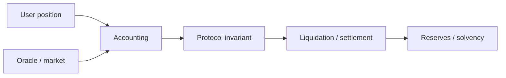

# Q49. Stablecoin 有哪些主要设计与 Failure Modes？

> **难度** ★★★ | **高频度** ★★★★☆ | **岗位** DeFi/协议 | **PDF** 第 57 页
>
> 本文件以 PDF 中 Q49 为主干；“GitHub 扩展”部分是在原内容上增加的工程化学习材料。原 PDF：[Jianzhi_Web3_Offer_100_Interview_Questions_2026.pdf](../../assets/pdf/Jianzhi_Web3_Offer_100_Interview_Questions_2026.pdf).

## 1. 面试官为什么问这题

不是考项目名，而是 peg mechanism 与资产负债表。

### 高分回答的层级

- **L1 - 定义正确**：术语不混淆，先给一到两句话结论。
- **L2 - 原理可推导**：能解释为什么，以及底层状态/数据/执行路径。
- **L3 - Failure Mode**：主动说明什么时候结论不成立、常见攻击或工程故障。
- **L4 - Invariant / Trade-off**：能给出不变量、信任假设或系统设计取舍。

## 2. 30 秒标准回答

> 可按主要 backing 分为法币储备型、链上超额抵押型、以及更多依赖内生资产/算法激励的设计。分析任何 stablecoin 都应问：1 unit 为什么应该值目标价格、谁能赎回、资产在哪里、压力下谁吸收损失。

## 3. 原理深挖（PDF 主干）

### 3.1 关键推导

法币储备型主要有托管、银行、赎回和监管风险；超额抵押型有 oracle、清算和 collateral volatility 风险；内生/算法模型尤其要警惕 reflexive death spiral：支撑资产价格与 stablecoin 信心同时下跌。

### 3.2 关键推导

Peg 不是“价格永远等于 1”，而是套利/赎回机制使偏离后有经济力量把价格拉回。分析时画清楚 mint、redeem、liquidation、reserve asset 和最后损失承担者。

## 4. 白板模型



在面试中不必追求图漂亮；图的作用是让**状态、信任边界、调用方向或资产流**一眼可见。

## 5. 必须说出的关键点

- peg mechanism
- redemption path
- reserve quality/liquidity
- loss absorber
- reflexivity

## 6. GitHub 扩展：工程化理解

下面内容是在 PDF 主干之上增加的生产/审计视角，用于把“知道概念”升级为“能落地”。

- 所有 DeFi 数学先标单位与 decimals，再讨论公式；很多事故来自单位、方向和舍入，而不是高深数学。
- 把协议写成 accounting invariants，例如 assets、shares、debt、collateral、fees 的守恒关系。
- 把 oracle、liquidity、liquidation 和 MEV 当作同一经济系统的一部分分析。
- 极端场景要覆盖低流动性、价格跳跃、拥堵、坏账、token 非标准行为和治理参数变化。
- 把 redemption path、reserve/collateral quality 和 liquidity stress 单独建模。

### 6.1 面试推导顺序

1. **先下定义**：用本题 30 秒回答建立边界。
2. **再给机制**：把对象、输入、状态变化或执行上下文说清楚。
3. **主动给失败模式**：从本题常见误区反推“哪里会出问题”。
4. **给 mitigation / 工程做法**：说明如何测试、监控或限制 blast radius。
5. **用 invariant 收尾**：让面试官看到你能从局部 API 上升到系统正确性。

### 6.2 验证 / 测试清单

- [ ] 对公式做 reference model / differential test。
- [ ] 覆盖 decimals、rounding、极端价格和极低流动性。
- [ ] 使用 fork test 模拟真实 token/oracle/pool 行为。

<!-- PROFESSIONAL_ENRICHMENT_START -->
### 6.3 前置知识与概念边界

这题属于 **DeFi / AMM / Lending**。以下 6.3–6.12 属于 **GitHub 专业深化（通用工程知识与推导）**，并非 PDF 原文；PDF 主干仍以上文第 1–5 节为准。

在进入细节前，建议先确认下面三个前置层次：

- token accounting 与 decimals
- AMM 定价/套利直觉
- oracle、抵押、清算与风险参数

本题已有关键点可以进一步拆成：

1. **peg mechanism**：面试中需要把它从关键词展开成“定义 → 机制 → 边界 → 工程后果”，不能只念术语。
2. **redemption path**：面试中需要把它从关键词展开成“定义 → 机制 → 边界 → 工程后果”，不能只念术语。
3. **reserve quality/liquidity**：面试中需要把它从关键词展开成“定义 → 机制 → 边界 → 工程后果”，不能只念术语。
4. **loss absorber**：面试中需要把它从关键词展开成“定义 → 机制 → 边界 → 工程后果”，不能只念术语。
5. **reflexivity**：面试中需要把它从关键词展开成“定义 → 机制 → 边界 → 工程后果”，不能只念术语。

> **边界原则**：能回答“它是什么”只能达到基础分；高级回答必须继续回答“它不是什么、依赖什么假设、失败时会怎样”。

### 6.4 形式化模型 / 白板推导

DeFi 题先写资产负债表和不变量：谁的资产进入协议、协议欠谁什么、价格从哪里来、何时允许价值转移。随后再讨论曲线、利率或清算参数，否则公式容易脱离经济语义。

白板时建议固定使用以下推导顺序：

1. **对象**：列出参与者、状态、资产或数据结构；
2. **输入**：哪些交易/消息/价格/签名会驱动状态变化；
3. **规则**：哪些条件决定有效、排序、授权或价格；
4. **状态变化**：写出成功路径和失败/回滚路径；
5. **Invariant**：任何正常或恶意输入下必须保持什么；
6. **Trust assumption**：哪些条件不是代码能独立保证的。

### 6.5 本题最值得深挖的一层：Stablecoin 先问“谁承担赎回承诺”

fiat-backed、crypto-collateralized、endogenous/algorithmic 方案的核心差异在资产负债表与 peg defense，而不是名称。

如果面试官继续追问，不要立刻换新术语。先从上述核心模型推出一个**具体后果**，再给一个**反例或边界条件**，最后说明**生产系统如何验证/缓解**。

### 6.6 生产工程决策

- 所有价格都写明 source、window、liquidity、staleness、decimal 与 fallback，不允许“price”成为黑盒变量。
- 对 shares/assets、collateral/debt、reserve/invariant 使用固定精度并定义舍入方向。
- 风险参数要考虑极端市场：流动性枯竭、gas 飙升、oracle 停更、相关性突变、坏账瀑布。
- 交易路径必须有 slippage/deadline/minOut 等用户保护，并考虑 MEV 与 sandwich 风险。

对本题而言，工程答案最好至少包含一个“**正常路径**”和一个“**故障路径**”。前者证明你理解功能，后者证明你理解系统。

### 6.7 Threat Model / Failure Modes

把失败模式分成三类会更专业：

- **语义错误**：概念或状态模型理解错，导致实现从根上错误；
- **对抗性输入**：攻击者利用排序、回调、价格、签名、权限等主动破坏假设；
- **系统性故障**：RPC、节点、sequencer、oracle、数据库或管理员路径异常。

本题重点检查：

- 把所有 stablecoin 都叫“算法稳定币”。
- 只看 reserve 数字，不看 redemption/legal control。
- 把 flash loan 当漏洞根因而忽略被放大的错误假设
- 用瞬时 spot price 作为高价值抵押定价
- 舍入/精度偏差在循环中累积为可提取价值
- 清算激励不足导致坏账，激励过高又伤害用户

> 面试时最好把“风险”改写成可验证句式：**在条件 A 下，攻击者/故障 B 可以让状态 C 违反 invariant D，影响资产/可用性 E。**

### 6.8 测试策略：Unit → Fuzz → Invariant → Integration

- [ ] 价格跳变、流动性枯竭、极端 decimals 的 fuzz
- [ ] 资产/份额/债务守恒 invariant
- [ ] 清算边界前后与 oracle stale 场景
- [ ] MEV/顺序敏感模拟和 fork-based integration test

进一步建议：

- **Unit test**：验证局部 API 与边界输入；
- **Fuzz test**：搜索你没有手工枚举的输入组合；
- **Invariant test**：验证任意调用序列下核心关系仍成立；
- **Integration/Fork test**：验证真实 token、oracle、RPC、链状态或跨合约行为；
- **Failure injection**：主动让依赖超时、重组、停机、返回异常，验证恢复路径。

### 6.9 可观测性与线上排障

如果这道题变成线上事故，不要只说“看日志”。先定义你要观察的**链上事实、派生状态与外部依赖**。本章常用信号包括：

- `TVL 与可用流动性`
- `health factor / utilization 分布`
- `oracle deviation/staleness`
- `bad debt / liquidation success rate`

排障顺序建议固定为：

```text
用户现象
  ↓
确认 chain / tx / block / request identity
  ↓
确认 source of truth
  ↓
定位状态机停在哪一步
  ↓
查看依赖与权限变化
  ↓
复现 / simulate / trace
  ↓
决定 retry / rollback / pause / compensate
```

### 6.10 不同岗位如何回答同一道题

- **协议 视角**：强调状态机、共识/经济假设、不变量、边界条件和 protocol-level trade-off。
- **DeFi 视角**：强调资产守恒、oracle、liquidity、rounding、清算与极端市场。
- **高级面试升级**：最后补一句“这个结论依赖哪些假设、线上怎样观测、出现异常如何回滚/降级”，通常能明显区分 Senior 与纯知识型回答。

### 6.11 面试官评分 Rubric

| 层级 | 候选人表现 | 典型判断 |
|---|---|---|
| **0 - 术语记忆** | 只能给一句定义，追问就断 | 不足以独立处理生产问题 |
| **1 - 机制理解** | 能解释核心流程和关键对象 | 基础工程能力 |
| **2 - 边界意识** | 能主动指出前提、反例和 Failure Mode | 中高级候选人信号 |
| **3 - 工程闭环** | 能给测试、监控、回滚、兼容性与成本取舍 | Senior 信号 |
| **4 - 系统推导** | 能用 invariant / trust model 串起上下游并提出替代设计 | Staff / Protocol 信号 |

### 6.12 关联题：把知识连成网络

- [Q48 Liquidation 的经济机制是什么？](q48.md)：建议用“相同底层机制 / 不同应用边界”方式对比复习。
- [Q50 设计 DeFi Protocol 时最重要的 Invariant 是什么？](q50.md)：建议用“相同底层机制 / 不同应用边界”方式对比复习。
- [Q47 为什么 DeFi Lending 通常需要 Over-collateralization？](q47.md)：建议用“相同底层机制 / 不同应用边界”方式对比复习。
- [Q46 Lending Protocol 的 Health Factor 是什么？](q46.md)：建议用“相同底层机制 / 不同应用边界”方式对比复习。
- [Q45 Uniswap V3 Tick 与 sqrtPriceX96 是什么？](q45.md)：建议用“相同底层机制 / 不同应用边界”方式对比复习。

不要把 100 题当成 100 个孤立答案。真正的面试常从当前题连续跳到 storage、signature、oracle、reorg、upgrade、MEV 或 system design；建立跨题连接比继续背更多定义更重要。
<!-- PROFESSIONAL_ENRICHMENT_END -->

## 7. 高频追问与回答方向

### 追问 1：为什么高流动性 redemption 比口头“100% backed”更重要？

**回答方向：** 压力时要能兑现。

进一步展开时应回扣：`peg mechanism`，并至少补一个边界条件或反例。

### 追问 2：稳定币作为 collateral 时如何处理 depeg？

**回答方向：** 动态 oracle 和 haircut。

进一步展开时应回扣：`redemption path`，并至少补一个边界条件或反例。

### 追问 3：跨链 wrapped stablecoin 多了什么风险？

**回答方向：** bridge risk。

进一步展开时应回扣：`reserve quality/liquidity`，并至少补一个边界条件或反例。

## 8. 常见错误回答 / Gotchas

- **错误模式：** 把所有 stablecoin 都叫“算法稳定币”。
- **错误模式：** 只看 reserve 数字，不看 redemption/legal control。
- **面试修正方式：** 不要只换一个更专业的名词；要明确指出错误假设、给出正确模型，并说明该错误在生产环境可能造成的后果。

## 9. 记忆锚点

> 问 stablecoin 四句话：拿什么支撑、怎么赎回、谁能套利、崩的时候谁先亏。

## 10. 自测题

1. 不看本文，用 30 秒重新回答：**Stablecoin 有哪些主要设计与 Failure Modes？**
2. 给出一个“定义正确但工程上会失败”的反例。
3. 给出至少一个可以自动化验证的 invariant / test。
4. 如果这是线上事故，你最先观察哪 3 个信号或状态？
5. 如果面试官要求把答案提升到 Staff 级，你会补哪一张状态机/信任边界图？

<!-- PROFESSIONAL_LAB_START -->
### 10.1 实战训练：把这题变成可展示的工程证据

**场景任务**：围绕 **Stablecoin 有哪些主要设计与 Failure Modes** 建立一张协议资产负债表，模拟价格跳变、流动性下降或高 gas 情况，说明哪个风险参数先触发、协议如何保持 solvency。

建议输出物：

1. 一张状态机 / 资产流 / 调用图；
2. 一份 10～30 行的最小代码、伪代码或数据结构；
3. 3 个 happy-path 测试 + 3 个 adversarial/failure-path 测试；
4. 至少 1 个 invariant；
5. 一段 2 分钟口述答案，要求不看稿；
6. 与 **Q48、Q50、Q47** 做一次对比复盘，说明相同底层机制与不同工程边界。

### 10.2 反向面试：你可以问面试官什么

为了判断团队真实工程成熟度，可以围绕本题反问：

- 这个系统当前最关键的 invariant / SLO 是什么？
- 过去出现过哪类与本题相关的线上事故或审计问题？
- 团队如何做 fork/invariant/failure-injection 测试？
- 协议升级或依赖变更时，谁负责 compatibility review 和 rollback plan？
- 哪些安全/可靠性判断是链上强制，哪些依赖 off-chain service 或人工流程？

这些问题既能帮助你了解岗位，也能体现你关注**长期正确性和运行质量**，而不只是完成一次编码任务。
<!-- PROFESSIONAL_LAB_END -->

## 11. 参考资料

### PDF 原始引用 / 对应官方资料
- 本题在 PDF 中未单独列出外部引用；其内容来自书内主干整理。

### GitHub 扩展阅读（2026-09 核验）
- [R9] [Uniswap - Uniswap v3 Core Whitepaper](https://app.uniswap.org/whitepaper-v3.pdf)
- [R10] [Aave - Health Factor & Liquidations](https://aave.com/help/borrowing/liquidations)

> 注：协议和文档会更新；面试前应核验目标链、compiler、OpenZeppelin 与协议版本。

---

[← Q48](q48.md) · [本章目录](index.md) · [总目录](../index.md) · [Q50 →](q50.md)
