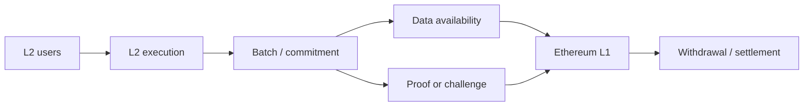

# Q51. 为什么 Ethereum 需要 Layer2？

> **难度** ★★ | **高频度** ★★★★★ | **岗位** 全岗位 | **PDF** 第 60 页
>
> 本文件以 PDF 中 Q51 为主干；“GitHub 扩展”部分是在原内容上增加的工程化学习材料。原 PDF：[Jianzhi_Web3_Offer_100_Interview_Questions_2026.pdf](../../assets/pdf/Jianzhi_Web3_Offer_100_Interview_Questions_2026.pdf).

## 1. 面试官为什么问这题

从全节点重复执行的安全模型推导扩容瓶颈。

### 高分回答的层级

- **L1 - 定义正确**：术语不混淆，先给一到两句话结论。
- **L2 - 原理可推导**：能解释为什么，以及底层状态/数据/执行路径。
- **L3 - Failure Mode**：主动说明什么时候结论不成立、常见攻击或工程故障。
- **L4 - Invariant / Trade-off**：能给出不变量、信任假设或系统设计取舍。

## 2. 30 秒标准回答

> L1 要求大量节点验证同一状态转换，因此不能无限提高每块计算和数据量。Rollup 把大量 execution 移到 L2，再把足够的数据和状态证明/争议机制锚定到 Ethereum，从而摊薄每笔交易的 L1 成本。

## 3. 原理深挖（PDF 主干）

### 3.1 关键推导

“把计算搬走”只是第一步。要继承 L1 安全，其他参与者仍必须能获得交易数据、验证状态转换，并在 sequencer 作恶或离线时有退出/强制包含路径。

### 3.2 关键推导

所以评价 L2 不能只看 TPS，要看 DA、proof system、bridge、sequencer、upgrade keys、forced inclusion 和 L1 settlement。

## 4. 白板模型



在面试中不必追求图漂亮；图的作用是让**状态、信任边界、调用方向或资产流**一眼可见。

## 5. 必须说出的关键点

- execution scales off L1
- security depends on DA + verification + settlement
- cost amortization via batching
- L2 has additional trust/liveness assumptions

## 6. GitHub 扩展：工程化理解

下面内容是在 PDF 主干之上增加的生产/审计视角，用于把“知道概念”升级为“能落地”。

- 先画安全模型：执行在哪里、数据在哪里、证明/挑战在哪里验证、最终结算在哪里。
- 区分 L2 inclusion、batch publication、L1 inclusion、L1 finality 和 withdrawal finality。
- 任何桥或 rollup 设计都要问：数据不可用、sequencer 离线、prover/challenger 失败时用户如何退出。
- 升级权限、pause/guardian、proof system 和 DA committee 都是 trust boundary。

### 6.1 面试推导顺序

1. **先下定义**：用本题 30 秒回答建立边界。
2. **再给机制**：把对象、输入、状态变化或执行上下文说清楚。
3. **主动给失败模式**：从本题常见误区反推“哪里会出问题”。
4. **给 mitigation / 工程做法**：说明如何测试、监控或限制 blast radius。
5. **用 invariant 收尾**：让面试官看到你能从局部 API 上升到系统正确性。

### 6.2 验证 / 测试清单

- [ ] 分别测试 L2 与 L1 侧状态机。
- [ ] 模拟 sequencer downtime、L1 reorg、challenge/proof delay。
- [ ] 桥接流程必须测试 duplicate message、replay、partial failure 与 escape path。

<!-- PROFESSIONAL_ENRICHMENT_START -->
### 6.3 前置知识与概念边界

这题属于 **Layer2 / Rollup / ZK / Bridge**。以下 6.3–6.12 属于 **GitHub 专业深化（通用工程知识与推导）**，并非 PDF 原文；PDF 主干仍以上文第 1–5 节为准。

在进入细节前，建议先确认下面三个前置层次：

- L1 execution/consensus/finality
- state root 与 Merkle commitment
- data availability、proof 与 bridge trust model

本题已有关键点可以进一步拆成：

1. **execution scales off L1**：面试中需要把它从关键词展开成“定义 → 机制 → 边界 → 工程后果”，不能只念术语。
2. **security depends on DA + verification + settlement**：面试中需要把它从关键词展开成“定义 → 机制 → 边界 → 工程后果”，不能只念术语。
3. **cost amortization via batching**：面试中需要把它从关键词展开成“定义 → 机制 → 边界 → 工程后果”，不能只念术语。
4. **L2 has additional trust/liveness assumptions**：面试中需要把它从关键词展开成“定义 → 机制 → 边界 → 工程后果”，不能只念术语。

> **边界原则**：能回答“它是什么”只能达到基础分；高级回答必须继续回答“它不是什么、依赖什么假设、失败时会怎样”。

### 6.4 形式化模型 / 白板推导

Rollup 题至少拆成四层：`Execution → State Commitment/Proof → Data Availability → Settlement/Finality`。Bridge 再额外加入“跨域消息真实性如何验证”。不要把低费用、proof 和 DA 混成一个概念。

白板时建议固定使用以下推导顺序：

1. **对象**：列出参与者、状态、资产或数据结构；
2. **输入**：哪些交易/消息/价格/签名会驱动状态变化；
3. **规则**：哪些条件决定有效、排序、授权或价格；
4. **状态变化**：写出成功路径和失败/回滚路径；
5. **Invariant**：任何正常或恶意输入下必须保持什么；
6. **Trust assumption**：哪些条件不是代码能独立保证的。

### 6.5 本题最值得深挖的一层：L2 扩容不是“绕开 Ethereum”

rollup 把执行移出 L1，但仍把 settlement/DA/proof 等安全关键部分锚定到 Ethereum。扩容收益来自批处理与摊销。

如果面试官继续追问，不要立刻换新术语。先从上述核心模型推出一个**具体后果**，再给一个**反例或边界条件**，最后说明**生产系统如何验证/缓解**。

### 6.6 生产工程决策

- 明确每个状态的最终性层级：L2 soft confirmation、batch posted、proof/challenge complete、L1 finalized。
- 把 sequencer/prover/batcher/bridge/admin 的故障与恶意行为分别建模。
- withdrawal 与 emergency exit 必须回答“最坏情况下用户如何拿回资产”。
- 数据发布、blob/call data、offchain DA 的成本与信任假设要一起讨论。

对本题而言，工程答案最好至少包含一个“**正常路径**”和一个“**故障路径**”。前者证明你理解功能，后者证明你理解系统。

### 6.7 Threat Model / Failure Modes

把失败模式分成三类会更专业：

- **语义错误**：概念或状态模型理解错，导致实现从根上错误；
- **对抗性输入**：攻击者利用排序、回调、价格、签名、权限等主动破坏假设；
- **系统性故障**：RPC、节点、sequencer、oracle、数据库或管理员路径异常。

本题重点检查：

- 把任何“跑在 Ethereum 旁边的链”都叫 L2。
- 只比较 TPS 和 gas。
- 把 validity proof 错当 data availability 保证
- 把 sequencer 停机等同于资金一定丢失
- bridge 只审计 Solidity 不审计跨链验证逻辑
- 忽视 upgrade keys / pause keys 带来的系统性信任

> 面试时最好把“风险”改写成可验证句式：**在条件 A 下，攻击者/故障 B 可以让状态 C 违反 invariant D，影响资产/可用性 E。**

### 6.8 测试策略：Unit → Fuzz → Invariant → Integration

- [ ] batch/proof/challenge 的状态机测试
- [ ] sequencer/prover/batcher 停机演练
- [ ] L1 reorg 与 delayed message 重放测试
- [ ] bridge message nonce/domain/source chain 验证

进一步建议：

- **Unit test**：验证局部 API 与边界输入；
- **Fuzz test**：搜索你没有手工枚举的输入组合；
- **Invariant test**：验证任意调用序列下核心关系仍成立；
- **Integration/Fork test**：验证真实 token、oracle、RPC、链状态或跨合约行为；
- **Failure injection**：主动让依赖超时、重组、停机、返回异常，验证恢复路径。

### 6.9 可观测性与线上排障

如果这道题变成线上事故，不要只说“看日志”。先定义你要观察的**链上事实、派生状态与外部依赖**。本章常用信号包括：

- `L2→L1 batch lag`
- `proof/challenge backlog`
- `DA publication success`
- `bridge message pending/failed/duplicate`

排障顺序建议固定为：

```text
用户现象
  ↓
确认 chain / tx / block / request identity
  ↓
确认 source of truth
  ↓
定位状态机停在哪一步
  ↓
查看依赖与权限变化
  ↓
复现 / simulate / trace
  ↓
决定 retry / rollback / pause / compensate
```

### 6.10 不同岗位如何回答同一道题

- **通用工程视角**：先给定义，再给机制、边界、失败模式、测试与生产取舍。
- **高级面试升级**：最后补一句“这个结论依赖哪些假设、线上怎样观测、出现异常如何回滚/降级”，通常能明显区分 Senior 与纯知识型回答。

### 6.11 面试官评分 Rubric

| 层级 | 候选人表现 | 典型判断 |
|---|---|---|
| **0 - 术语记忆** | 只能给一句定义，追问就断 | 不足以独立处理生产问题 |
| **1 - 机制理解** | 能解释核心流程和关键对象 | 基础工程能力 |
| **2 - 边界意识** | 能主动指出前提、反例和 Failure Mode | 中高级候选人信号 |
| **3 - 工程闭环** | 能给测试、监控、回滚、兼容性与成本取舍 | Senior 信号 |
| **4 - 系统推导** | 能用 invariant / trust model 串起上下游并提出替代设计 | Staff / Protocol 信号 |

### 6.12 关联题：把知识连成网络

- [Q52 Optimistic Rollup 的工作原理是什么？](q52.md)：建议用“相同底层机制 / 不同应用边界”方式对比复习。
- [Q53 ZK Rollup 与 Optimistic Rollup 的核心区别？](q53.md)：建议用“相同底层机制 / 不同应用边界”方式对比复习。
- [Q54 EIP-4844 为什么对 Rollup 重要？](q54.md)：建议用“相同底层机制 / 不同应用边界”方式对比复习。
- [Q55 Data Availability 到底是什么意思？](q55.md)：建议用“相同底层机制 / 不同应用边界”方式对比复习。
- [Q56 Sequencer 是什么？中心化 Sequencer 有哪些风险？](q56.md)：建议用“相同底层机制 / 不同应用边界”方式对比复习。

不要把 100 题当成 100 个孤立答案。真正的面试常从当前题连续跳到 storage、signature、oracle、reorg、upgrade、MEV 或 system design；建立跨题连接比继续背更多定义更重要。
<!-- PROFESSIONAL_ENRICHMENT_END -->

## 7. 高频追问与回答方向

### 追问 1：Sidechain 与 Rollup 最大区别？

**回答方向：** 是否把安全/数据验证锚定到 L1。

进一步展开时应回扣：`execution scales off L1`，并至少补一个边界条件或反例。

### 追问 2：为什么只把 state root 发 L1 不够？

**回答方向：** 没有数据无法重建状态。

进一步展开时应回扣：`security depends on DA + verification + settlement`，并至少补一个边界条件或反例。

### 追问 3：L2 出块快是否等于 finality 快？

**回答方向：** 不一定。

进一步展开时应回扣：`cost amortization via batching`，并至少补一个边界条件或反例。

## 8. 常见错误回答 / Gotchas

- **错误模式：** 把任何“跑在 Ethereum 旁边的链”都叫 L2。
- **错误模式：** 只比较 TPS 和 gas。
- **面试修正方式：** 不要只换一个更专业的名词；要明确指出错误假设、给出正确模型，并说明该错误在生产环境可能造成的后果。

## 9. 记忆锚点

> Rollup 的价值是“把执行批量化，同时保留足够证据让 L1 能裁决”。

## 10. 自测题

1. 不看本文，用 30 秒重新回答：**为什么 Ethereum 需要 Layer2？**
2. 给出一个“定义正确但工程上会失败”的反例。
3. 给出至少一个可以自动化验证的 invariant / test。
4. 如果这是线上事故，你最先观察哪 3 个信号或状态？
5. 如果面试官要求把答案提升到 Staff 级，你会补哪一张状态机/信任边界图？

<!-- PROFESSIONAL_LAB_START -->
### 10.1 实战训练：把这题变成可展示的工程证据

**场景任务**：围绕 **为什么 Ethereum 需要 Layer2** 画 `L2 → DA → L1` 状态时间线，分别标注用户看到成功、系统可挑战/证明、L1 finalized 的时点，并说明 sequencer/prover/DA 任一故障时用户资产怎样退出。

建议输出物：

1. 一张状态机 / 资产流 / 调用图；
2. 一份 10～30 行的最小代码、伪代码或数据结构；
3. 3 个 happy-path 测试 + 3 个 adversarial/failure-path 测试；
4. 至少 1 个 invariant；
5. 一段 2 分钟口述答案，要求不看稿；
6. 与 **Q52、Q53、Q54** 做一次对比复盘，说明相同底层机制与不同工程边界。

### 10.2 反向面试：你可以问面试官什么

为了判断团队真实工程成熟度，可以围绕本题反问：

- 这个系统当前最关键的 invariant / SLO 是什么？
- 过去出现过哪类与本题相关的线上事故或审计问题？
- 团队如何做 fork/invariant/failure-injection 测试？
- 协议升级或依赖变更时，谁负责 compatibility review 和 rollback plan？
- 哪些安全/可靠性判断是链上强制，哪些依赖 off-chain service 或人工流程？

这些问题既能帮助你了解岗位，也能体现你关注**长期正确性和运行质量**，而不只是完成一次编码任务。
<!-- PROFESSIONAL_LAB_END -->

## 11. 参考资料

### PDF 原始引用 / 对应官方资料
- 本题在 PDF 中未单独列出外部引用；其内容来自书内主干整理。

### GitHub 扩展阅读（2026-09 核验）
- [R2] [Ethereum Improvement Proposals - EIP-4844: Shard Blob Transactions](https://eips.ethereum.org/EIPS/eip-4844)
- [R19] [Ethereum.org - Optimistic Rollups](https://ethereum.org/developers/docs/scaling/optimistic-rollups/)
- [R20] [Ethereum.org - Zero-knowledge rollups](https://ethereum.org/developers/docs/scaling/zk-rollups/)
- [R21] [Ethereum.org - Data availability](https://ethereum.org/developers/docs/data-availability/)

> 注：协议和文档会更新；面试前应核验目标链、compiler、OpenZeppelin 与协议版本。

---

[← Q50](../05-defi/q50.md) · [本章目录](index.md) · [总目录](../index.md) · [Q52 →](q52.md)
