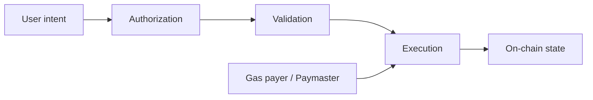

# Q65. ERC-2612 Permit 是什么？

> **难度** ★★★ | **高频度** ★★★★☆ | **岗位** DeFi/钱包 | **PDF** 第 75 页
>
> 本文件以 PDF 中 Q65 为主干；“GitHub 扩展”部分是在原内容上增加的工程化学习材料。原 PDF：[Jianzhi_Web3_Offer_100_Interview_Questions_2026.pdf](../../assets/pdf/Jianzhi_Web3_Offer_100_Interview_Questions_2026.pdf).

## 1. 面试官为什么问这题

典型 meta-authorization 题。

### 高分回答的层级

- **L1 - 定义正确**：术语不混淆，先给一到两句话结论。
- **L2 - 原理可推导**：能解释为什么，以及底层状态/数据/执行路径。
- **L3 - Failure Mode**：主动说明什么时候结论不成立、常见攻击或工程故障。
- **L4 - Invariant / Trade-off**：能给出不变量、信任假设或系统设计取舍。

## 2. 30 秒标准回答

> Permit 允许 token holder 在链下签署 allowance 授权，任何人把签名提交给 token contract 即可设置 allowance，因此用户无需先单独发送 approve transaction。

## 3. 原理深挖（PDF 主干）

### 3.1 关键推导

Permit 不是“免 gas”，而是把 owner 的 approve transaction 替换成签名；最终 permit + downstream action 仍由某个 relayer/spender transaction 执行。它改善“先 approve 再 swap”的两步 UX。

### 3.2 关键推导

安全关键仍是 EIP-712 domain、nonce、deadline 和 spender/amount 字段。不同 token 的 permit 实现可能存在兼容差异，前端不能盲目假设都支持。

## 4. 白板模型



在面试中不必追求图漂亮；图的作用是让**状态、信任边界、调用方向或资产流**一眼可见。

## 5. 必须说出的关键点

- offchain signed approval
- onchain relayer submits
- nonce/deadline/domain
- reduces one user transaction

## 6. GitHub 扩展：工程化理解

下面内容是在 PDF 主干之上增加的生产/审计视角，用于把“知道概念”升级为“能落地”。

- 把授权、执行和付费分开：谁证明“可以做”、谁真正执行、谁承担 gas。
- 所有签名问题默认检查 domain、chainId、verifying contract、nonce、deadline 与 action-specific fields。
- Smart wallet 设计不仅是 UX，还要包含 recovery、session key、module/plugin 权限和升级路径。
- ERC-4337 与 EIP-7702 要从“基础设施路线 vs protocol-level delegation”理解，而不是当作同一东西。

### 6.1 面试推导顺序

1. **先下定义**：用本题 30 秒回答建立边界。
2. **再给机制**：把对象、输入、状态变化或执行上下文说清楚。
3. **主动给失败模式**：从本题常见误区反推“哪里会出问题”。
4. **给 mitigation / 工程做法**：说明如何测试、监控或限制 blast radius。
5. **用 invariant 收尾**：让面试官看到你能从局部 API 上升到系统正确性。

### 6.2 验证 / 测试清单

- [ ] 签名必须测试错误 chainId/domain/nonce/deadline。
- [ ] 测试重放、批处理部分失败、paymaster 拒绝与 recovery。
- [ ] 对 module/session key 使用最小权限测试和过期/撤销测试。
- [ ] 对同一签名在不同链、不同合约、不同 nonce 上重复提交。

<!-- PROFESSIONAL_ENRICHMENT_START -->
### 6.3 前置知识与概念边界

这题属于 **Wallet / Signature / Account Abstraction**。以下 6.3–6.12 属于 **GitHub 专业深化（通用工程知识与推导）**，并非 PDF 原文；PDF 主干仍以上文第 1–5 节为准。

在进入细节前，建议先确认下面三个前置层次：

- ECDSA/签名验证基础
- nonce、domain separation 与 replay protection
- EOA、smart account 与 transaction lifecycle

本题已有关键点可以进一步拆成：

1. **offchain signed approval**：面试中需要把它从关键词展开成“定义 → 机制 → 边界 → 工程后果”，不能只念术语。
2. **onchain relayer submits**：面试中需要把它从关键词展开成“定义 → 机制 → 边界 → 工程后果”，不能只念术语。
3. **nonce/deadline/domain**：面试中需要把它从关键词展开成“定义 → 机制 → 边界 → 工程后果”，不能只念术语。
4. **reduces one user transaction**：面试中需要把它从关键词展开成“定义 → 机制 → 边界 → 工程后果”，不能只念术语。

> **边界原则**：能回答“它是什么”只能达到基础分；高级回答必须继续回答“它不是什么、依赖什么假设、失败时会怎样”。

### 6.4 形式化模型 / 白板推导

钱包题统一拆成 `Intent → Authorization → Validation → Execution → Gas Payment → Recovery`。签名只是 authorization 的一种载体；真正安全边界由 domain、nonce、权限范围、过期时间和执行上下文共同决定。

白板时建议固定使用以下推导顺序：

1. **对象**：列出参与者、状态、资产或数据结构；
2. **输入**：哪些交易/消息/价格/签名会驱动状态变化；
3. **规则**：哪些条件决定有效、排序、授权或价格；
4. **状态变化**：写出成功路径和失败/回滚路径；
5. **Invariant**：任何正常或恶意输入下必须保持什么；
6. **Trust assumption**：哪些条件不是代码能独立保证的。

### 6.5 本题最值得深挖的一层：Permit 把 approve 的授权从 transaction 变为 signature

spender/relayer 可提交签名完成 allowance 设置；安全仍依赖 nonce、deadline、domain 与 token 实现正确性。

如果面试官继续追问，不要立刻换新术语。先从上述核心模型推出一个**具体后果**，再给一个**反例或边界条件**，最后说明**生产系统如何验证/缓解**。

### 6.6 生产工程决策

- 签名结构必须绑定 chain/domain/action/nonce/deadline，不能只签“看起来唯一”的 message。
- owner、guardian、session key、module、paymaster 各自使用最小权限与独立撤销路径。
- AA 系统要把 validation gas、execution gas、sponsor policy 和 bundler failure 分开观测。
- UX 必须展示真实授权范围，避免无限授权、隐式 delegation 或不可理解的 typed data。

对本题而言，工程答案最好至少包含一个“**正常路径**”和一个“**故障路径**”。前者证明你理解功能，后者证明你理解系统。

### 6.7 Threat Model / Failure Modes

把失败模式分成三类会更专业：

- **语义错误**：概念或状态模型理解错，导致实现从根上错误；
- **对抗性输入**：攻击者利用排序、回调、价格、签名、权限等主动破坏假设；
- **系统性故障**：RPC、节点、sequencer、oracle、数据库或管理员路径异常。

本题重点检查：

- 说“permit 不需要任何链上交易”。
- 忽略签名 nonce。
- 跨链/跨合约/跨函数 replay
- 恢复/升级路径权限大于日常 owner
- session key 无到期或 scope 过宽
- paymaster 被 griefing 或 sponsor policy 可绕过

> 面试时最好把“风险”改写成可验证句式：**在条件 A 下，攻击者/故障 B 可以让状态 C 违反 invariant D，影响资产/可用性 E。**

### 6.8 测试策略：Unit → Fuzz → Invariant → Integration

- [ ] 错误 chainId/domain/nonce/deadline 的签名拒绝测试
- [ ] 批处理部分失败与原子性测试
- [ ] recovery/module/session-key 撤销与过期
- [ ] bundler/paymaster 拒绝、超时、gas 边界测试

进一步建议：

- **Unit test**：验证局部 API 与边界输入；
- **Fuzz test**：搜索你没有手工枚举的输入组合；
- **Invariant test**：验证任意调用序列下核心关系仍成立；
- **Integration/Fork test**：验证真实 token、oracle、RPC、链状态或跨合约行为；
- **Failure injection**：主动让依赖超时、重组、停机、返回异常，验证恢复路径。

### 6.9 可观测性与线上排障

如果这道题变成线上事故，不要只说“看日志”。先定义你要观察的**链上事实、派生状态与外部依赖**。本章常用信号包括：

- `signature validation failure`
- `nonce gap / replay attempts`
- `UserOp inclusion latency`
- `paymaster spend / rejection reason`

排障顺序建议固定为：

```text
用户现象
  ↓
确认 chain / tx / block / request identity
  ↓
确认 source of truth
  ↓
定位状态机停在哪一步
  ↓
查看依赖与权限变化
  ↓
复现 / simulate / trace
  ↓
决定 retry / rollback / pause / compensate
```

### 6.10 不同岗位如何回答同一道题

- **钱包 视角**：强调签名域、nonce/replay、用户授权范围、链切换与错误恢复。
- **DeFi 视角**：强调资产守恒、oracle、liquidity、rounding、清算与极端市场。
- **高级面试升级**：最后补一句“这个结论依赖哪些假设、线上怎样观测、出现异常如何回滚/降级”，通常能明显区分 Senior 与纯知识型回答。

### 6.11 面试官评分 Rubric

| 层级 | 候选人表现 | 典型判断 |
|---|---|---|
| **0 - 术语记忆** | 只能给一句定义，追问就断 | 不足以独立处理生产问题 |
| **1 - 机制理解** | 能解释核心流程和关键对象 | 基础工程能力 |
| **2 - 边界意识** | 能主动指出前提、反例和 Failure Mode | 中高级候选人信号 |
| **3 - 工程闭环** | 能给测试、监控、回滚、兼容性与成本取舍 | Senior 信号 |
| **4 - 系统推导** | 能用 invariant / trust model 串起上下游并提出替代设计 | Staff / Protocol 信号 |

### 6.12 关联题：把知识连成网络

- [Q64 EIP-712 解决什么问题？](q64.md)：建议用“相同底层机制 / 不同应用边界”方式对比复习。
- [Q66 Account Abstraction 解决哪些 UX 与安全问题？](q66.md)：建议用“相同底层机制 / 不同应用边界”方式对比复习。
- [Q63 什么是 Signature Replay Attack？](q63.md)：建议用“相同底层机制 / 不同应用边界”方式对比复习。
- [Q67 ERC-4337 的 UserOperation 与 EntryPoint 流程是什么？](q67.md)：建议用“相同底层机制 / 不同应用边界”方式对比复习。
- [Q62 ecrecover 做什么？有哪些安全注意事项？](q62.md)：建议用“相同底层机制 / 不同应用边界”方式对比复习。

不要把 100 题当成 100 个孤立答案。真正的面试常从当前题连续跳到 storage、signature、oracle、reorg、upgrade、MEV 或 system design；建立跨题连接比继续背更多定义更重要。
<!-- PROFESSIONAL_ENRICHMENT_END -->

## 7. 高频追问与回答方向

### 追问 1：Permit2 与 ERC-2612 思路有何不同？

**回答方向：** 外部统一授权层与更丰富权限模型。

进一步展开时应回扣：`offchain signed approval`，并至少补一个边界条件或反例。

### 追问 2：为什么 permit 交易可以由别人提交？

**回答方向：** 签名已经证明 holder 授权。

进一步展开时应回扣：`onchain relayer submits`，并至少补一个边界条件或反例。

### 追问 3：front-running permit 会盗币吗？

**回答方向：** 如果 action 设计正确，抢先提交同授权不应改变 recipient/amount 语义。

进一步展开时应回扣：`nonce/deadline/domain`，并至少补一个边界条件或反例。

## 8. 常见错误回答 / Gotchas

- **错误模式：** 说“permit 不需要任何链上交易”。
- **错误模式：** 忽略签名 nonce。
- **面试修正方式：** 不要只换一个更专业的名词；要明确指出错误假设、给出正确模型，并说明该错误在生产环境可能造成的后果。

## 9. 记忆锚点

> Permit 把“我亲自发 approve 交易”变成“我签一个别人也能代交的 approve 授权”。

## 10. 自测题

1. 不看本文，用 30 秒重新回答：**ERC-2612 Permit 是什么？**
2. 给出一个“定义正确但工程上会失败”的反例。
3. 给出至少一个可以自动化验证的 invariant / test。
4. 如果这是线上事故，你最先观察哪 3 个信号或状态？
5. 如果面试官要求把答案提升到 Staff 级，你会补哪一张状态机/信任边界图？

<!-- PROFESSIONAL_LAB_START -->
### 10.1 实战训练：把这题变成可展示的工程证据

**场景任务**：围绕 **ERC-2612 Permit 是什么** 设计一次授权：明确 signer、domain、chainId、nonce、deadline、scope、gas payer 和 revoke path，然后逐项尝试 replay / privilege escalation。

建议输出物：

1. 一张状态机 / 资产流 / 调用图；
2. 一份 10～30 行的最小代码、伪代码或数据结构；
3. 3 个 happy-path 测试 + 3 个 adversarial/failure-path 测试；
4. 至少 1 个 invariant；
5. 一段 2 分钟口述答案，要求不看稿；
6. 与 **Q64、Q66、Q63** 做一次对比复盘，说明相同底层机制与不同工程边界。

### 10.2 反向面试：你可以问面试官什么

为了判断团队真实工程成熟度，可以围绕本题反问：

- 这个系统当前最关键的 invariant / SLO 是什么？
- 过去出现过哪类与本题相关的线上事故或审计问题？
- 团队如何做 fork/invariant/failure-injection 测试？
- 协议升级或依赖变更时，谁负责 compatibility review 和 rollback plan？
- 哪些安全/可靠性判断是链上强制，哪些依赖 off-chain service 或人工流程？

这些问题既能帮助你了解岗位，也能体现你关注**长期正确性和运行质量**，而不只是完成一次编码任务。
<!-- PROFESSIONAL_LAB_END -->

## 11. 参考资料

### PDF 原始引用 / 对应官方资料
- 本题在 PDF 中未单独列出外部引用；其内容来自书内主干整理。

### GitHub 扩展阅读（2026-09 核验）
- [R11] [Ethereum Improvement Proposals - ERC-4337: Account Abstraction Using Alt Mempool](https://eips.ethereum.org/EIPS/eip-4337)
- [R3] [Ethereum Improvement Proposals - EIP-7702: Set Code for EOAs](https://eips.ethereum.org/EIPS/eip-7702)
- [R17] [Ethereum Improvement Proposals - EIP-712: Typed structured data hashing and signing](https://eips.ethereum.org/EIPS/eip-712)
- [R18] [Ethereum Improvement Proposals - ERC-2612: Permit Extension for EIP-20 Signed Approvals](https://eips.ethereum.org/EIPS/eip-2612)

> 注：协议和文档会更新；面试前应核验目标链、compiler、OpenZeppelin 与协议版本。

---

[← Q64](q64.md) · [本章目录](index.md) · [总目录](../index.md) · [Q66 →](q66.md)
