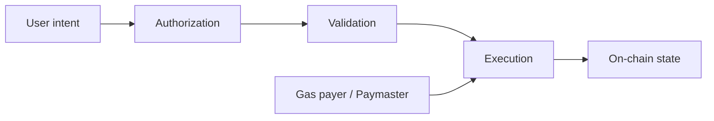

# Q69. EIP-7702 与 ERC-4337 是什么关系？

> **难度** ★★★★★ | **高频度** ★★★★★ | **岗位** AA/高级 Ethereum | **Core 30** | **PDF** 第 79 页
>
> 本文件以 PDF 中 Q69 为主干；“GitHub 扩展”部分是在原内容上增加的工程化学习材料。原 PDF：[Jianzhi_Web3_Offer_100_Interview_Questions_2026.pdf](../../assets/pdf/Jianzhi_Web3_Offer_100_Interview_Questions_2026.pdf).

## 1. 面试官为什么问这题

当前账户抽象的辨析题。

### 高分回答的层级

- **L1 - 定义正确**：术语不混淆，先给一到两句话结论。
- **L2 - 原理可推导**：能解释为什么，以及底层状态/数据/执行路径。
- **L3 - Failure Mode**：主动说明什么时候结论不成立、常见攻击或工程故障。
- **L4 - Invariant / Trade-off**：能给出不变量、信任假设或系统设计取舍。

## 2. 30 秒标准回答

> EIP-7702 是协议级新 transaction type，使 EOA 可通过 authorization 设置 delegation indicator，让调用执行委托合约代码，从而获得 batching、sponsorship、权限降级等能力；ERC-4337 则是无需 consensus 改动的 UserOperation/EntryPoint 基础设施。

## 3. 原理深挖（PDF 主干）

### 3.1 关键推导

二者不是简单替代。7702 让“现有 EOA 地址”获得智能账户式代码能力，4337 提供 bundler、paymaster、UserOp mempool 和统一 EntryPoint 生态。当前 ERC-4337 规范已明确 `Requires EIP-7702` 并包含 EIP-7702 delegated smart account 支持。

### 3.2 关键推导

安全上 7702 带来新的 EOA storage/code 语义、初始化 front-running、delegation target 安全和 sponsored relayer griefing 等问题。旧代码依赖 `tx.origin`/`code.length==0` 判断 EOA 的假设更脆弱。

## 4. 白板模型



在面试中不必追求图漂亮；图的作用是让**状态、信任边界、调用方向或资产流**一眼可见。

## 5. 必须说出的关键点

- 7702: protocol transaction + EOA code delegation
- 4337: alt mempool + UserOp + EntryPoint
- can be complementary
- legacy EOA assumptions break

## 6. GitHub 扩展：工程化理解

下面内容是在 PDF 主干之上增加的生产/审计视角，用于把“知道概念”升级为“能落地”。

- 把授权、执行和付费分开：谁证明“可以做”、谁真正执行、谁承担 gas。
- 所有签名问题默认检查 domain、chainId、verifying contract、nonce、deadline 与 action-specific fields。
- Smart wallet 设计不仅是 UX，还要包含 recovery、session key、module/plugin 权限和升级路径。
- ERC-4337 与 EIP-7702 要从“基础设施路线 vs protocol-level delegation”理解，而不是当作同一东西。
- 把 owner key、session key、guardian、module、paymaster 的权限域分别建模。
- UI 必须展示真实授权范围，不能让用户只看到不可理解的 raw hex。

### 6.1 面试推导顺序

1. **先下定义**：用本题 30 秒回答建立边界。
2. **再给机制**：把对象、输入、状态变化或执行上下文说清楚。
3. **主动给失败模式**：从本题常见误区反推“哪里会出问题”。
4. **给 mitigation / 工程做法**：说明如何测试、监控或限制 blast radius。
5. **用 invariant 收尾**：让面试官看到你能从局部 API 上升到系统正确性。

### 6.2 验证 / 测试清单

- [ ] 签名必须测试错误 chainId/domain/nonce/deadline。
- [ ] 测试重放、批处理部分失败、paymaster 拒绝与 recovery。
- [ ] 对 module/session key 使用最小权限测试和过期/撤销测试。

<!-- PROFESSIONAL_ENRICHMENT_START -->
### 6.3 前置知识与概念边界

这题属于 **Wallet / Signature / Account Abstraction**。以下 6.3–6.12 属于 **GitHub 专业深化（通用工程知识与推导）**，并非 PDF 原文；PDF 主干仍以上文第 1–5 节为准。

在进入细节前，建议先确认下面三个前置层次：

- ECDSA/签名验证基础
- nonce、domain separation 与 replay protection
- EOA、smart account 与 transaction lifecycle

本题已有关键点可以进一步拆成：

1. **7702: protocol transaction + EOA code delegation**：面试中需要把它从关键词展开成“定义 → 机制 → 边界 → 工程后果”，不能只念术语。
2. **4337: alt mempool + UserOp + EntryPoint**：面试中需要把它从关键词展开成“定义 → 机制 → 边界 → 工程后果”，不能只念术语。
3. **can be complementary**：面试中需要把它从关键词展开成“定义 → 机制 → 边界 → 工程后果”，不能只念术语。
4. **legacy EOA assumptions break**：面试中需要把它从关键词展开成“定义 → 机制 → 边界 → 工程后果”，不能只念术语。

> **边界原则**：能回答“它是什么”只能达到基础分；高级回答必须继续回答“它不是什么、依赖什么假设、失败时会怎样”。

### 6.4 形式化模型 / 白板推导

钱包题统一拆成 `Intent → Authorization → Validation → Execution → Gas Payment → Recovery`。签名只是 authorization 的一种载体；真正安全边界由 domain、nonce、权限范围、过期时间和执行上下文共同决定。

白板时建议固定使用以下推导顺序：

1. **对象**：列出参与者、状态、资产或数据结构；
2. **输入**：哪些交易/消息/价格/签名会驱动状态变化；
3. **规则**：哪些条件决定有效、排序、授权或价格；
4. **状态变化**：写出成功路径和失败/回滚路径；
5. **Invariant**：任何正常或恶意输入下必须保持什么；
6. **Trust assumption**：哪些条件不是代码能独立保证的。

### 6.5 本题最值得深挖的一层：7702 与 4337 是互补层次

7702 改变 EOA 可委托代码的协议能力；4337 提供 UserOp/bundler/paymaster/EntryPoint 生态。现代账户可结合二者而不是二选一。

如果面试官继续追问，不要立刻换新术语。先从上述核心模型推出一个**具体后果**，再给一个**反例或边界条件**，最后说明**生产系统如何验证/缓解**。

### 6.6 生产工程决策

- 签名结构必须绑定 chain/domain/action/nonce/deadline，不能只签“看起来唯一”的 message。
- owner、guardian、session key、module、paymaster 各自使用最小权限与独立撤销路径。
- AA 系统要把 validation gas、execution gas、sponsor policy 和 bundler failure 分开观测。
- UX 必须展示真实授权范围，避免无限授权、隐式 delegation 或不可理解的 typed data。

对本题而言，工程答案最好至少包含一个“**正常路径**”和一个“**故障路径**”。前者证明你理解功能，后者证明你理解系统。

### 6.7 Threat Model / Failure Modes

把失败模式分成三类会更专业：

- **语义错误**：概念或状态模型理解错，导致实现从根上错误；
- **对抗性输入**：攻击者利用排序、回调、价格、签名、权限等主动破坏假设；
- **系统性故障**：RPC、节点、sequencer、oracle、数据库或管理员路径异常。

本题重点检查：

- 说“7702 已经淘汰 4337”。
- 继续用 `address.code.length==0` 当人类用户判断。
- 跨链/跨合约/跨函数 replay
- 恢复/升级路径权限大于日常 owner
- session key 无到期或 scope 过宽
- paymaster 被 griefing 或 sponsor policy 可绕过

> 面试时最好把“风险”改写成可验证句式：**在条件 A 下，攻击者/故障 B 可以让状态 C 违反 invariant D，影响资产/可用性 E。**

### 6.8 测试策略：Unit → Fuzz → Invariant → Integration

- [ ] 错误 chainId/domain/nonce/deadline 的签名拒绝测试
- [ ] 批处理部分失败与原子性测试
- [ ] recovery/module/session-key 撤销与过期
- [ ] bundler/paymaster 拒绝、超时、gas 边界测试

进一步建议：

- **Unit test**：验证局部 API 与边界输入；
- **Fuzz test**：搜索你没有手工枚举的输入组合；
- **Invariant test**：验证任意调用序列下核心关系仍成立；
- **Integration/Fork test**：验证真实 token、oracle、RPC、链状态或跨合约行为；
- **Failure injection**：主动让依赖超时、重组、停机、返回异常，验证恢复路径。

### 6.9 可观测性与线上排障

如果这道题变成线上事故，不要只说“看日志”。先定义你要观察的**链上事实、派生状态与外部依赖**。本章常用信号包括：

- `signature validation failure`
- `nonce gap / replay attempts`
- `UserOp inclusion latency`
- `paymaster spend / rejection reason`

排障顺序建议固定为：

```text
用户现象
  ↓
确认 chain / tx / block / request identity
  ↓
确认 source of truth
  ↓
定位状态机停在哪一步
  ↓
查看依赖与权限变化
  ↓
复现 / simulate / trace
  ↓
决定 retry / rollback / pause / compensate
```

### 6.10 不同岗位如何回答同一道题

- **AA 视角**：强调 validation/execution/gas sponsorship/recovery/module permissions。
- **高级面试升级**：最后补一句“这个结论依赖哪些假设、线上怎样观测、出现异常如何回滚/降级”，通常能明显区分 Senior 与纯知识型回答。

### 6.11 面试官评分 Rubric

| 层级 | 候选人表现 | 典型判断 |
|---|---|---|
| **0 - 术语记忆** | 只能给一句定义，追问就断 | 不足以独立处理生产问题 |
| **1 - 机制理解** | 能解释核心流程和关键对象 | 基础工程能力 |
| **2 - 边界意识** | 能主动指出前提、反例和 Failure Mode | 中高级候选人信号 |
| **3 - 工程闭环** | 能给测试、监控、回滚、兼容性与成本取舍 | Senior 信号 |
| **4 - 系统推导** | 能用 invariant / trust model 串起上下游并提出替代设计 | Staff / Protocol 信号 |

### 6.12 关联题：把知识连成网络

- [Q68 ERC-4337 Paymaster 是做什么的？](q68.md)：建议用“相同底层机制 / 不同应用边界”方式对比复习。
- [Q67 ERC-4337 的 UserOperation 与 EntryPoint 流程是什么？](q67.md)：建议用“相同底层机制 / 不同应用边界”方式对比复习。
- [Q70 如何设计一个生产级 Smart Wallet？](q70.md)：建议用“相同底层机制 / 不同应用边界”方式对比复习。
- [Q66 Account Abstraction 解决哪些 UX 与安全问题？](q66.md)：建议用“相同底层机制 / 不同应用边界”方式对比复习。
- [Q65 ERC-2612 Permit 是什么？](q65.md)：建议用“相同底层机制 / 不同应用边界”方式对比复习。

不要把 100 题当成 100 个孤立答案。真正的面试常从当前题连续跳到 storage、signature、oracle、reorg、upgrade、MEV 或 system design；建立跨题连接比继续背更多定义更重要。
<!-- PROFESSIONAL_ENRICHMENT_END -->

## 7. 高频追问与回答方向

### 追问 1：7702 delegation 是复制 code 还是指向目标？

**回答方向：** 写入 delegation indicator 并执行目标 code。

进一步展开时应回扣：`7702: protocol transaction + EOA code delegation`，并至少补一个边界条件或反例。

### 追问 2：授权能跨链吗？

**回答方向：** authorization tuple chain_id 可约束语义。

进一步展开时应回扣：`4337: alt mempool + UserOp + EntryPoint`，并至少补一个边界条件或反例。

### 追问 3：为什么 4337 仍有价值？

**回答方向：** 完整 bundler/paymaster/mempool/account ecosystem。

进一步展开时应回扣：`can be complementary`，并至少补一个边界条件或反例。

## 8. 常见错误回答 / Gotchas

- **错误模式：** 说“7702 已经淘汰 4337”。
- **错误模式：** 继续用 `address.code.length==0` 当人类用户判断。
- **面试修正方式：** 不要只换一个更专业的名词；要明确指出错误假设、给出正确模型，并说明该错误在生产环境可能造成的后果。

## 9. 记忆锚点

> 7702 改“EOA 能不能像合约一样执行”；4337 改“用户操作怎样被验证、赞助和打包进链”。

## 10. 自测题

1. 不看本文，用 30 秒重新回答：**EIP-7702 与 ERC-4337 是什么关系？**
2. 给出一个“定义正确但工程上会失败”的反例。
3. 给出至少一个可以自动化验证的 invariant / test。
4. 如果这是线上事故，你最先观察哪 3 个信号或状态？
5. 如果面试官要求把答案提升到 Staff 级，你会补哪一张状态机/信任边界图？

<!-- PROFESSIONAL_LAB_START -->
### 10.1 实战训练：把这题变成可展示的工程证据

**场景任务**：围绕 **EIP-7702 与 ERC-4337 是什么关系** 设计一次授权：明确 signer、domain、chainId、nonce、deadline、scope、gas payer 和 revoke path，然后逐项尝试 replay / privilege escalation。

建议输出物：

1. 一张状态机 / 资产流 / 调用图；
2. 一份 10～30 行的最小代码、伪代码或数据结构；
3. 3 个 happy-path 测试 + 3 个 adversarial/failure-path 测试；
4. 至少 1 个 invariant；
5. 一段 2 分钟口述答案，要求不看稿；
6. 与 **Q68、Q67、Q70** 做一次对比复盘，说明相同底层机制与不同工程边界。

### 10.2 反向面试：你可以问面试官什么

为了判断团队真实工程成熟度，可以围绕本题反问：

- 这个系统当前最关键的 invariant / SLO 是什么？
- 过去出现过哪类与本题相关的线上事故或审计问题？
- 团队如何做 fork/invariant/failure-injection 测试？
- 协议升级或依赖变更时，谁负责 compatibility review 和 rollback plan？
- 哪些安全/可靠性判断是链上强制，哪些依赖 off-chain service 或人工流程？

这些问题既能帮助你了解岗位，也能体现你关注**长期正确性和运行质量**，而不只是完成一次编码任务。
<!-- PROFESSIONAL_LAB_END -->

## 11. 参考资料

### PDF 原始引用 / 对应官方资料
- [R3] [Ethereum Improvement Proposals - EIP-7702: Set Code for EOAs](https://eips.ethereum.org/EIPS/eip-7702)
- [R11] [Ethereum Improvement Proposals - ERC-4337: Account Abstraction Using Alt Mempool](https://eips.ethereum.org/EIPS/eip-4337)

### GitHub 扩展阅读（2026-09 核验）
- [R3] [Ethereum Improvement Proposals - EIP-7702: Set Code for EOAs](https://eips.ethereum.org/EIPS/eip-7702)
- [R11] [Ethereum Improvement Proposals - ERC-4337: Account Abstraction Using Alt Mempool](https://eips.ethereum.org/EIPS/eip-4337)
- [R17] [Ethereum Improvement Proposals - EIP-712: Typed structured data hashing and signing](https://eips.ethereum.org/EIPS/eip-712)
- [R18] [Ethereum Improvement Proposals - ERC-2612: Permit Extension for EIP-20 Signed Approvals](https://eips.ethereum.org/EIPS/eip-2612)

> 注：协议和文档会更新；面试前应核验目标链、compiler、OpenZeppelin 与协议版本。

---

[← Q68](q68.md) · [本章目录](index.md) · [总目录](../index.md) · [Q70 →](q70.md)
