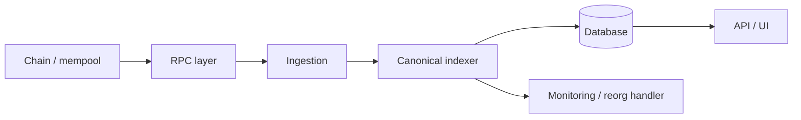

# Q79. Indexer 如何正确处理 Chain Reorg？

> **难度** ★★★★ | **高频度** ★★★★★ | **岗位** 后端/交易所 | **PDF** 第 90 页
>
> 本文件以 PDF 中 Q79 为主干；“GitHub 扩展”部分是在原内容上增加的工程化学习材料。原 PDF：[Jianzhi_Web3_Offer_100_Interview_Questions_2026.pdf](../../assets/pdf/Jianzhi_Web3_Offer_100_Interview_Questions_2026.pdf).

## 1. 面试官为什么问这题

真实生产事故题。

### 高分回答的层级

- **L1 - 定义正确**：术语不混淆，先给一到两句话结论。
- **L2 - 原理可推导**：能解释为什么，以及底层状态/数据/执行路径。
- **L3 - Failure Mode**：主动说明什么时候结论不成立、常见攻击或工程故障。
- **L4 - Invariant / Trade-off**：能给出不变量、信任假设或系统设计取舍。

## 2. 30 秒标准回答

> 每处理一个 block 都保存 number、hash、parentHash 以及该 block 对数据库造成的可逆变更。新 block 的 parentHash 与本地 canonical tip 不一致时，寻找 common ancestor，按逆序回滚 orphaned blocks，再应用新 canonical branch。

## 3. 原理深挖（PDF 主干）

### 3.1 关键推导

数据表最好带 `block_number/block_hash/tx_hash/log_index` 唯一身份，写入要幂等。对于余额/聚合值，可使用 append-only event + recompute，或记录 undo log/transactional delta。

### 3.2 关键推导

还应区分 `seen/pending/confirmed/finalized` 业务状态。高风险业务可以只在 finalized 后对用户产生不可逆外部副作用，或在提前 credit 时保留补偿机制。

## 4. 白板模型



在面试中不必追求图漂亮；图的作用是让**状态、信任边界、调用方向或资产流**一眼可见。

## 5. 必须说出的关键点

- parentHash continuity
- find common ancestor
- rollback orphan branch
- idempotent replay
- confirmation/finality states

## 6. GitHub 扩展：工程化理解

下面内容是在 PDF 主干之上增加的生产/审计视角，用于把“知道概念”升级为“能落地”。

- Web3 基础设施首先是分布式系统：timeout、retry、idempotency、backfill、canonicality、observability 一个都不能少。
- 链上成功与产品成功是两套状态机；RPC、indexer、DB 和 UI 都可能滞后或产生局部错误。
- 涉及 mempool/MEV 时要显式讨论信息泄露、排序权和竞争条件。
- 读链数据时永远保留 block number + block hash；只存高度不足以安全处理 reorg。

### 6.1 面试推导顺序

1. **先下定义**：用本题 30 秒回答建立边界。
2. **再给机制**：把对象、输入、状态变化或执行上下文说清楚。
3. **主动给失败模式**：从本题常见误区反推“哪里会出问题”。
4. **给 mitigation / 工程做法**：说明如何测试、监控或限制 blast radius。
5. **用 invariant 收尾**：让面试官看到你能从局部 API 上升到系统正确性。

### 6.2 验证 / 测试清单

- [ ] 模拟 provider timeout、不同 RPC 返回不一致和 rate limit。
- [ ] 构造 reorg/backfill/duplicate logs 验证幂等。
- [ ] 为关键 lag、error rate、head distance、queue depth 建监控。
- [ ] 人工制造短 reorg，核对 DB rollback、事件去重和最终一致性。

<!-- PROFESSIONAL_ENRICHMENT_START -->
### 6.3 前置知识与概念边界

这题属于 **Oracle / MEV / Infrastructure**。以下 6.3–6.12 属于 **GitHub 专业深化（通用工程知识与推导）**，并非 PDF 原文；PDF 主干仍以上文第 1–5 节为准。

在进入细节前，建议先确认下面三个前置层次：

- 节点/RPC 与 canonical chain
- mempool 与交易排序
- 事件日志、索引器与外部数据源

本题已有关键点可以进一步拆成：

1. **parentHash continuity**：面试中需要把它从关键词展开成“定义 → 机制 → 边界 → 工程后果”，不能只念术语。
2. **find common ancestor**：面试中需要把它从关键词展开成“定义 → 机制 → 边界 → 工程后果”，不能只念术语。
3. **rollback orphan branch**：面试中需要把它从关键词展开成“定义 → 机制 → 边界 → 工程后果”，不能只念术语。
4. **idempotent replay**：面试中需要把它从关键词展开成“定义 → 机制 → 边界 → 工程后果”，不能只念术语。
5. **confirmation/finality states**：面试中需要把它从关键词展开成“定义 → 机制 → 边界 → 工程后果”，不能只念术语。

> **边界原则**：能回答“它是什么”只能达到基础分；高级回答必须继续回答“它不是什么、依赖什么假设、失败时会怎样”。

### 6.4 形式化模型 / 白板推导

Infra 题要区分“链上共识事实”和“应用派生视图”。RPC、Indexer、Oracle 都是把底层状态暴露给上层的基础设施，但它们有不同一致性、可用性和信任模型。

白板时建议固定使用以下推导顺序：

1. **对象**：列出参与者、状态、资产或数据结构；
2. **输入**：哪些交易/消息/价格/签名会驱动状态变化；
3. **规则**：哪些条件决定有效、排序、授权或价格；
4. **状态变化**：写出成功路径和失败/回滚路径；
5. **Invariant**：任何正常或恶意输入下必须保持什么；
6. **Trust assumption**：哪些条件不是代码能独立保证的。

### 6.5 本题最值得深挖的一层：Reorg 处理的核心是可逆派生状态

每个派生更新必须能追溯到 block hash；检测 parent mismatch 后找到 common ancestor，回滚 orphaned blocks，再按新 canonical chain replay。

如果面试官继续追问，不要立刻换新术语。先从上述核心模型推出一个**具体后果**，再给一个**反例或边界条件**，最后说明**生产系统如何验证/缓解**。

### 6.6 生产工程决策

- 所有外部依赖都要定义 freshness、quorum/fallback、timeout、重试、幂等与降级策略。
- Indexer 永远按 block hash/parent hash 维护 canonical chain，不能只按递增 block number。
- RPC 多供应商需要做结果一致性校验，而不是简单 round-robin。
- MEV 风险要从公开意图、排序权和可提取价值三者分析，并优先设计用户保护。

对本题而言，工程答案最好至少包含一个“**正常路径**”和一个“**故障路径**”。前者证明你理解功能，后者证明你理解系统。

### 6.7 Threat Model / Failure Modes

把失败模式分成三类会更专业：

- **语义错误**：概念或状态模型理解错，导致实现从根上错误；
- **对抗性输入**：攻击者利用排序、回调、价格、签名、权限等主动破坏假设；
- **系统性故障**：RPC、节点、sequencer、oracle、数据库或管理员路径异常。

本题重点检查：

- 用 block number 作为唯一键，忽略同高度不同 hash。
- reorg 后只“覆盖新数据”但没删除旧派生状态。
- RPC 返回 stale/forked view 仍被业务当最终事实
- Indexer reorg 后重复/漏处理事件
- oracle source 单点或 staleness 未处理
- 公开 mempool 暴露订单意图导致顺序型攻击

> 面试时最好把“风险”改写成可验证句式：**在条件 A 下，攻击者/故障 B 可以让状态 C 违反 invariant D，影响资产/可用性 E。**

### 6.8 测试策略：Unit → Fuzz → Invariant → Integration

- [ ] 多 RPC 分歧与故障注入
- [ ] reorg rollback/replay/idempotency
- [ ] oracle stale/deviation/source-down 场景
- [ ] private/public submission 路径与顺序敏感仿真

进一步建议：

- **Unit test**：验证局部 API 与边界输入；
- **Fuzz test**：搜索你没有手工枚举的输入组合；
- **Invariant test**：验证任意调用序列下核心关系仍成立；
- **Integration/Fork test**：验证真实 token、oracle、RPC、链状态或跨合约行为；
- **Failure injection**：主动让依赖超时、重组、停机、返回异常，验证恢复路径。

### 6.9 可观测性与线上排障

如果这道题变成线上事故，不要只说“看日志”。先定义你要观察的**链上事实、派生状态与外部依赖**。本章常用信号包括：

- `RPC error/latency/head divergence`
- `indexer lag/reorg depth`
- `oracle update age/deviation`
- `mempool→inclusion latency / failed replacement`

排障顺序建议固定为：

```text
用户现象
  ↓
确认 chain / tx / block / request identity
  ↓
确认 source of truth
  ↓
定位状态机停在哪一步
  ↓
查看依赖与权限变化
  ↓
复现 / simulate / trace
  ↓
决定 retry / rollback / pause / compensate
```

### 6.10 不同岗位如何回答同一道题

- **后端 视角**：强调幂等、reorg、RPC/节点一致性、数据模型、重试与可观测性。
- **高级面试升级**：最后补一句“这个结论依赖哪些假设、线上怎样观测、出现异常如何回滚/降级”，通常能明显区分 Senior 与纯知识型回答。

### 6.11 面试官评分 Rubric

| 层级 | 候选人表现 | 典型判断 |
|---|---|---|
| **0 - 术语记忆** | 只能给一句定义，追问就断 | 不足以独立处理生产问题 |
| **1 - 机制理解** | 能解释核心流程和关键对象 | 基础工程能力 |
| **2 - 边界意识** | 能主动指出前提、反例和 Failure Mode | 中高级候选人信号 |
| **3 - 工程闭环** | 能给测试、监控、回滚、兼容性与成本取舍 | Senior 信号 |
| **4 - 系统推导** | 能用 invariant / trust model 串起上下游并提出替代设计 | Staff / Protocol 信号 |

### 6.12 关联题：把知识连成网络

- [Q78 为什么 Web3 应用通常需要 Indexer？](q78.md)：建议用“相同底层机制 / 不同应用边界”方式对比复习。
- [Q80 RPC Provider 挂了，生产 dApp 应如何降级？](q80.md)：建议用“相同底层机制 / 不同应用边界”方式对比复习。
- [Q77 Archive Node、Full Node、Light Client 有什么区别？](q77.md)：建议用“相同底层机制 / 不同应用边界”方式对比复习。
- [Q76 JSON-RPC 在 Web3 架构中是什么？](q76.md)：建议用“相同底层机制 / 不同应用边界”方式对比复习。
- [Q75 为什么 Public Mempool 会产生独特安全问题？](q75.md)：建议用“相同底层机制 / 不同应用边界”方式对比复习。

不要把 100 题当成 100 个孤立答案。真正的面试常从当前题连续跳到 storage、signature、oracle、reorg、upgrade、MEV 或 system design；建立跨题连接比继续背更多定义更重要。
<!-- PROFESSIONAL_ENRICHMENT_END -->

## 7. 高频追问与回答方向

### 追问 1：如果 reorg 深度超过本地缓存怎么办？

**回答方向：** 从持久 checkpoint 往回找。

进一步展开时应回扣：`parentHash continuity`，并至少补一个边界条件或反例。

### 追问 2：Webhook 已经发给外部系统怎么撤销？

**回答方向：** 需要补偿事件而不是幻想 exactly-once。

进一步展开时应回扣：`find common ancestor`，并至少补一个边界条件或反例。

### 追问 3：数据库怎样保证 rollback 原子？

**回答方向：** 每 block transaction/delta log。

进一步展开时应回扣：`rollback orphan branch`，并至少补一个边界条件或反例。

## 8. 常见错误回答 / Gotchas

- **错误模式：** 用 block number 作为唯一键，忽略同高度不同 hash。
- **错误模式：** reorg 后只“覆盖新数据”但没删除旧派生状态。
- **面试修正方式：** 不要只换一个更专业的名词；要明确指出错误假设、给出正确模型，并说明该错误在生产环境可能造成的后果。

## 9. 记忆锚点

> Reorg 处理的本质：数据库必须能把最近一段链“倒带”，再沿新分支重放。

## 10. 自测题

1. 不看本文，用 30 秒重新回答：**Indexer 如何正确处理 Chain Reorg？**
2. 给出一个“定义正确但工程上会失败”的反例。
3. 给出至少一个可以自动化验证的 invariant / test。
4. 如果这是线上事故，你最先观察哪 3 个信号或状态？
5. 如果面试官要求把答案提升到 Staff 级，你会补哪一张状态机/信任边界图？

<!-- PROFESSIONAL_LAB_START -->
### 10.1 实战训练：把这题变成可展示的工程证据

**场景任务**：围绕 **Indexer 如何正确处理 Chain Reorg** 做一次故障演练：让主 RPC/Oracle/Indexer 产生 stale 或 forked view，说明系统如何检测、切换、回滚以及避免重复副作用。

建议输出物：

1. 一张状态机 / 资产流 / 调用图；
2. 一份 10～30 行的最小代码、伪代码或数据结构；
3. 3 个 happy-path 测试 + 3 个 adversarial/failure-path 测试；
4. 至少 1 个 invariant；
5. 一段 2 分钟口述答案，要求不看稿；
6. 与 **Q78、Q80、Q77** 做一次对比复盘，说明相同底层机制与不同工程边界。

### 10.2 反向面试：你可以问面试官什么

为了判断团队真实工程成熟度，可以围绕本题反问：

- 这个系统当前最关键的 invariant / SLO 是什么？
- 过去出现过哪类与本题相关的线上事故或审计问题？
- 团队如何做 fork/invariant/failure-injection 测试？
- 协议升级或依赖变更时，谁负责 compatibility review 和 rollback plan？
- 哪些安全/可靠性判断是链上强制，哪些依赖 off-chain service 或人工流程？

这些问题既能帮助你了解岗位，也能体现你关注**长期正确性和运行质量**，而不只是完成一次编码任务。
<!-- PROFESSIONAL_LAB_END -->

## 11. 参考资料

### PDF 原始引用 / 对应官方资料
- 本题在 PDF 中未单独列出外部引用；其内容来自书内主干整理。

### GitHub 扩展阅读（2026-09 核验）
- [R1] [Ethereum.org - Ethereum Virtual Machine (EVM)](https://ethereum.org/developers/docs/evm/)

> 注：协议和文档会更新；面试前应核验目标链、compiler、OpenZeppelin 与协议版本。

---

[← Q78](q78.md) · [本章目录](index.md) · [总目录](../index.md) · [Q80 →](q80.md)
