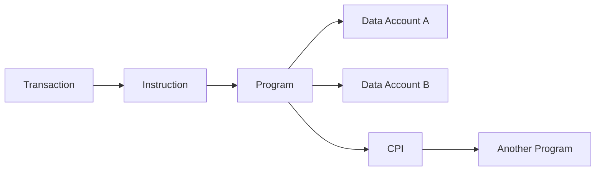

# Q90. 设计一个 Ethereum + Solana Wallet SDK。

> **难度** ★★★★★ | **高频度** ★★★★★ | **岗位** Wallet/Staff/Multi-chain | **PDF** 第 102 页
>
> 本文件以 PDF 中 Q90 为主干；“GitHub 扩展”部分是在原内容上增加的工程化学习材料。原 PDF：[Jianzhi_Web3_Offer_100_Interview_Questions_2026.pdf](../../assets/pdf/Jianzhi_Web3_Offer_100_Interview_Questions_2026.pdf).

## 1. 面试官为什么问这题

综合 SDK、签名、transaction lifecycle 与错误抽象题。

### 高分回答的层级

- **L1 - 定义正确**：术语不混淆，先给一到两句话结论。
- **L2 - 原理可推导**：能解释为什么，以及底层状态/数据/执行路径。
- **L3 - Failure Mode**：主动说明什么时候结论不成立、常见攻击或工程故障。
- **L4 - Invariant / Trade-off**：能给出不变量、信任假设或系统设计取舍。

## 2. 30 秒标准回答

> 建议用 chain adapter 架构：统一 account/session/intent API，EVM adapter 处理 nonce/EIP-1559/typed data/AA，Solana adapter 处理 recent blockhash/account metas/versioned transaction/fee payer；上层统一返回可观测 transaction state。

## 3. 原理深挖（PDF 主干）

### 3.1 关键推导

Key management 层不要假设同一 key algorithm：Ethereum 常见 secp256k1，Solana 常见 Ed25519。Signer interface 应面向“sign message/sign transaction capability”，而不是暴露 raw private key。

### 3.2 关键推导

Transaction builder、simulation、fee estimation、confirmation、token metadata、hardware wallet、RPC failover 都应模块化。失败状态必须保留链特定原因，例如 EVM replacement 与 Solana blockhash expired。

## 4. 白板模型



在面试中不必追求图漂亮；图的作用是让**状态、信任边界、调用方向或资产流**一眼可见。

## 5. 必须说出的关键点

- chain adapters
- signer capability interface
- transaction state machine
- simulation before send
- RPC redundancy
- hardware/session key support

## 6. GitHub 扩展：工程化理解

下面内容是在 PDF 主干之上增加的生产/审计视角，用于把“知道概念”升级为“能落地”。

- Solana 题先说清 `program` 与 `data account` 分离，再谈 signer/writable/owner 权限。
- PDA 问题要同时回答 derivation、off-curve、bump、创建账户和 `invoke_signed`。
- CPI 要检查 privilege propagation、account validation 与 reentrancy/composability。
- 并行性来自显式账户访问集合，而不是“Solana 天生所有交易并行”。
- 把 owner key、session key、guardian、module、paymaster 的权限域分别建模。
- UI 必须展示真实授权范围，不能让用户只看到不可理解的 raw hex。

### 6.1 面试推导顺序

1. **先下定义**：用本题 30 秒回答建立边界。
2. **再给机制**：把对象、输入、状态变化或执行上下文说清楚。
3. **主动给失败模式**：从本题常见误区反推“哪里会出问题”。
4. **给 mitigation / 工程做法**：说明如何测试、监控或限制 blast radius。
5. **用 invariant 收尾**：让面试官看到你能从局部 API 上升到系统正确性。

### 6.2 验证 / 测试清单

- [ ] 构造错误 owner/signer/writable account，确保程序拒绝。
- [ ] PDA 测试错误 seeds/bump 与未经授权的 CPI。
- [ ] 测试 account lock 冲突、compute budget 与交易原子回滚。

<!-- PROFESSIONAL_ENRICHMENT_START -->
### 6.3 前置知识与概念边界

这题属于 **Solana / Multi-chain**。以下 6.3–6.12 属于 **GitHub 专业深化（通用工程知识与推导）**，并非 PDF 原文；PDF 主干仍以上文第 1–5 节为准。

在进入细节前，建议先确认下面三个前置层次：

- Solana accounts/programs/instructions
- PDA/CPI/Signer 权限
- Ethereum 与 Solana transaction/state model 差异

本题已有关键点可以进一步拆成：

1. **chain adapters**：面试中需要把它从关键词展开成“定义 → 机制 → 边界 → 工程后果”，不能只念术语。
2. **signer capability interface**：面试中需要把它从关键词展开成“定义 → 机制 → 边界 → 工程后果”，不能只念术语。
3. **transaction state machine**：面试中需要把它从关键词展开成“定义 → 机制 → 边界 → 工程后果”，不能只念术语。
4. **simulation before send**：面试中需要把它从关键词展开成“定义 → 机制 → 边界 → 工程后果”，不能只念术语。
5. **RPC redundancy**：面试中需要把它从关键词展开成“定义 → 机制 → 边界 → 工程后果”，不能只念术语。
6. **hardware/session key support**：面试中需要把它从关键词展开成“定义 → 机制 → 边界 → 工程后果”，不能只念术语。

> **边界原则**：能回答“它是什么”只能达到基础分；高级回答必须继续回答“它不是什么、依赖什么假设、失败时会怎样”。

### 6.4 形式化模型 / 白板推导

Solana 题用 `Program Code + Explicit Accounts + Runtime Ownership/Locks` 建模；多链题则抽象为统一 intent，但每条链保留独立的 address、fee、signing、finality、token 与 error semantics。

白板时建议固定使用以下推导顺序：

1. **对象**：列出参与者、状态、资产或数据结构；
2. **输入**：哪些交易/消息/价格/签名会驱动状态变化；
3. **规则**：哪些条件决定有效、排序、授权或价格；
4. **状态变化**：写出成功路径和失败/回滚路径；
5. **Invariant**：任何正常或恶意输入下必须保持什么；
6. **Trust assumption**：哪些条件不是代码能独立保证的。

### 6.5 本题最值得深挖的一层：Wallet SDK 要统一接口、保留链语义

公共层负责 intent、signer、status；adapter 层负责 chain-specific address/fee/transaction/finality。错误模型必须携带足够链上下文。

如果面试官继续追问，不要立刻换新术语。先从上述核心模型推出一个**具体后果**，再给一个**反例或边界条件**，最后说明**生产系统如何验证/缓解**。

### 6.6 生产工程决策

- 明确 writable/read-only/signer/owner 等 account 权限，避免把“传进来的 account”自动视为可信。
- PDA seeds、bump、program id 和初始化流程属于地址安全边界。
- CPI 需要重新审视权限传播、reentrancy-like composition 和 account aliasing。
- 多链 SDK 应统一接口但不能抹平链语义；finality、fee estimation、simulation 需要 per-chain adapter。

对本题而言，工程答案最好至少包含一个“**正常路径**”和一个“**故障路径**”。前者证明你理解功能，后者证明你理解系统。

### 6.7 Threat Model / Failure Modes

把失败模式分成三类会更专业：

- **语义错误**：概念或状态模型理解错，导致实现从根上错误；
- **对抗性输入**：攻击者利用排序、回调、价格、签名、权限等主动破坏假设；
- **系统性故障**：RPC、节点、sequencer、oracle、数据库或管理员路径异常。

本题重点检查：

- 一个 `privateKey: string` 贯穿所有模块。
- 把 chain-specific error 全部转换成 “Transaction failed”。
- account owner/signer 校验不足
- PDA seed domain 不清导致地址碰撞或权限混淆
- 多链统一抽象隐藏链特有失败语义
- 跨链 supply/accounting 只做“消息成功”而不做资产守恒

> 面试时最好把“风险”改写成可验证句式：**在条件 A 下，攻击者/故障 B 可以让状态 C 违反 invariant D，影响资产/可用性 E。**

### 6.8 测试策略：Unit → Fuzz → Invariant → Integration

- [ ] 错误 owner/signer/PDA seeds 的拒绝测试
- [ ] CPI 权限与 account aliasing
- [ ] 并发 writable account 冲突与 retry
- [ ] 跨链 mint/burn/lock accounting invariant

进一步建议：

- **Unit test**：验证局部 API 与边界输入；
- **Fuzz test**：搜索你没有手工枚举的输入组合；
- **Invariant test**：验证任意调用序列下核心关系仍成立；
- **Integration/Fork test**：验证真实 token、oracle、RPC、链状态或跨合约行为；
- **Failure injection**：主动让依赖超时、重组、停机、返回异常，验证恢复路径。

### 6.9 可观测性与线上排障

如果这道题变成线上事故，不要只说“看日志”。先定义你要观察的**链上事实、派生状态与外部依赖**。本章常用信号包括：

- `transaction simulation error`
- `account lock contention`
- `slot/finality lag`
- `跨链消息与 supply reconciliation`

排障顺序建议固定为：

```text
用户现象
  ↓
确认 chain / tx / block / request identity
  ↓
确认 source of truth
  ↓
定位状态机停在哪一步
  ↓
查看依赖与权限变化
  ↓
复现 / simulate / trace
  ↓
决定 retry / rollback / pause / compensate
```

### 6.10 不同岗位如何回答同一道题

- **Staff 视角**：从局部机制上升到端到端信任边界、SLO、控制面与事故恢复。
- **高级面试升级**：最后补一句“这个结论依赖哪些假设、线上怎样观测、出现异常如何回滚/降级”，通常能明显区分 Senior 与纯知识型回答。

### 6.11 面试官评分 Rubric

| 层级 | 候选人表现 | 典型判断 |
|---|---|---|
| **0 - 术语记忆** | 只能给一句定义，追问就断 | 不足以独立处理生产问题 |
| **1 - 机制理解** | 能解释核心流程和关键对象 | 基础工程能力 |
| **2 - 边界意识** | 能主动指出前提、反例和 Failure Mode | 中高级候选人信号 |
| **3 - 工程闭环** | 能给测试、监控、回滚、兼容性与成本取舍 | Senior 信号 |
| **4 - 系统推导** | 能用 invariant / trust model 串起上下游并提出替代设计 | Staff / Protocol 信号 |

### 6.12 关联题：把知识连成网络

- [Q89 Multi-chain Token 如何保证 Total Supply Invariant？](q89.md)：建议用“相同底层机制 / 不同应用边界”方式对比复习。
- [Q88 为什么 Multi-chain dApp 比单链难很多？](q88.md)：建议用“相同底层机制 / 不同应用边界”方式对比复习。
- [Q87 Ethereum 与 Solana Transaction Atomicity 有何异同？](q87.md)：建议用“相同底层机制 / 不同应用边界”方式对比复习。
- [Q86 Solana 为什么更容易并行执行某些 Transactions？](q86.md)：建议用“相同底层机制 / 不同应用边界”方式对比复习。
- [Q81 Ethereum 与 Solana 最大的编程模型区别是什么？](q81.md)：建议用“相同底层机制 / 不同应用边界”方式对比复习。

不要把 100 题当成 100 个孤立答案。真正的面试常从当前题连续跳到 storage、signature、oracle、reorg、upgrade、MEV 或 system design；建立跨题连接比继续背更多定义更重要。
<!-- PROFESSIONAL_ENRICHMENT_END -->

## 7. 高频追问与回答方向

### 追问 1：同一助记词能否派生两条链 keys？

**回答方向：** 可以通过不同 derivation curves/path，但实现需明确。

进一步展开时应回扣：`chain adapters`，并至少补一个边界条件或反例。

### 追问 2：如何防 dApp 请求错误链签名？

**回答方向：** domain/chain display + policy。

进一步展开时应回扣：`signer capability interface`，并至少补一个边界条件或反例。

### 追问 3：如何做 send retry？

**回答方向：** 重广播 signed bytes vs rebuild expired transaction 取决于链。

进一步展开时应回扣：`transaction state machine`，并至少补一个边界条件或反例。

## 8. 常见错误回答 / Gotchas

- **错误模式：** 一个 `privateKey: string` 贯穿所有模块。
- **错误模式：** 把 chain-specific error 全部转换成 “Transaction failed”。
- **面试修正方式：** 不要只换一个更专业的名词；要明确指出错误假设、给出正确模型，并说明该错误在生产环境可能造成的后果。

## 9. 记忆锚点

> 跨链钱包 SDK 的最高层抽象是“用户意图和状态机”，不是“所有链都有同一种 transaction”。

## 10. 自测题

1. 不看本文，用 30 秒重新回答：**设计一个 Ethereum + Solana Wallet SDK。**
2. 给出一个“定义正确但工程上会失败”的反例。
3. 给出至少一个可以自动化验证的 invariant / test。
4. 如果这是线上事故，你最先观察哪 3 个信号或状态？
5. 如果面试官要求把答案提升到 Staff 级，你会补哪一张状态机/信任边界图？

<!-- PROFESSIONAL_LAB_START -->
### 10.1 实战训练：把这题变成可展示的工程证据

**场景任务**：围绕 **设计一个 Ethereum + Solana Wallet SDK。** 同时画 Ethereum 与 Solana 的状态/账户访问，明确 signer、owner、writable accounts 与 finality，再说明统一 SDK 层应该暴露什么、隐藏什么。

建议输出物：

1. 一张状态机 / 资产流 / 调用图；
2. 一份 10～30 行的最小代码、伪代码或数据结构；
3. 3 个 happy-path 测试 + 3 个 adversarial/failure-path 测试；
4. 至少 1 个 invariant；
5. 一段 2 分钟口述答案，要求不看稿；
6. 与 **Q89、Q88、Q87** 做一次对比复盘，说明相同底层机制与不同工程边界。

### 10.2 反向面试：你可以问面试官什么

为了判断团队真实工程成熟度，可以围绕本题反问：

- 这个系统当前最关键的 invariant / SLO 是什么？
- 过去出现过哪类与本题相关的线上事故或审计问题？
- 团队如何做 fork/invariant/failure-injection 测试？
- 协议升级或依赖变更时，谁负责 compatibility review 和 rollback plan？
- 哪些安全/可靠性判断是链上强制，哪些依赖 off-chain service 或人工流程？

这些问题既能帮助你了解岗位，也能体现你关注**长期正确性和运行质量**，而不只是完成一次编码任务。
<!-- PROFESSIONAL_LAB_END -->

## 11. 参考资料

### PDF 原始引用 / 对应官方资料
- 本题在 PDF 中未单独列出外部引用；其内容来自书内主干整理。

### GitHub 扩展阅读（2026-09 核验）
- [R12] [Solana Documentation - Core Concepts](https://solana.com/docs/core)
- [R13] [Solana Documentation - Program Derived Addresses (PDAs)](https://solana.com/docs/core/pda)
- [R14] [Solana Documentation - Cross Program Invocation (CPI)](https://solana.com/docs/core/cpi)

> 注：协议和文档会更新；面试前应核验目标链、compiler、OpenZeppelin 与协议版本。

---

[← Q89](q89.md) · [本章目录](index.md) · [总目录](../index.md) · [Q91 →](../10-system-design-practice/q91.md)
