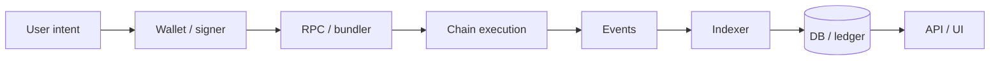

# Q93. System Design：设计一个 NFT Marketplace。

> **难度** ★★★★ | **高频度** ★★★★★ | **岗位** Solidity/全栈 | **PDF** 第 106 页
>
> 本文件以 PDF 中 Q93 为主干；“GitHub 扩展”部分是在原内容上增加的工程化学习材料。原 PDF：[Jianzhi_Web3_Offer_100_Interview_Questions_2026.pdf](../../assets/pdf/Jianzhi_Web3_Offer_100_Interview_Questions_2026.pdf).

## 1. 面试官为什么问这题

综合订单、授权、签名、结算和索引。

### 高分回答的层级

- **L1 - 定义正确**：术语不混淆，先给一到两句话结论。
- **L2 - 原理可推导**：能解释为什么，以及底层状态/数据/执行路径。
- **L3 - Failure Mode**：主动说明什么时候结论不成立、常见攻击或工程故障。
- **L4 - Invariant / Trade-off**：能给出不变量、信任假设或系统设计取舍。

## 2. 30 秒标准回答

> 先决定 listing 是 onchain custody/状态还是 offchain signed order。现代高效设计常让 seller 保留 NFT，通过 EIP-712 签订单，成交时 settlement contract 验签、nonce/expiry、ownership/approval，并原子转移 NFT 与资金。

## 3. 原理深挖（PDF 主干）

### 3.1 关键推导

订单至少绑定 maker、asset contract、tokenId/amount、payment token、price、nonce、expiry、chain/domain。取消可用 per-order nonce、counter increment 或 bitmap。

### 3.2 关键推导

结算要处理 royalties/fees、ERC721/1155、安全转账 callback、fee-on-transfer token、native ETH refund、partial fill（若支持）、reentrancy 和 signature replay。链下 order book/indexer 只是发现订单，链上 settlement 才是最终约束。

## 4. 白板模型



在面试中不必追求图漂亮；图的作用是让**状态、信任边界、调用方向或资产流**一眼可见。

## 5. 必须说出的关键点

- offchain order + onchain settlement
- EIP-712 domain/nonce/expiry
- approval/ownership checked at fill time
- atomic asset/payment transfer
- indexer is not source of truth

## 6. GitHub 扩展：工程化理解

下面内容是在 PDF 主干之上增加的生产/审计视角，用于把“知道概念”升级为“能落地”。

- 先澄清 functional / non-functional requirements，再画数据流和用户可见状态机。
- 列资产不变量和信任边界，再决定链上/链下边界、升级与权限模型。
- 故障设计覆盖 timeout、retry、idempotency、reorg、replacement、backfill、灾备和降级。
- 最后才谈吞吐、缓存、分片与成本；Staff 级答案必须给 observability 和 runbook。

### 6.1 面试推导顺序

1. **先下定义**：用本题 30 秒回答建立边界。
2. **再给机制**：把对象、输入、状态变化或执行上下文说清楚。
3. **主动给失败模式**：从本题常见误区反推“哪里会出问题”。
4. **给 mitigation / 工程做法**：说明如何测试、监控或限制 blast radius。
5. **用 invariant 收尾**：让面试官看到你能从局部 API 上升到系统正确性。

### 6.2 验证 / 测试清单

- [ ] 对状态机每个 transition 写幂等测试。
- [ ] 做故障注入：RPC、DB、queue、signer、oracle、sequencer。
- [ ] 对资产流做 double-entry/invariant reconciliation。

<!-- PROFESSIONAL_ENRICHMENT_START -->
### 6.3 前置知识与概念边界

这题属于 **System Design / Coding / Debug**。以下 6.3–6.12 属于 **GitHub 专业深化（通用工程知识与推导）**，并非 PDF 原文；PDF 主干仍以上文第 1–5 节为准。

在进入细节前，建议先确认下面三个前置层次：

- 前九章的状态、安全、DeFi 与 infra 基础
- 幂等、事务、队列、缓存、数据库与 SRE 基础
- 威胁建模与可观测性

本题已有关键点可以进一步拆成：

1. **offchain order + onchain settlement**：面试中需要把它从关键词展开成“定义 → 机制 → 边界 → 工程后果”，不能只念术语。
2. **EIP-712 domain/nonce/expiry**：面试中需要把它从关键词展开成“定义 → 机制 → 边界 → 工程后果”，不能只念术语。
3. **approval/ownership checked at fill time**：面试中需要把它从关键词展开成“定义 → 机制 → 边界 → 工程后果”，不能只念术语。
4. **atomic asset/payment transfer**：面试中需要把它从关键词展开成“定义 → 机制 → 边界 → 工程后果”，不能只念术语。
5. **indexer is not source of truth**：面试中需要把它从关键词展开成“定义 → 机制 → 边界 → 工程后果”，不能只念术语。

> **边界原则**：能回答“它是什么”只能达到基础分；高级回答必须继续回答“它不是什么、依赖什么假设、失败时会怎样”。

### 6.4 形式化模型 / 白板推导

系统设计题先分离 `On-chain source of truth`、`Off-chain orchestration` 和 `Derived read model`。然后画资产流、状态机、信任边界和失败恢复路径；最后才讨论具体数据库、队列或框架。

白板时建议固定使用以下推导顺序：

1. **对象**：列出参与者、状态、资产或数据结构；
2. **输入**：哪些交易/消息/价格/签名会驱动状态变化；
3. **规则**：哪些条件决定有效、排序、授权或价格；
4. **状态变化**：写出成功路径和失败/回滚路径；
5. **Invariant**：任何正常或恶意输入下必须保持什么；
6. **Trust assumption**：哪些条件不是代码能独立保证的。

### 6.5 本题最值得深挖的一层：Marketplace 的核心是订单状态机

listing/order、signature、nonce、expiry、fill、fee/royalty、asset transfer 共同构成结算协议。高级设计通常偏向 offchain order + onchain settlement。

如果面试官继续追问，不要立刻换新术语。先从上述核心模型推出一个**具体后果**，再给一个**反例或边界条件**，最后说明**生产系统如何验证/缓解**。

### 6.6 生产工程决策

- 先写功能/非功能需求和 invariant，再画组件图，避免一上来堆技术名词。
- 所有写路径都要回答幂等键、重试、重复消息、事务边界和补偿策略。
- 链上与内部 ledger 必须可对账；金额、decimals、chain/token identity 都要有强类型语义。
- 安全设计必须覆盖 admin key、upgrade、pause、incident response、审计日志与最坏情况用户退出。

对本题而言，工程答案最好至少包含一个“**正常路径**”和一个“**故障路径**”。前者证明你理解功能，后者证明你理解系统。

### 6.7 Threat Model / Failure Modes

把失败模式分成三类会更专业：

- **语义错误**：概念或状态模型理解错，导致实现从根上错误；
- **对抗性输入**：攻击者利用排序、回调、价格、签名、权限等主动破坏假设；
- **系统性故障**：RPC、节点、sequencer、oracle、数据库或管理员路径异常。

本题重点检查：

- 只设计 CRUD API，不设计链上重放/授权。
- 成交前不重新检查 NFT ownership/approval。
- 没有定义 source of truth，链上与数据库互相覆盖
- 只画 happy path，没有 reorg/RPC/queue/db failure
- 余额直接 UPDATE 而非 ledger/可审计账务
- 把“去中心化”当作自动高可用而忽略前端/RPC/indexer 单点

> 面试时最好把“风险”改写成可验证句式：**在条件 A 下，攻击者/故障 B 可以让状态 C 违反 invariant D，影响资产/可用性 E。**

### 6.8 测试策略：Unit → Fuzz → Invariant → Integration

- [ ] 故障注入：RPC/DB/queue/worker 重启与网络分区
- [ ] 幂等与 exactly-once-like 行为验证
- [ ] reorg/backfill/replay 的恢复演练
- [ ] 容量、延迟、资金安全和权限边界的压测/攻防测试

进一步建议：

- **Unit test**：验证局部 API 与边界输入；
- **Fuzz test**：搜索你没有手工枚举的输入组合；
- **Invariant test**：验证任意调用序列下核心关系仍成立；
- **Integration/Fork test**：验证真实 token、oracle、RPC、链状态或跨合约行为；
- **Failure injection**：主动让依赖超时、重组、停机、返回异常，验证恢复路径。

### 6.9 可观测性与线上排障

如果这道题变成线上事故，不要只说“看日志”。先定义你要观察的**链上事实、派生状态与外部依赖**。本章常用信号包括：

- `end-to-end settlement latency`
- `queue lag / retry rate`
- `ledger reconciliation delta`
- `reorg/RPC/indexer incident indicators`

排障顺序建议固定为：

```text
用户现象
  ↓
确认 chain / tx / block / request identity
  ↓
确认 source of truth
  ↓
定位状态机停在哪一步
  ↓
查看依赖与权限变化
  ↓
复现 / simulate / trace
  ↓
决定 retry / rollback / pause / compensate
```

### 6.10 不同岗位如何回答同一道题

- **Solidity 视角**：强调 EVM 语义、storage/call context、gas、安全测试与部署约束。
- **高级面试升级**：最后补一句“这个结论依赖哪些假设、线上怎样观测、出现异常如何回滚/降级”，通常能明显区分 Senior 与纯知识型回答。

### 6.11 面试官评分 Rubric

| 层级 | 候选人表现 | 典型判断 |
|---|---|---|
| **0 - 术语记忆** | 只能给一句定义，追问就断 | 不足以独立处理生产问题 |
| **1 - 机制理解** | 能解释核心流程和关键对象 | 基础工程能力 |
| **2 - 边界意识** | 能主动指出前提、反例和 Failure Mode | 中高级候选人信号 |
| **3 - 工程闭环** | 能给测试、监控、回滚、兼容性与成本取舍 | Senior 信号 |
| **4 - 系统推导** | 能用 invariant / trust model 串起上下游并提出替代设计 | Staff / Protocol 信号 |

### 6.12 关联题：把知识连成网络

- [Q92 Coding Review：看到一个 Withdraw 函数，如何快速审查？](q92.md)：建议用“相同底层机制 / 不同应用边界”方式对比复习。
- [Q94 System Design：设计 DAO Governance System。](q94.md)：建议用“相同底层机制 / 不同应用边界”方式对比复习。
- [Q91 Coding：实现一个 Mini ERC-20 Staking Contract，怎样从 O(N) 奖励更新到 O(1)？](q91.md)：建议用“相同底层机制 / 不同应用边界”方式对比复习。
- [Q95 System Design：设计 Multi-sig Wallet。](q95.md)：建议用“相同底层机制 / 不同应用边界”方式对比复习。
- [Q96 System Design：设计 Token Vesting Contract。](q96.md)：建议用“相同底层机制 / 不同应用边界”方式对比复习。

不要把 100 题当成 100 个孤立答案。真正的面试常从当前题连续跳到 storage、signature、oracle、reorg、upgrade、MEV 或 system design；建立跨题连接比继续背更多定义更重要。
<!-- PROFESSIONAL_ENRICHMENT_END -->

## 7. 高频追问与回答方向

### 追问 1：为什么 listing 时不锁 NFT？

**回答方向：** 更低 gas/custody，但订单可能变 stale。

进一步展开时应回扣：`offchain order + onchain settlement`，并至少补一个边界条件或反例。

### 追问 2：订单价格变更如何取消旧单？

**回答方向：** nonce/counter。

进一步展开时应回扣：`EIP-712 domain/nonce/expiry`，并至少补一个边界条件或反例。

### 追问 3：royalty 是否协议强制？

**回答方向：** 取决于 marketplace policy/standard。

进一步展开时应回扣：`approval/ownership checked at fill time`，并至少补一个边界条件或反例。

## 8. 常见错误回答 / Gotchas

- **错误模式：** 只设计 CRUD API，不设计链上重放/授权。
- **错误模式：** 成交前不重新检查 NFT ownership/approval。
- **面试修正方式：** 不要只换一个更专业的名词；要明确指出错误假设、给出正确模型，并说明该错误在生产环境可能造成的后果。

## 9. 记忆锚点

> Marketplace 的核心不是“展示 NFT”，而是把一个可撤销的卖方意图安全地变成原子结算。

## 10. 自测题

1. 不看本文，用 30 秒重新回答：**System Design：设计一个 NFT Marketplace。**
2. 给出一个“定义正确但工程上会失败”的反例。
3. 给出至少一个可以自动化验证的 invariant / test。
4. 如果这是线上事故，你最先观察哪 3 个信号或状态？
5. 如果面试官要求把答案提升到 Staff 级，你会补哪一张状态机/信任边界图？

<!-- PROFESSIONAL_LAB_START -->
### 10.1 实战训练：把这题变成可展示的工程证据

**场景任务**：把 **System Design：设计一个 NFT Marketplace。** 作为真实系统设计题：先写需求和 invariant，再给组件/状态机/数据模型，最后完成故障注入、安全测试、容量估算和事故恢复方案。

建议输出物：

1. 一张状态机 / 资产流 / 调用图；
2. 一份 10～30 行的最小代码、伪代码或数据结构；
3. 3 个 happy-path 测试 + 3 个 adversarial/failure-path 测试；
4. 至少 1 个 invariant；
5. 一段 2 分钟口述答案，要求不看稿；
6. 与 **Q92、Q94、Q91** 做一次对比复盘，说明相同底层机制与不同工程边界。

### 10.2 反向面试：你可以问面试官什么

为了判断团队真实工程成熟度，可以围绕本题反问：

- 这个系统当前最关键的 invariant / SLO 是什么？
- 过去出现过哪类与本题相关的线上事故或审计问题？
- 团队如何做 fork/invariant/failure-injection 测试？
- 协议升级或依赖变更时，谁负责 compatibility review 和 rollback plan？
- 哪些安全/可靠性判断是链上强制，哪些依赖 off-chain service 或人工流程？

这些问题既能帮助你了解岗位，也能体现你关注**长期正确性和运行质量**，而不只是完成一次编码任务。
<!-- PROFESSIONAL_LAB_END -->

## 11. 参考资料

### PDF 原始引用 / 对应官方资料
- 本题在 PDF 中未单独列出外部引用；其内容来自书内主干整理。

### GitHub 扩展阅读（2026-09 核验）
- [R5] [Solidity Documentation - Security Considerations](https://docs.soliditylang.org/en/latest/security-considerations.html)
- [R6] [OpenZeppelin Contracts - Access Control](https://docs.openzeppelin.com/contracts/5.x/access-control)
- [R23] [Foundry Book - Foundry documentation](https://book.getfoundry.sh/)

> 注：协议和文档会更新；面试前应核验目标链、compiler、OpenZeppelin 与协议版本。

---

[← Q92](q92.md) · [本章目录](index.md) · [总目录](../index.md) · [Q94 →](q94.md)
