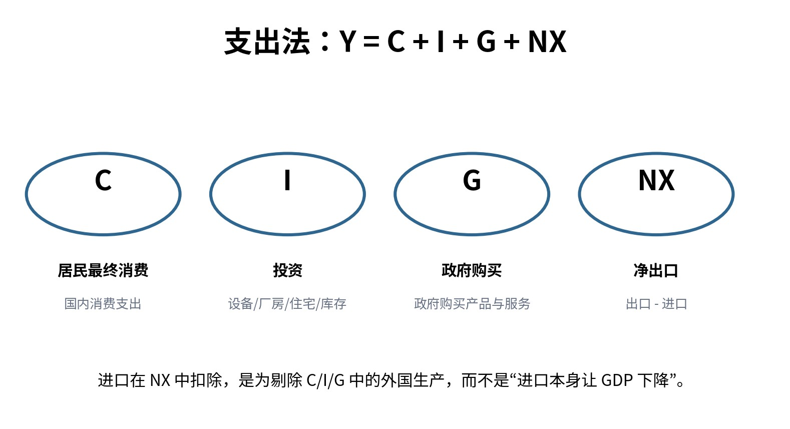

# Q003｜为什么支出法是 Y = C + I + G + NX？进口为什么要减掉？

> **模块：** 国民收入核算与宏观数据  
> **PDF 标记：** 基础 / 必会  
> **原书位置：** [PDF 第 6 页](../../book/macroeconomics-interview-100-2026.pdf#page=6)  
> **前置建议：** [Q001](q001-gdp-definition.md)、[Q002](q002-gdp-vs-gni.md)

[← Q002](q002-gdp-vs-gni.md) · [模块目录](README.md) · [Q004 →](q004-inventory-investment.md)

## 1. 这道题真正考什么

这不是一道只靠背定义得分的题。它位于“国民收入核算与宏观数据”的知识链中，面试官主要观察你能否完成：**概念边界 → 最小模型/公式 → 因果机制 → 条件变化 → 局限 → 现实或研究含义**。

**本题达标线：** 90 秒内先给结论，再给必要公式/机制；能够接住至少 2 层追问，并且不在口径、符号或时间尺度上自相矛盾。

## 2. 90 秒标准作答（PDF 原稿）

支出法的目标不是把所有支出机械相加，而是从支出端识别“对本国最终产出的支出”。C、I、G 中可能包含进口品，因此要减去 M；出口 X 是外国对本国产出的购买，所以要加回。进口项的作用是剔除外国生产，而不是说“进口本身让 GDP 减少”。
Y = C + I + G + (X - M)

## 3. 核心公式 / 结构

- $Y=C+I+G+(X-M)$
- $A\equiv C+I+G,\quad Y=A+NX$

> 公式不是答案。面试时必须解释每个变量、方向和成立条件。

### 图形辅助

> 图只用于帮助你建立方向感。现场回答仍要能脱离图片口述“冲击 → 中间变量 → 均衡结果”。

## 4. 深挖解析（PDF 原稿）

- C 是居民最终消费，不等于所有居民付款。
- I 包括固定资本形成、住宅投资和库存变化，并不等同于买股票。
- G 是政府购买产品与服务，不含纯转移支付。
- NX 的核算意义是校正生产地口径。

## 5. 专业扩展：把答案从“会背”升级到“会分析”

- 支出恒等式本质是对“国内最终生产”的会计分解。
- 更专业的说法是国内吸收 A=C+I+G，因此 Y=A+NX；
- 进口被减去是为了把吸收中的国外产出剔除，而不是把进口当成负生产。

### 5.1 机制拆解

建议用以下顺序组织口头推理：

1. **确定对象与口径**：先说明本题讨论的变量、时间尺度和制度环境。
2. **给出冲击或比较对象**：明确究竟是什么外生变化，而不是直接跳到结论。
3. **追踪中间变量**：至少给出 2-3 个中间环节，避免“政策一变，GDP 就变”的黑箱叙述。
4. **得到均衡结果**：说明哪些变量上升、下降或不确定，并解释为何。
5. **主动补一条边界**：指出结论在哪些假设被放松后会减弱、反转或无法识别。

### 5.2 本题最重要的假设与边界

- 核算口径保持一致，避免把存量/资产交易与当期生产混淆。
- 名义与实际、境内与居民、总量与人均必须明确。
- 若现实事实与基准模型的关键预测方向不一致，应优先检查“冲击识别是否错了”或“是否遗漏了同时发生的第二个冲击”。

## 6. 教授追问与参考答题路径

### 追问 1｜居民买一台 30 万元进口车，C 和 NX 如何变化？GDP 净影响为何可能为 0？

**参考答题路径：** 先判定核算边界与居民/境内口径，再逐笔记录 C/I/G/NX 或收入归属，最后做净效应检查。 本追问应围绕题干中的关键边界做比较静态，不要只重复第一轮答案。
### 追问 2｜政府购买进口设备时 G 与 NX 如何同时记录？

**参考答题路径：** 先判定核算边界与居民/境内口径，再逐笔记录 C/I/G/NX 或收入归属，最后做净效应检查。 本追问应围绕题干中的关键边界做比较静态，不要只重复第一轮答案。

## 7. 常见失分点（PDF 原稿 + 修正）

看到“进口增加”就直接说 GDP 减少；忘记进口通常已经在 C/I/G 中先被计入。

**修正原则：** 不要为了快速作答省略口径、时间尺度或模型假设；真正的高分答案通常比低分答案“更短但边界更清楚”。

## 8. 举一反三 / 迁移训练

**PDF 原题扩展：** 用支出法解释“国内总支出增加但 GDP 不一定等量增加”。

再做两道无提示迁移：

1. **改变一个关键假设**：把本题的一个核心假设反过来，重新判断结论是否仍成立，并解释变化来自哪一条机制。
2. **现实映射**：选择一个近三年的宏观现象，说明需要哪些数据才能判断本题机制是否真的在起作用。不得只凭新闻标题下结论。

## 9. 面试评分 Rubric（10 分）

| 维度 | 分值 | 达标标准 |
|---|---:|---|
| 定义与边界 | 2 | 核心概念准确，不混淆名义/实际、流量/存量、短期/长期等口径 |
| 方程 / 图形 | 2 | 只给必要工具，变量与方向解释正确 |
| 核算口径与边界 | 3 | 能讲出中间机制，不把相关性当因果 |
| 条件与局限 | 2 | 主动说明至少一个关键假设及放松后的变化 |
| 表达 | 1 | 第一轮 60-90 秒内结构清楚，给考官留下可追问接口 |

## 10. 关联题目

- [Q002｜GDP 与 GNI/GNP 有什么区别？](q002-gdp-vs-gni.md)
- [Q004｜产品生产出来但没卖掉，为什么仍然进入 GDP？](q004-inventory-investment.md)
- [Q009｜为什么国民账户中储蓄恒等于投资？计划储蓄与计划投资又为什么可能不相等？](q009-saving-investment-identity.md)
- [Q010｜面对一组宏观数据，你如何判断经济“增长质量”，而不是只报 GDP 增速？](q010-growth-quality-dashboard.md)
- [Q042｜本币贬值为什么可能改善净出口？](../05-open-economy/q042-depreciation-and-net-exports.md)

## 11. 资料与来源

- 本题为经典宏观理论母题；可配合仓库 [参考资料](../appendices/references.md) 与标准宏观教材复习。

---

**训练建议：** 合上答案，用手机计时 90 秒口答；随后随机从“改变参数 / 改变制度 / 加入预期 / 加入金融摩擦 / 现实映射 / 因果识别”中抽两个追问。只记录真正导致结论错误的瓶颈。
