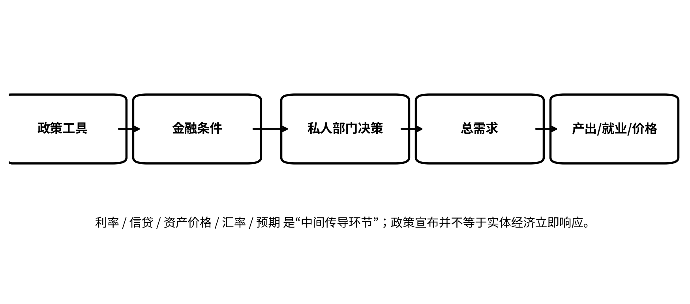

# Q025｜扩张性货币政策如何从央行工具传导到产出？

> **模块：** IS-LM 与政策组合  
> **PDF 标记：** 政策 / 必会  
> **原书位置：** [PDF 第 20 页](../../book/macroeconomics-interview-100-2026.pdf#page=20)  
> **前置建议：** [Q023](q023-lm-curve-slope.md)、[Q024](q024-fiscal-crowding-out.md)

[← Q024](q024-fiscal-crowding-out.md) · [模块目录](README.md) · [Q026 →](q026-liquidity-trap.md)

## 1. 这道题真正考什么

这不是一道只靠背定义得分的题。它位于“IS-LM 与政策组合”的知识链中，面试官主要观察你能否完成：**概念边界 → 最小模型/公式 → 因果机制 → 条件变化 → 局限 → 现实或研究含义**。

**本题达标线：** 90 秒内先给结论，再给必要公式/机制；能够接住至少 2 层追问，并且不在口径、符号或时间尺度上自相矛盾。

## 2. 90 秒标准作答（PDF 原稿）

传统 IS-LM 表达为 M 增加使 LM 右移、利率下降、投资上升、产出增加。现代回答应继续展开：政策利率或流动性工具影响市场利率、信贷条件、资产价格、汇率与预期，再改变家庭消费、企业投资和净出口，最后影响总需求、就业和价格。

## 3. 核心公式 / 结构

- $M/P\uparrow\Rightarrow r\downarrow\Rightarrow I,C,NX\uparrow\Rightarrow Y\uparrow$

> 公式不是答案。面试时必须解释每个变量、方向和成立条件。

### 图形辅助

> 图只用于帮助你建立方向感。现场回答仍要能脱离图片口述“冲击 → 中间变量 → 均衡结果”。

## 4. 深挖解析（PDF 原稿）

- 传导存在时滞与不确定性。
- 银行资本、风险偏好、抵押品价格会改变信贷渠道。
- 低通胀时实际利率可能仍偏高。

## 5. 专业扩展：把答案从“会背”升级到“会分析”

- 货币政策传导至少包括政策利率、收益率曲线、银行贷款、资产价格、汇率和预期六条渠道。
- 任何一环失灵，都可能出现“央行宽松但实体需求反应弱”。

### 5.1 机制拆解

建议用以下顺序组织口头推理：

1. **确定对象与口径**：先说明本题讨论的变量、时间尺度和制度环境。
2. **给出冲击或比较对象**：明确究竟是什么外生变化，而不是直接跳到结论。
3. **追踪中间变量**：至少给出 2-3 个中间环节，避免“政策一变，GDP 就变”的黑箱叙述。
4. **得到均衡结果**：说明哪些变量上升、下降或不确定，并解释为何。
5. **主动补一条边界**：指出结论在哪些假设被放松后会减弱、反转或无法识别。

### 5.2 本题最重要的假设与边界

- 传统 IS-LM 通常给定价格水平；现代央行更接近利率目标。
- 金融摩擦、开放经济和预期会改变简单结论。
- 若现实事实与基准模型的关键预测方向不一致，应优先检查“冲击识别是否错了”或“是否遗漏了同时发生的第二个冲击”。

## 6. 教授追问与参考答题路径

### 追问 1｜为什么降息后企业投资可能仍不增加？

**参考答题路径：** 先判断哪条曲线移动，再给 Y、r 的方向；随后讨论斜率、央行反应和挤出/传导是否改变强度。 本追问应围绕题干中的关键边界做比较静态，不要只重复第一轮答案。
### 追问 2｜汇率渠道如何强化或削弱货币宽松？

**参考答题路径：** 先判断哪条曲线移动，再给 Y、r 的方向；随后讨论斜率、央行反应和挤出/传导是否改变强度。 本追问应围绕题干中的关键边界做比较静态，不要只重复第一轮答案。

## 7. 常见失分点（PDF 原稿 + 修正）

把“降息=投资必增”当机械因果；忽略预期与信用风险。

**修正原则：** 不要为了快速作答省略口径、时间尺度或模型假设；真正的高分答案通常比低分答案“更短但边界更清楚”。

## 8. 举一反三 / 迁移训练

**PDF 原题扩展：** 用一个房地产下行场景解释为何货币政策传导可能变弱。

再做两道无提示迁移：

1. **改变一个关键假设**：把本题的一个核心假设反过来，重新判断结论是否仍成立，并解释变化来自哪一条机制。
2. **现实映射**：选择一个近三年的宏观现象，说明需要哪些数据才能判断本题机制是否真的在起作用。不得只凭新闻标题下结论。

## 9. 面试评分 Rubric（10 分）

| 维度 | 分值 | 达标标准 |
|---|---:|---|
| 定义与边界 | 2 | 核心概念准确，不混淆名义/实际、流量/存量、短期/长期等口径 |
| 方程 / 图形 | 2 | 只给必要工具，变量与方向解释正确 |
| 曲线移动与政策传导 | 3 | 能讲出中间机制，不把相关性当因果 |
| 条件与局限 | 2 | 主动说明至少一个关键假设及放松后的变化 |
| 表达 | 1 | 第一轮 60-90 秒内结构清楚，给考官留下可追问接口 |

## 10. 关联题目

- [Q024｜扩张性财政政策在 IS-LM 中为什么会产生挤出效应？](q024-fiscal-crowding-out.md)
- [Q026｜什么是流动性陷阱？为什么货币政策可能变弱？](q026-liquidity-trap.md)
- [Q029｜为什么央行降息不一定立即刺激投资？](q029-why-rate-cuts-may-not-boost-investment.md)
- [Q045｜浮动汇率下货币政策为什么通常更强？](../05-open-economy/q045-monetary-policy-floating-fx.md)
- [Q077｜什么是信贷渠道？它与传统利率渠道有什么不同？](../08-fiscal-monetary-finance/q077-credit-channel.md)

## 11. 资料与来源

- 本题为经典宏观理论母题；可配合仓库 [参考资料](../appendices/references.md) 与标准宏观教材复习。

---

**训练建议：** 合上答案，用手机计时 90 秒口答；随后随机从“改变参数 / 改变制度 / 加入预期 / 加入金融摩擦 / 现实映射 / 因果识别”中抽两个追问。只记录真正导致结论错误的瓶颈。
