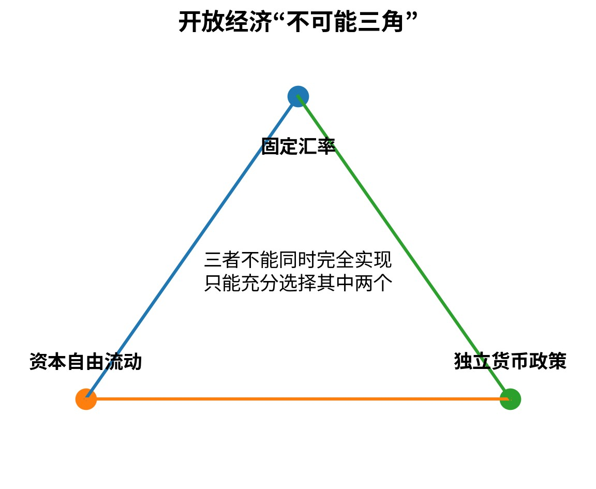

# Q048｜什么是不可能三角？

> **模块：** 开放经济与汇率  
> **PDF 标记：** 开放经济 / 必会  
> **原书位置：** [PDF 第 35 页](../../book/macroeconomics-interview-100-2026.pdf#page=35)  
> **前置建议：** [Q046](q046-fiscal-policy-fixed-fx.md)、[Q047](q047-monetary-independence-fixed-fx.md)

[← Q047](q047-monetary-independence-fixed-fx.md) · [模块目录](README.md) · [Q049 →](q049-fed-hikes-spillovers.md)

## 1. 这道题真正考什么

这不是一道只靠背定义得分的题。它位于“开放经济与汇率”的知识链中，面试官主要观察你能否完成：**概念边界 → 最小模型/公式 → 因果机制 → 条件变化 → 局限 → 现实或研究含义**。

**本题达标线：** 90 秒内先给结论，再给必要公式/机制；能够接住至少 2 层追问，并且不在口径、符号或时间尺度上自相矛盾。

## 2. 90 秒标准作答（PDF 原稿）

一个经济体无法同时完全实现固定汇率、资本自由流动和独立货币政策。固定汇率+资本自由意味着国内利率必须高度跟随外部条件；固定汇率+货币独立需要限制资本流动；资本自由+货币独立则需要允许汇率浮动。

## 3. 核心公式 / 结构

- 固定汇率 + 资本自由流动 + 独立货币政策：三者不能同时完全实现

> 公式不是答案。面试时必须解释每个变量、方向和成立条件。

### 图形辅助

> 图只用于帮助你建立方向感。现场回答仍要能脱离图片口述“冲击 → 中间变量 → 均衡结果”。

## 4. 深挖解析（PDF 原稿）

- 它是政策约束，不是说只能永久选择某一个制度。
- 现实安排通常处在连续光谱而非三个极端角点。
- 宏观审慎工具可以缓解但不能消除基本约束。

## 5. 专业扩展：把答案从“会背”升级到“会分析”

- 不可能三角不是说三个目标“一个都不能部分拥有”，而是三个目标无法同时做到完全。
- 现实国家可在汇率弹性、资本管制和货币独立性之间选择中间点。

### 5.1 机制拆解

建议用以下顺序组织口头推理：

1. **确定对象与口径**：先说明本题讨论的变量、时间尺度和制度环境。
2. **给出冲击或比较对象**：明确究竟是什么外生变化，而不是直接跳到结论。
3. **追踪中间变量**：至少给出 2-3 个中间环节，避免“政策一变，GDP 就变”的黑箱叙述。
4. **得到均衡结果**：说明哪些变量上升、下降或不确定，并解释为何。
5. **主动补一条边界**：指出结论在哪些假设被放松后会减弱、反转或无法识别。

### 5.2 本题最重要的假设与边界

- 结论高度依赖资本流动程度与汇率制度。
- 实际汇率与名义汇率的定义必须保持一致。
- 若现实事实与基准模型的关键预测方向不一致，应优先检查“冲击识别是否错了”或“是否遗漏了同时发生的第二个冲击”。

## 6. 教授追问与参考答题路径

### 追问 1｜中国的资本流动管理如何使现实比教科书三角更复杂？

**参考答题路径：** 先声明汇率定义、汇率制度和资本流动程度，再走“利率—资本流动—汇率—NX—Y”链。 本追问应围绕题干中的关键边界做比较静态，不要只重复第一轮答案。
### 追问 2｜欧元区成员国放弃了三角中的哪项自主权？

**参考答题路径：** 先声明汇率定义、汇率制度和资本流动程度，再走“利率—资本流动—汇率—NX—Y”链。 本追问应围绕题干中的关键边界做比较静态，不要只重复第一轮答案。

## 7. 常见失分点（PDF 原稿 + 修正）

把“不可能三角”说成三者只能选一个；忽略“完全实现”这一限定。

**修正原则：** 不要为了快速作答省略口径、时间尺度或模型假设；真正的高分答案通常比低分答案“更短但边界更清楚”。

## 8. 举一反三 / 迁移训练

**PDF 原题扩展：** 选择三个不同经济体，判断它们更接近三角的哪条边。

再做两道无提示迁移：

1. **改变一个关键假设**：把本题的一个核心假设反过来，重新判断结论是否仍成立，并解释变化来自哪一条机制。
2. **现实映射**：选择一个近三年的宏观现象，说明需要哪些数据才能判断本题机制是否真的在起作用。不得只凭新闻标题下结论。

## 9. 面试评分 Rubric（10 分）

| 维度 | 分值 | 达标标准 |
|---|---:|---|
| 定义与边界 | 2 | 核心概念准确，不混淆名义/实际、流量/存量、短期/长期等口径 |
| 方程 / 图形 | 2 | 只给必要工具，变量与方向解释正确 |
| 制度条件与开放传导 | 3 | 能讲出中间机制，不把相关性当因果 |
| 条件与局限 | 2 | 主动说明至少一个关键假设及放松后的变化 |
| 表达 | 1 | 第一轮 60-90 秒内结构清楚，给考官留下可追问接口 |

## 10. 关联题目

- [Q047｜固定汇率下为什么难以保持独立货币政策？](q047-monetary-independence-fixed-fx.md)
- [Q049｜美联储加息为什么会影响其他经济体？](q049-fed-hikes-spillovers.md)
- [Q044｜浮动汇率下财政扩张为什么可能被汇率升值部分抵消？](q044-fiscal-policy-floating-fx.md)
- [Q045｜浮动汇率下货币政策为什么通常更强？](q045-monetary-policy-floating-fx.md)

## 11. 资料与来源

- 本题为经典宏观理论母题；可配合仓库 [参考资料](../appendices/references.md) 与标准宏观教材复习。

---

**训练建议：** 合上答案，用手机计时 90 秒口答；随后随机从“改变参数 / 改变制度 / 加入预期 / 加入金融摩擦 / 现实映射 / 因果识别”中抽两个追问。只记录真正导致结论错误的瓶颈。
