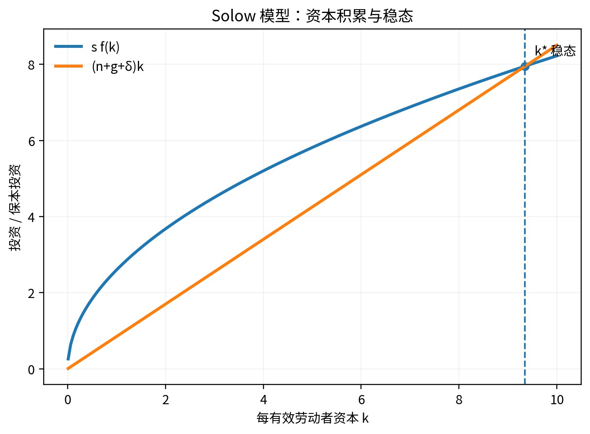

# Q052｜Solow 模型的核心动态方程是什么？

> **模块：** 长期增长  
> **PDF 标记：** 增长 / 必会  
> **原书位置：** [PDF 第 39 页](../../book/macroeconomics-interview-100-2026.pdf#page=39)  
> **前置建议：** [Q051](q051-sources-of-long-run-growth.md)

[← Q051](q051-sources-of-long-run-growth.md) · [模块目录](README.md) · [Q053 →](q053-saving-rate-and-growth.md)

## 1. 这道题真正考什么

这不是一道只靠背定义得分的题。它位于“长期增长”的知识链中，面试官主要观察你能否完成：**概念边界 → 最小模型/公式 → 因果机制 → 条件变化 → 局限 → 现实或研究含义**。

**本题达标线：** 90 秒内先给结论，再给必要公式/机制；能够接住至少 2 层追问，并且不在口径、符号或时间尺度上自相矛盾。

## 2. 90 秒标准作答（PDF 原稿）

以每有效劳动者资本 k 表示，资本动态可写为 Δk = s f(k) - (n+g+δ)k。第一项是新增投资，第二项是为抵
消人口增长、技术进步造成的资本稀释和折旧所需的“保本投资”。稳态在两者相等处。
Δk = s f(k) - (n+g+δ)k

## 3. 核心公式 / 结构

- $\dot k=s f(k)-(n+g+\delta)k$

> 公式不是答案。面试时必须解释每个变量、方向和成立条件。

### 图形辅助

> 图只用于帮助你建立方向感。现场回答仍要能脱离图片口述“冲击 → 中间变量 → 均衡结果”。

## 4. 深挖解析（PDF 原稿）

- 稳态是 k 不再变化，而总量 K 和 Y 仍可增长。
- 技术进步使人均产出长期增长。
- 参数变化产生新的稳态与过渡动态。

## 5. 专业扩展：把答案从“会背”升级到“会分析”

- Solow 核心是每有效劳动者资本的积累：储蓄形成新资本，折旧、人口和技术进步稀释资本。
- 稳态是两者相等，而不是总 GDP 停止增长。

### 5.1 机制拆解

建议用以下顺序组织口头推理：

1. **确定对象与口径**：先说明本题讨论的变量、时间尺度和制度环境。
2. **给出冲击或比较对象**：明确究竟是什么外生变化，而不是直接跳到结论。
3. **追踪中间变量**：至少给出 2-3 个中间环节，避免“政策一变，GDP 就变”的黑箱叙述。
4. **得到均衡结果**：说明哪些变量上升、下降或不确定，并解释为何。
5. **主动补一条边界**：指出结论在哪些假设被放松后会减弱、反转或无法识别。

### 5.2 本题最重要的假设与边界

- Solow 基准包含规模报酬不变、资本边际报酬递减等假设。
- 长期结论要区分总量、每工人和每有效劳动者。
- 若现实事实与基准模型的关键预测方向不一致，应优先检查“冲击识别是否错了”或“是否遗漏了同时发生的第二个冲击”。

## 6. 教授追问与参考答题路径

### 追问 1｜储蓄率提高后 k 如何过渡到新稳态？

**参考答题路径：** 先写动态方程或稳态条件，区分水平与增长率，再做参数比较静态和模型局限。 本追问应围绕题干中的关键边界做比较静态，不要只重复第一轮答案。
### 追问 2｜折旧率提高会使稳态怎样变化？

**参考答题路径：** 先写动态方程或稳态条件，区分水平与增长率，再做参数比较静态和模型局限。 本追问应围绕题干中的关键边界做比较静态，不要只重复第一轮答案。

## 7. 常见失分点（PDF 原稿 + 修正）

把稳态理解成 GDP 不增长；漏掉 g 和 n。

**修正原则：** 不要为了快速作答省略口径、时间尺度或模型假设；真正的高分答案通常比低分答案“更短但边界更清楚”。

## 8. 举一反三 / 迁移训练

**PDF 原题扩展：** 画出 sf(k) 与 (n+g+δ)k，并用箭头标出稳态两侧的动态。

再做两道无提示迁移：

1. **改变一个关键假设**：把本题的一个核心假设反过来，重新判断结论是否仍成立，并解释变化来自哪一条机制。
2. **现实映射**：选择一个近三年的宏观现象，说明需要哪些数据才能判断本题机制是否真的在起作用。不得只凭新闻标题下结论。

## 9. 面试评分 Rubric（10 分）

| 维度 | 分值 | 达标标准 |
|---|---:|---|
| 定义与边界 | 2 | 核心概念准确，不混淆名义/实际、流量/存量、短期/长期等口径 |
| 方程 / 图形 | 2 | 只给必要工具，变量与方向解释正确 |
| 稳态与增长率区分 | 3 | 能讲出中间机制，不把相关性当因果 |
| 条件与局限 | 2 | 主动说明至少一个关键假设及放松后的变化 |
| 表达 | 1 | 第一轮 60-90 秒内结构清楚，给考官留下可追问接口 |

## 10. 关联题目

- [Q051｜长期经济增长的主要源泉是什么？](q051-sources-of-long-run-growth.md)
- [Q053｜提高储蓄率会永久提高长期经济增长率吗？](q053-saving-rate-and-growth.md)
- [Q054｜什么是资本黄金律？](q054-golden-rule-capital.md)
- [Q055｜人口增长率提高会怎样影响 Solow 稳态？](q055-population-growth-solow.md)

## 11. 资料与来源

- 本题为经典宏观理论母题；可配合仓库 [参考资料](../appendices/references.md) 与标准宏观教材复习。

---

**训练建议：** 合上答案，用手机计时 90 秒口答；随后随机从“改变参数 / 改变制度 / 加入预期 / 加入金融摩擦 / 现实映射 / 因果识别”中抽两个追问。只记录真正导致结论错误的瓶颈。
