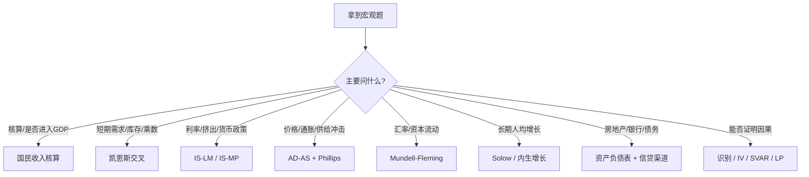

# 附录 B｜模型选择树

## 原 PDF 版文字树

- 怎么核算 / 是否进入 GDP → 国民收入核算。
- 短期需求不足、乘数、库存 → 凯恩斯交叉。
- 利率、投资、财政挤出、货币政策 → IS-LM / IS-MP。
- 价格、通胀、供给冲击、滞胀 → AD-AS + Phillips。
- 汇率、资本流动、固定/浮动汇率 → Mundell-Fleming + 不可能三角。
- 长期人均增长、储蓄、人口、技术 → Solow / 内生增长。
- 房地产、银行、债务、资产价格 → 资产负债表 + 信贷渠道 + 债务通缩。
- 政策“是否有效” → 先诊断冲击，再给传导、条件、时滞和副作用。
- 实证“能否证明” → 先想内生性、反向因果、遗漏变量和识别。
