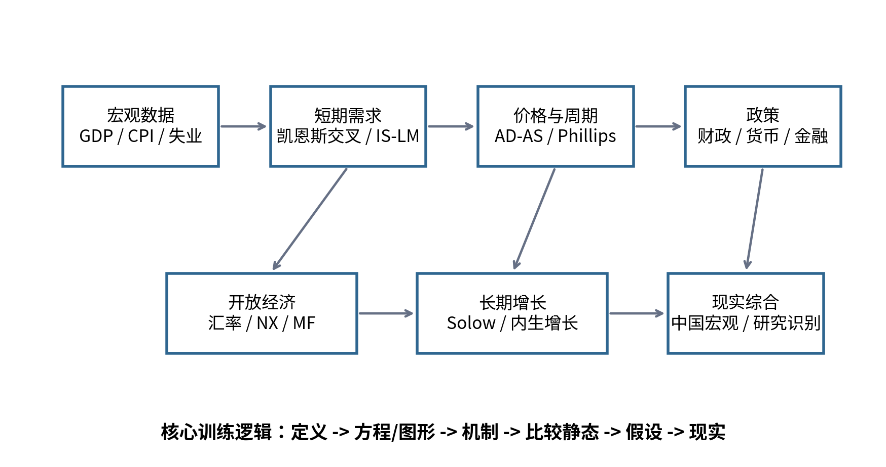

# 宏观经济学面试 100 题

**Professional Interview Repository · 2026**

本仓库把 78 页 PDF《宏观经济学面试 100 题：真题母题与追问链》重构为可维护的知识库：**100 道题对应 100 个 Markdown 文件**。每题保留 PDF 的 90 秒答案、深挖解析、教授追问、常见失分点和举一反三，并额外加入公式、假设边界、专业扩展、评分 Rubric、跨题链接和来源追溯。

## 快速入口

- [回答框架：6 层面试法](00-guide/answer-framework.md)
- [模型选择树](appendices/model-selection-tree.md)
- [高频公式表](appendices/formula-sheet.md)
- [教授追问的 12 种套路](appendices/professor-followups.md)
- [30 天刷题路径](appendices/30-day-plan.md)
- [2026 中国宏观数据卡](appendices/china-2026-data-card.md)
- [参考资料与核验依据](appendices/references.md)

## 10 个模块

1. [国民收入核算与宏观数据](01-national-accounts/README.md)
2. [凯恩斯交叉与乘数](02-keynesian-cross/README.md)
3. [IS-LM 与政策组合](03-is-lm/README.md)
4. [AD-AS、通胀、失业与周期](04-ad-as/README.md)
5. [开放经济与汇率](05-open-economy/README.md)
6. [长期增长](06-growth/README.md)
7. [现代宏观与预期](07-modern-macro/README.md)
8. [财政、债务、货币与金融传导](08-fiscal-monetary-finance/README.md)
9. [2026 中国宏观热点](09-china-2026/README.md)
10. [研究能力与压力面试](10-research-interview/README.md)

## 真正的掌握标准

不是“看完 100 题”，而是随机抽一道能在 **90 秒** 内完成：**定义 → 方程/图形 → 机制 → 条件 → 现实**，随后接住至少两次追问。
