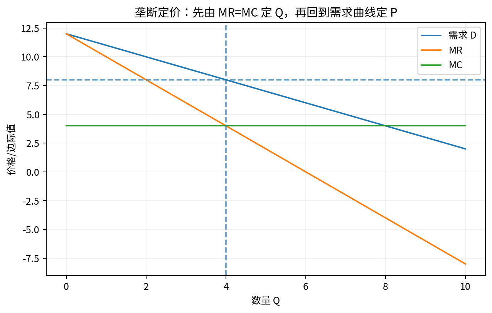

# Chapter 01 · 供给、需求与弹性

> 从“价格变了”追到“哪条曲线为什么移动”，并能用弹性、税负与管制做比较静态。

## FLOW TARGET

完成本章后，你应该能够：

- 从价格与数量的联合变化识别可能的供需冲击
- 掌握点弹性、税负归宿与价格管制的比较静态
- 区分结构关系、均衡结果与因果识别


**统一解题流水线**：观察 P/Q → 写供需 → 定位 shifter → 比较静态 → 构造反事实 → 寻找识别证据



## 题目索引

| 题号 | 问题 | 难度 | 来源类型 | Core 20 |
|---|---|---|---|---|
| [Q001](Q001.md) | 商品价格突然上涨，你如何系统判断原因？ | ★★★ | 经典高仿真面试题 | ⭐ |
| [Q002](Q002.md) | 手机价格可能受到哪些供给和需求因素影响？ | ★★ | Bates White 官方 case 衍生 |  |
| [Q003](Q003.md) | 为什么需求曲线通常向下倾斜？ | ★★★ | 经典高仿真面试题 |  |
| [Q004](Q004.md) | 需求量变化和需求变化有什么区别？ | ★ | 经典高仿真面试题 |  |
| [Q005](Q005.md) | 为什么弹性比需求曲线斜率更有用？ | ★★★ | 经典高仿真面试题 |  |
| [Q006](Q006.md) | 需求缺乏弹性时，价格上涨为什么使总收入增加？ | ★★ | 经典高仿真面试题 |  |
| [Q007](Q007.md) | 汽油税究竟由消费者承担还是企业承担？ | ★★★ | 经典高仿真面试题 | ⭐ |
| [Q008](Q008.md) | 完全无弹性的需求遇到单位税会发生什么？ | ★★★ | 经典高仿真面试题 |  |
| [Q009](Q009.md) | 最低工资提高一定减少就业吗？ | ★★★★ | 经典高仿真面试题 | ⭐ |
| [Q010](Q010.md) | 为什么价格管制会产生短缺？短缺为什么不一定表现为排队？ | ★★★ | 经典高仿真面试题 |  |

## 本章完成标准

- 能在不看答案的情况下完成所有 30 秒版本；
- 至少 70% 的题能完成关键白板公式；
- Core 20 题（如本章有）能承受 2-3 次条件变化；
- 至少做 2 道迁移题，并明确数据/反事实。


## 本章专业深化地图

### 1. 理论主线

```text
市场对象 → 供需函数 → shifter → 均衡 → 弹性 → 税/管制 → 识别
```

不要把本章题目看成孤立知识点。面试官改变一个条件时，应沿这条主线判断：**哪个目标函数、约束、均衡条件或识别假设被改变了？**

### 2. 必须会写的白板公式

- `Qd(P,X)=Qs(P,Z)`
- `ε=(dQ/dP)(P/Q)`
- `Pb-Ps=t`

目标不是背符号，而是能解释：每个式子的选择变量是什么、哪些变量内生、哪些参数外生、什么假设让该式子成立。

### 3. 高频认知瓶颈

- 把均衡结果当作外生原因
- 只看价格、不联合数量
- 税收法定归宿与经济归宿混淆

如果在本章连续两题出现同一类错误，应回到相关前置题，而不是继续刷更多相似题。

### 4. 推荐训练顺序

**第一遍｜Recognition → Recall**：按题号完成所有 30 秒答案。

**第二遍｜Derivation**：只做公式与图，不看 3 分钟答案。

**第三遍｜Stress Test**：每题至少接受一次参数变化或假设变化。

**第四遍｜Case Transfer**：把本章模型迁移到一个陌生行业或政策。

### 5. 本章模拟面试链

Q001：价格上涨诊断 → Q007：税收归宿 → Q009：最低工资与 monopsony

建议连续完成，不在题与题之间查资料。每题 3–5 分钟，面试官只追问一个最薄弱环节。

### 6. 跨章节连接

本章是 Q073–Q084 产业组织和 Q096–Q098 因果识别的基础。

- **向前追溯**：若推导卡住，优先回到最优化/供需/成本等基础节点；
- **向后迁移**：若标准题已自动化，立即转到政策、产业组织、信息或因果识别场景。

### 7. 本章 Mastery Gate

- [ ] 每题 30 秒版本能不看提示输出；
- [ ] 80% 题目能写核心方程并解释符号；
- [ ] 至少 3 题能完成完整 comparative statics；
- [ ] 至少 2 题能提出可证伪预测与识别证据；
- [ ] 至少 1 题能主动指出静态模型、局部均衡或完全信息假设的边界；
- [ ] Core 20：Q001, Q007, Q009 能承受连续 3 次追问。

### 8. 推荐交叉参考

- [Advanced Micro Interview Methods](../../reference/advanced-methods.md)
- [微观面试中的因果识别与计量工具](../../reference/econometrics-for-micro-interviews.md)
- [白板图形 Playbook](../../reference/diagram-playbook.md)
