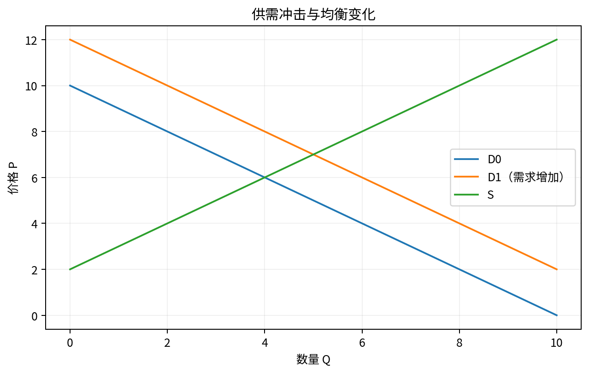

# Chapter 02 · 消费者理论

> 从偏好、预算与最优化出发，掌握 MRS、Marshallian/Hicksian demand、Slutsky 与福利测度。

## FLOW TARGET

完成本章后，你应该能够：

- 从偏好与预算集合推导最优选择
- 掌握 MRS、Marshallian/Hicksian demand 与 Slutsky 分解
- 用 CV/EV 和 revealed preference 讨论福利


**统一解题流水线**：偏好 → 预算 → 最优化 → 需求 → 价格/收入变化 → 福利



## 题目索引

| 题号 | 问题 | 难度 | 来源类型 | Core 20 |
|---|---|---|---|---|
| [Q011](Q011.md) | 什么是边际替代率 MRS？ | ★★ | 经典高仿真面试题 |  |
| [Q012](Q012.md) | 为什么效用函数的数字通常没有直接经济意义？ | ★★★ | 经典高仿真面试题 |  |
| [Q013](Q013.md) | 为什么无差异曲线通常凸向原点？ | ★★★ | 经典高仿真面试题 |  |
| [Q014](Q014.md) | Cobb-Douglas 消费者如何求最优需求？ | ★★★ | 经典高仿真面试题 |  |
| [Q015](Q015.md) | 正常品、劣等品、Giffen 品分别是什么？ | ★★★ | 经典高仿真面试题 | ⭐ |
| [Q016](Q016.md) | 把价格效应拆成收入效应和替代效应。 | ★★★★ | 经典高仿真面试题 | ⭐ |
| [Q017](Q017.md) | 补偿需求和 Marshallian demand 有什么区别？ | ★★★★ | 经典高仿真面试题 |  |
| [Q018](Q018.md) | 价格下降后消费者一定更好吗？ | ★★★ | 经典高仿真面试题 |  |
| [Q019](Q019.md) | 什么是消费者剩余？什么时候它不是严格的福利指标？ | ★★★★ | 经典高仿真面试题 |  |
| [Q020](Q020.md) | 一张会员卡售价100元，让之后所有商品打八折。消费者会买吗？ | ★★★★ | 经典高仿真面试题 |  |

## 本章完成标准

- 能在不看答案的情况下完成所有 30 秒版本；
- 至少 70% 的题能完成关键白板公式；
- Core 20 题（如本章有）能承受 2-3 次条件变化；
- 至少做 2 道迁移题，并明确数据/反事实。


## 本章专业深化地图

### 1. 理论主线

```text
偏好 → 可行集 → primal → Marshallian demand → dual → Hicksian demand → Slutsky → welfare
```

不要把本章题目看成孤立知识点。面试官改变一个条件时，应沿这条主线判断：**哪个目标函数、约束、均衡条件或识别假设被改变了？**

### 2. 必须会写的白板公式

- `MRS=MUx/MUy`
- `∂xi/∂pj = ∂hi/∂pj - xj∂xi/∂m`
- `∂e/∂pi=hi`

目标不是背符号，而是能解释：每个式子的选择变量是什么、哪些变量内生、哪些参数外生、什么假设让该式子成立。

### 3. 高频认知瓶颈

- 把序数效用当作基数福利
- 机械使用切线条件忽略角点
- 不会在 Marshallian/Hicksian 之间切换

如果在本章连续两题出现同一类错误，应回到相关前置题，而不是继续刷更多相似题。

### 4. 推荐训练顺序

**第一遍｜Recognition → Recall**：按题号完成所有 30 秒答案。

**第二遍｜Derivation**：只做公式与图，不看 3 分钟答案。

**第三遍｜Stress Test**：每题至少接受一次参数变化或假设变化。

**第四遍｜Case Transfer**：把本章模型迁移到一个陌生行业或政策。

### 5. 本章模拟面试链

Q014：Cobb-Douglas → Q016：Slutsky → Q019：CS 与 CV/EV

建议连续完成，不在题与题之间查资料。每题 3–5 分钟，面试官只追问一个最薄弱环节。

### 6. 跨章节连接

本章直接支撑需求估计、价格歧视、平台福利与反垄断需求分析。

- **向前追溯**：若推导卡住，优先回到最优化/供需/成本等基础节点；
- **向后迁移**：若标准题已自动化，立即转到政策、产业组织、信息或因果识别场景。

### 7. 本章 Mastery Gate

- [ ] 每题 30 秒版本能不看提示输出；
- [ ] 80% 题目能写核心方程并解释符号；
- [ ] 至少 3 题能完成完整 comparative statics；
- [ ] 至少 2 题能提出可证伪预测与识别证据；
- [ ] 至少 1 题能主动指出静态模型、局部均衡或完全信息假设的边界；
- [ ] Core 20：Q015, Q016 能承受连续 3 次追问。

### 8. 推荐交叉参考

- [Advanced Micro Interview Methods](../../reference/advanced-methods.md)
- [微观面试中的因果识别与计量工具](../../reference/econometrics-for-micro-interviews.md)
- [白板图形 Playbook](../../reference/diagram-playbook.md)
