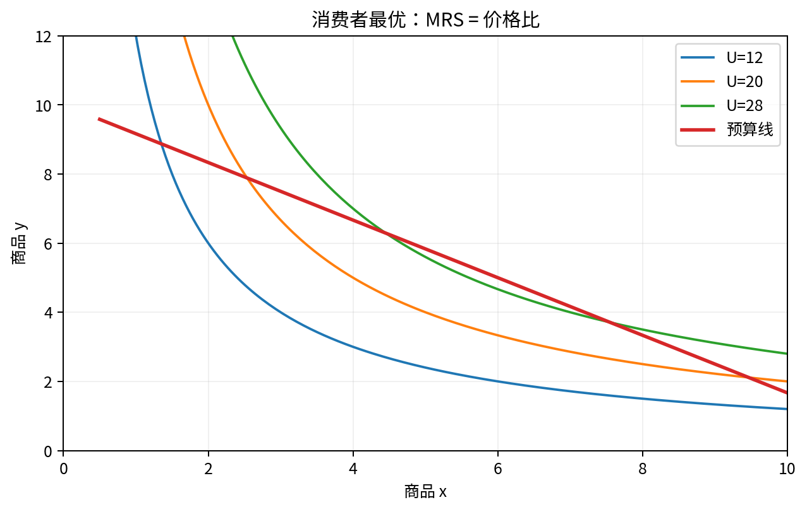

# Chapter 03 · 生产、成本与竞争厂商

> 理解生产技术如何映射到成本曲线，并用边际决策解释供给、停产、进入退出。

## FLOW TARGET

完成本章后，你应该能够：

- 把生产技术映射为成本曲线
- 掌握 MR=MC、shutdown、entry/exit 与长期竞争均衡
- 区分短期边际决策与长期行业调整


**统一解题流水线**：技术 → 成本 → 边际条件 → 产量 → 停产/退出 → 行业进入



## 题目索引

| 题号 | 问题 | 难度 | 来源类型 | Core 20 |
|---|---|---|---|---|
| [Q021](Q021.md) | 为什么企业利润最大化条件通常是 MR=MC？ | ★★ | 经典高仿真面试题 |  |
| [Q022](Q022.md) | 完全竞争企业为什么满足 P=MC？ | ★★ | 经典高仿真面试题 | ⭐ |
| [Q023](Q023.md) | 企业亏损为什么可能仍然继续生产？ | ★★★ | 经典高仿真面试题 | ⭐ |
| [Q024](Q024.md) | sunk cost 为什么不应该影响当前决策？ | ★★★ | 经典高仿真面试题 |  |
| [Q025](Q025.md) | 固定成本提高会不会改变竞争厂商短期供给？ | ★★★ | 经典高仿真面试题 |  |
| [Q026](Q026.md) | 为什么长期完全竞争企业经济利润为零？ | ★★★ | 经典高仿真面试题 |  |
| [Q027](Q027.md) | 规模经济与边际报酬递减矛盾吗？ | ★★★ | 经典高仿真面试题 |  |
| [Q028](Q028.md) | 为什么 MC 穿过 AVC 和 AC 的最低点？ | ★★ | 经典高仿真面试题 |  |
| [Q029](Q029.md) | 一个行业技术进步，长期价格和企业数量如何变化？ | ★★★★ | 经典高仿真面试题 |  |
| [Q030](Q030.md) | 单位成本下降一定说明存在自然垄断吗？ | ★★★★ | 经典高仿真面试题 |  |

## 本章完成标准

- 能在不看答案的情况下完成所有 30 秒版本；
- 至少 70% 的题能完成关键白板公式；
- Core 20 题（如本章有）能承受 2-3 次条件变化；
- 至少做 2 道迁移题，并明确数据/反事实。


## 本章专业深化地图

### 1. 理论主线

```text
技术 → 成本最小化 → 成本函数 → 利润最大化 → 短期供给 → 关停 → 长期进入退出
```

不要把本章题目看成孤立知识点。面试官改变一个条件时，应沿这条主线判断：**哪个目标函数、约束、均衡条件或识别假设被改变了？**

### 2. 必须会写的白板公式

- `dπ/dq=MR-MC`
- `P=MC`
- `dAC/dQ=(MC-AC)/Q`

目标不是背符号，而是能解释：每个式子的选择变量是什么、哪些变量内生、哪些参数外生、什么假设让该式子成立。

### 3. 高频认知瓶颈

- 把 sunk/fixed/avoidable cost 混为一谈
- P=MC 不检查 shutdown
- 企业供给与行业长期均衡混淆

如果在本章连续两题出现同一类错误，应回到相关前置题，而不是继续刷更多相似题。

### 4. 推荐训练顺序

**第一遍｜Recognition → Recall**：按题号完成所有 30 秒答案。

**第二遍｜Derivation**：只做公式与图，不看 3 分钟答案。

**第三遍｜Stress Test**：每题至少接受一次参数变化或假设变化。

**第四遍｜Case Transfer**：把本章模型迁移到一个陌生行业或政策。

### 5. 本章模拟面试链

Q021：MR=MC → Q023：亏损仍生产 → Q030：自然垄断

建议连续完成，不在题与题之间查资料。每题 3–5 分钟，面试官只追问一个最薄弱环节。

### 6. 跨章节连接

本章是垄断定价、pass-through、损害测算与自然垄断监管的成本侧基础。

- **向前追溯**：若推导卡住，优先回到最优化/供需/成本等基础节点；
- **向后迁移**：若标准题已自动化，立即转到政策、产业组织、信息或因果识别场景。

### 7. 本章 Mastery Gate

- [ ] 每题 30 秒版本能不看提示输出；
- [ ] 80% 题目能写核心方程并解释符号；
- [ ] 至少 3 题能完成完整 comparative statics；
- [ ] 至少 2 题能提出可证伪预测与识别证据；
- [ ] 至少 1 题能主动指出静态模型、局部均衡或完全信息假设的边界；
- [ ] Core 20：Q022, Q023 能承受连续 3 次追问。

### 8. 推荐交叉参考

- [Advanced Micro Interview Methods](../../reference/advanced-methods.md)
- [微观面试中的因果识别与计量工具](../../reference/econometrics-for-micro-interviews.md)
- [白板图形 Playbook](../../reference/diagram-playbook.md)
