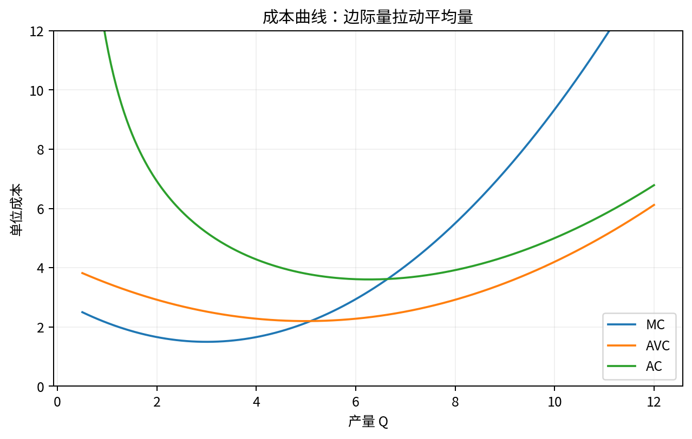

# Chapter 04 · 垄断与定价

> 从 MR=MC 推导 markup、价格歧视、两部收费与动态创新权衡。

## FLOW TARGET

完成本章后，你应该能够：

- 从 MR=MC 推导 markup 与 Lerner index
- 比较价格歧视、两部收费和互补品定价
- 把静态市场势力与动态创新激励区分开


**统一解题流水线**：需求 → MR → MC → 数量 → 价格 → markup → welfare



## 题目索引

| 题号 | 问题 | 难度 | 来源类型 | Core 20 |
|---|---|---|---|---|
| [Q031](Q031.md) | 为什么垄断企业通常满足 P>MC？ | ★★★ | 经典高仿真面试题 | ⭐ |
| [Q032](Q032.md) | 推导 Lerner Index。 | ★★★★ | 经典高仿真面试题 | ⭐ |
| [Q033](Q033.md) | 垄断者为什么不会选择需求曲线无弹性区域？ | ★★★ | 经典高仿真面试题 |  |
| [Q034](Q034.md) | 垄断一定赚钱吗？ | ★★ | 经典高仿真面试题 |  |
| [Q035](Q035.md) | 什么是一、二、三级价格歧视？ | ★★★ | 经典高仿真面试题 |  |
| [Q036](Q036.md) | 为什么学生票通常比成人票便宜？ | ★★★ | 经典高仿真面试题 |  |
| [Q037](Q037.md) | 两部收费制为什么可能优于单一价格？ | ★★★★ | 经典高仿真面试题 |  |
| [Q038](Q038.md) | 为什么电影院可能高价卖爆米花？ | ★★★★ | 经典高仿真面试题 |  |
| [Q039](Q039.md) | 免费软件仍然可能是垄断产品吗？ | ★★★★ | 经典高仿真面试题 |  |
| [Q040](Q040.md) | 专利为什么同时产生效率收益和效率损失？ | ★★★★ | 经典高仿真面试题 | ⭐ |

## 本章完成标准

- 能在不看答案的情况下完成所有 30 秒版本；
- 至少 70% 的题能完成关键白板公式；
- Core 20 题（如本章有）能承受 2-3 次条件变化；
- 至少做 2 道迁移题，并明确数据/反事实。


## 本章专业深化地图

### 1. 理论主线

```text
需求 → MR → markup → 弹性 → 单产品定价 → 价格歧视 → 非线性/多产品定价 → 动态创新
```

不要把本章题目看成孤立知识点。面试官改变一个条件时，应沿这条主线判断：**哪个目标函数、约束、均衡条件或识别假设被改变了？**

### 2. 必须会写的白板公式

- `MR=MC`
- `(P-MC)/P=-1/ε`
- `T≤CS(p)`

目标不是背符号，而是能解释：每个式子的选择变量是什么、哪些变量内生、哪些参数外生、什么假设让该式子成立。

### 3. 高频认知瓶颈

- 把 market power 等同于高利润
- 把 Lerner index 当利润率
- 价格歧视不说明套利/可识别群体

如果在本章连续两题出现同一类错误，应回到相关前置题，而不是继续刷更多相似题。

### 4. 推荐训练顺序

**第一遍｜Recognition → Recall**：按题号完成所有 30 秒答案。

**第二遍｜Derivation**：只做公式与图，不看 3 分钟答案。

**第三遍｜Stress Test**：每题至少接受一次参数变化或假设变化。

**第四遍｜Case Transfer**：把本章模型迁移到一个陌生行业或政策。

### 5. 本章模拟面试链

Q032：Lerner → Q035：价格歧视 → Q040：专利动态效率

建议连续完成，不在题与题之间查资料。每题 3–5 分钟，面试官只追问一个最薄弱环节。

### 6. 跨章节连接

本章与 Q078–Q084 的 diversion、GUPPI、pass-through 形成产业组织主线。

- **向前追溯**：若推导卡住，优先回到最优化/供需/成本等基础节点；
- **向后迁移**：若标准题已自动化，立即转到政策、产业组织、信息或因果识别场景。

### 7. 本章 Mastery Gate

- [ ] 每题 30 秒版本能不看提示输出；
- [ ] 80% 题目能写核心方程并解释符号；
- [ ] 至少 3 题能完成完整 comparative statics；
- [ ] 至少 2 题能提出可证伪预测与识别证据；
- [ ] 至少 1 题能主动指出静态模型、局部均衡或完全信息假设的边界；
- [ ] Core 20：Q031, Q032, Q040 能承受连续 3 次追问。

### 8. 推荐交叉参考

- [Advanced Micro Interview Methods](../../reference/advanced-methods.md)
- [微观面试中的因果识别与计量工具](../../reference/econometrics-for-micro-interviews.md)
- [白板图形 Playbook](../../reference/diagram-playbook.md)
