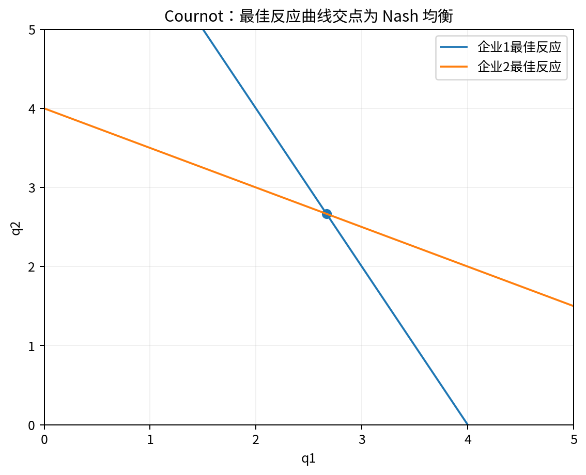

# Chapter 05 · 寡头与博弈论

> 把“我最优”升级为“在别人最优反应下我最优”，掌握 Nash、Cournot、Bertrand、Stackelberg 与重复博弈。

## FLOW TARGET

完成本章后，你应该能够：

- 用 best response 定义 Nash equilibrium
- 推导 Cournot、Bertrand、Stackelberg 的均衡
- 理解重复博弈、混合策略与模型假设的作用


**统一解题流水线**：玩家/策略 → payoff → best response → equilibrium → deviation → comparative statics



## 题目索引

| 题号 | 问题 | 难度 | 来源类型 | Core 20 |
|---|---|---|---|---|
| [Q041](Q041.md) | 什么是 Nash equilibrium？ | ★★ | 经典高仿真面试题 | ⭐ |
| [Q042](Q042.md) | Nash equilibrium 和 dominant strategy equilibrium 有什么区别？ | ★★★ | 经典高仿真面试题 |  |
| [Q043](Q043.md) | 为什么囚徒困境中个人理性导致集体低效？ | ★★★ | 经典高仿真面试题 |  |
| [Q044](Q044.md) | Cournot 模型中企业竞争什么？ | ★★ | 经典高仿真面试题 |  |
| [Q045](Q045.md) | 推导线性 Cournot 双寡头均衡。 | ★★★★ | 经典高仿真面试题 | ⭐ |
| [Q046](Q046.md) | Bertrand competition 是什么？ | ★★★ | 公开面经高频题型 | ⭐ |
| [Q047](Q047.md) | 为什么两个企业就可能产生完全竞争价格？ | ★★★ | 经典高仿真面试题 |  |
| [Q048](Q048.md) | 现实中为什么往往没有出现 Bertrand paradox？ | ★★★★ | 经典高仿真面试题 |  |
| [Q049](Q049.md) | Stackelberg leader 为什么通常生产更多？ | ★★★★ | 经典高仿真面试题 |  |
| [Q050](Q050.md) | 重复博弈为什么可能维持合作？ | ★★★★ | 经典高仿真面试题 | ⭐ |
| [Q051](Q051.md) | 企业数量增加一定让竞争增强吗？ | ★★★★ | 经典高仿真面试题 |  |
| [Q052](Q052.md) | 混合策略 Nash equilibrium 的经济意义是什么？ | ★★★★ | 经典高仿真面试题 |  |

## 本章完成标准

- 能在不看答案的情况下完成所有 30 秒版本；
- 至少 70% 的题能完成关键白板公式；
- Core 20 题（如本章有）能承受 2-3 次条件变化；
- 至少做 2 道迁移题，并明确数据/反事实。


## 本章专业深化地图

### 1. 理论主线

```text
玩家 → 策略 → payoff → best response → Nash → 时序/承诺 → 重复互动 → refinement
```

不要把本章题目看成孤立知识点。面试官改变一个条件时，应沿这条主线判断：**哪个目标函数、约束、均衡条件或识别假设被改变了？**

### 2. 必须会写的白板公式

- `s_i*∈BR_i(s_-i*)`
- `Cournot: ∂πi/∂qi=0`
- `πC/(1-δ) ≥ πD+δπP/(1-δ)`

目标不是背符号，而是能解释：每个式子的选择变量是什么、哪些变量内生、哪些参数外生、什么假设让该式子成立。

### 3. 高频认知瓶颈

- 把 Nash 当 Pareto efficiency
- 不先说明战略变量
- 动态题不做 backward induction

如果在本章连续两题出现同一类错误，应回到相关前置题，而不是继续刷更多相似题。

### 4. 推荐训练顺序

**第一遍｜Recognition → Recall**：按题号完成所有 30 秒答案。

**第二遍｜Derivation**：只做公式与图，不看 3 分钟答案。

**第三遍｜Stress Test**：每题至少接受一次参数变化或假设变化。

**第四遍｜Case Transfer**：把本章模型迁移到一个陌生行业或政策。

### 5. 本章模拟面试链

Q041：Nash → Q045：Cournot → Q050：重复博弈

建议连续完成，不在题与题之间查资料。每题 3–5 分钟，面试官只追问一个最薄弱环节。

### 6. 跨章节连接

本章为 merger unilateral effects、cartel、平台战略与合同博弈提供战略互动语言。

- **向前追溯**：若推导卡住，优先回到最优化/供需/成本等基础节点；
- **向后迁移**：若标准题已自动化，立即转到政策、产业组织、信息或因果识别场景。

### 7. 本章 Mastery Gate

- [ ] 每题 30 秒版本能不看提示输出；
- [ ] 80% 题目能写核心方程并解释符号；
- [ ] 至少 3 题能完成完整 comparative statics；
- [ ] 至少 2 题能提出可证伪预测与识别证据；
- [ ] 至少 1 题能主动指出静态模型、局部均衡或完全信息假设的边界；
- [ ] Core 20：Q041, Q045, Q046, Q050 能承受连续 3 次追问。

### 8. 推荐交叉参考

- [Advanced Micro Interview Methods](../../reference/advanced-methods.md)
- [微观面试中的因果识别与计量工具](../../reference/econometrics-for-micro-interviews.md)
- [白板图形 Playbook](../../reference/diagram-playbook.md)
