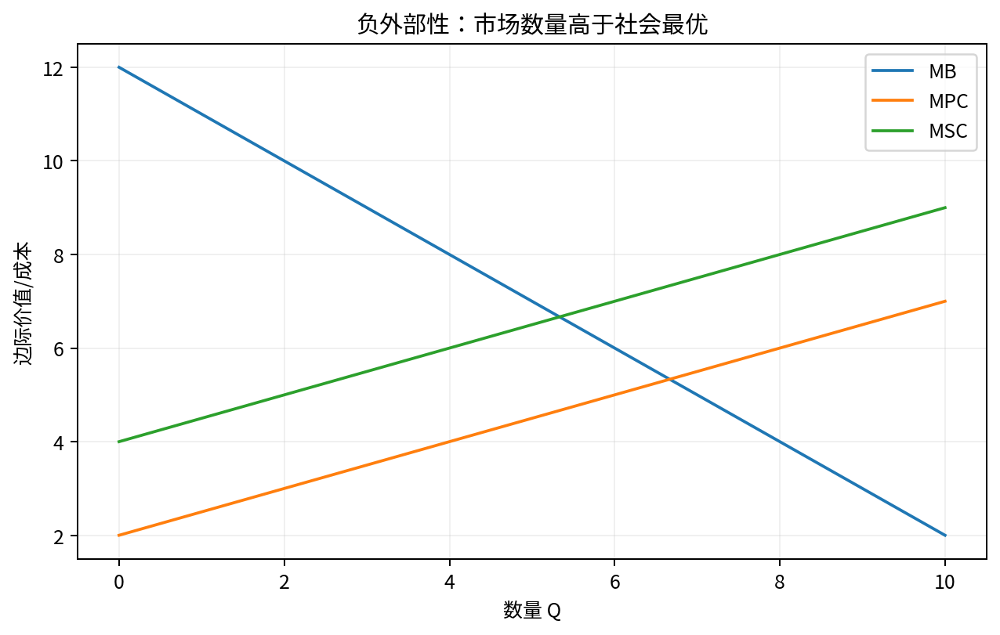

# Chapter 06 · 福利、一般均衡与政府干预

> 用 Pareto、DWL、外部性、公共品与福利定理判断政策何时改善或恶化配置。

## FLOW TARGET

完成本章后，你应该能够：

- 区分 Pareto efficiency 与分配公平
- 理解福利经济学定理及其假设
- 用 wedge 与 surplus 分析税、关税、补贴、公共品与外部性


**统一解题流水线**：无扭曲基准 → wedge/市场失灵 → 新均衡 → surplus → distribution → policy counterfactual



## 题目索引

| 题号 | 问题 | 难度 | 来源类型 | Core 20 |
|---|---|---|---|---|
| [Q053](Q053.md) | 什么是 Pareto efficiency？ | ★★ | 经典高仿真面试题 |  |
| [Q054](Q054.md) | 福利经济学第一定理是什么？ | ★★★ | 经典高仿真面试题 | ⭐ |
| [Q055](Q055.md) | 第二福利定理比第一福利定理多告诉我们什么？ | ★★★★ | 经典高仿真面试题 |  |
| [Q056](Q056.md) | Edgeworth Box 中 contract curve 是什么？ | ★★★ | 经典高仿真面试题 |  |
| [Q057](Q057.md) | 为什么竞争均衡中消费者和企业的边际条件会同时对齐？ | ★★★★ | 经典高仿真面试题 |  |
| [Q058](Q058.md) | 什么是 deadweight loss？ | ★★ | 经典高仿真面试题 |  |
| [Q059](Q059.md) | 关税为什么产生无谓损失？ | ★★★ | 经典高仿真面试题 |  |
| [Q060](Q060.md) | 补贴一定提高社会福利吗？ | ★★★ | 经典高仿真面试题 |  |
| [Q061](Q061.md) | 公共品为什么会出现 free-rider problem？ | ★★★ | 经典高仿真面试题 |  |
| [Q062](Q062.md) | 为什么 Coase theorem 不是“政府什么都不用管”？ | ★★★★ | 经典高仿真面试题 |  |

## 本章完成标准

- 能在不看答案的情况下完成所有 30 秒版本；
- 至少 70% 的题能完成关键白板公式；
- Core 20 题（如本章有）能承受 2-3 次条件变化；
- 至少做 2 道迁移题，并明确数据/反事实。


## 本章专业深化地图

### 1. 理论主线

```text
可行集 → Pareto → competitive equilibrium → welfare theorem → wedge → policy → incidence → general equilibrium
```

不要把本章题目看成孤立知识点。面试官改变一个条件时，应沿这条主线判断：**哪个目标函数、约束、均衡条件或识别假设被改变了？**

### 2. 必须会写的白板公式

- `MRS=Px/Py=MRT`
- `DWL=TS_efficient-TS_actual`
- `Σ MRS_i=MRT`

目标不是背符号，而是能解释：每个式子的选择变量是什么、哪些变量内生、哪些参数外生、什么假设让该式子成立。

### 3. 高频认知瓶颈

- 效率与公平混淆
- DWL 与政府收入混淆
- 只做局部均衡不说明长期/一般均衡

如果在本章连续两题出现同一类错误，应回到相关前置题，而不是继续刷更多相似题。

### 4. 推荐训练顺序

**第一遍｜Recognition → Recall**：按题号完成所有 30 秒答案。

**第二遍｜Derivation**：只做公式与图，不看 3 分钟答案。

**第三遍｜Stress Test**：每题至少接受一次参数变化或假设变化。

**第四遍｜Case Transfer**：把本章模型迁移到一个陌生行业或政策。

### 5. 本章模拟面试链

Q054：第一福利定理 → Q058：DWL → Q061：公共品

建议连续完成，不在题与题之间查资料。每题 3–5 分钟，面试官只追问一个最薄弱环节。

### 6. 跨章节连接

本章把个体最优化提升到政策评价，是税、补贴、关税和 antitrust consumer welfare 的基础。

- **向前追溯**：若推导卡住，优先回到最优化/供需/成本等基础节点；
- **向后迁移**：若标准题已自动化，立即转到政策、产业组织、信息或因果识别场景。

### 7. 本章 Mastery Gate

- [ ] 每题 30 秒版本能不看提示输出；
- [ ] 80% 题目能写核心方程并解释符号；
- [ ] 至少 3 题能完成完整 comparative statics；
- [ ] 至少 2 题能提出可证伪预测与识别证据；
- [ ] 至少 1 题能主动指出静态模型、局部均衡或完全信息假设的边界；
- [ ] Core 20：Q054 能承受连续 3 次追问。

### 8. 推荐交叉参考

- [Advanced Micro Interview Methods](../../reference/advanced-methods.md)
- [微观面试中的因果识别与计量工具](../../reference/econometrics-for-micro-interviews.md)
- [白板图形 Playbook](../../reference/diagram-playbook.md)
