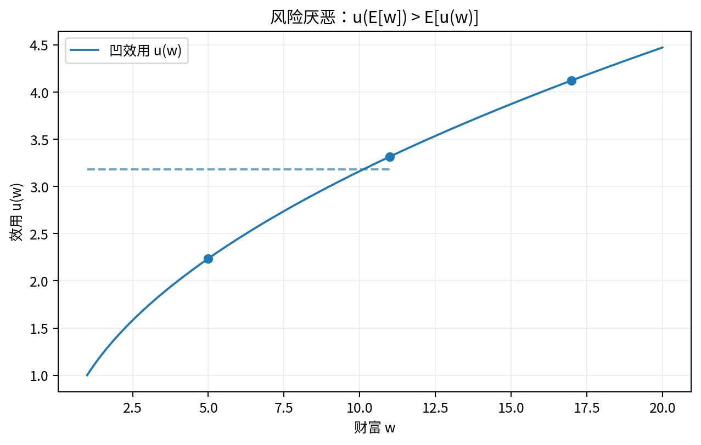

# Chapter 07 · 风险、信息不对称与契约

> 用期望效用、逆向选择、道德风险、信号、筛选与委托代理解释制度设计。

## FLOW TARGET

完成本章后，你应该能够：

- 掌握 expected utility、CE 与 risk premium
- 区分 adverse selection、moral hazard、signaling 与 screening
- 用 IC/IR 约束理解契约设计


**统一解题流水线**：状态/类型/行动 → 可观察性 → payoff → IC/IR → equilibrium contract → welfare



## 题目索引

| 题号 | 问题 | 难度 | 来源类型 | Core 20 |
|---|---|---|---|---|
| [Q063](Q063.md) | 什么是 expected utility？ | ★★★ | 经典高仿真面试题 |  |
| [Q064](Q064.md) | 为什么风险厌恶者愿意买保险？ | ★★★ | 经典高仿真面试题 |  |
| [Q065](Q065.md) | 什么是 certainty equivalent 与 risk premium？ | ★★★ | 经典高仿真面试题 |  |
| [Q066](Q066.md) | adverse selection 与 moral hazard 有什么区别？ | ★★★ | 经典高仿真面试题 | ⭐ |
| [Q067](Q067.md) | 为什么二手车市场可能出现 lemons problem？ | ★★★ | 经典高仿真面试题 |  |
| [Q068](Q068.md) | 保险为什么可能产生 moral hazard？ | ★★★ | 经典高仿真面试题 |  |
| [Q069](Q069.md) | 为什么教育可能成为 signal？ | ★★★★ | 经典高仿真面试题 |  |
| [Q070](Q070.md) | signaling 与 screening 有什么区别？ | ★★★ | 经典高仿真面试题 |  |
| [Q071](Q071.md) | principal-agent problem 的核心冲突是什么？ | ★★★★ | 经典高仿真面试题 |  |
| [Q072](Q072.md) | “按能力贡献、按需要分配”会遇到什么信息与激励问题？ | ★★★★ | 经典高仿真面试题 |  |

## 本章完成标准

- 能在不看答案的情况下完成所有 30 秒版本；
- 至少 70% 的题能完成关键白板公式；
- Core 20 题（如本章有）能承受 2-3 次条件变化；
- 至少做 2 道迁移题，并明确数据/反事实。


## 本章专业深化地图

### 1. 理论主线

```text
risk preference → CE/RP → hidden type/action → IC/IR → signaling/screening → principal-agent
```

不要把本章题目看成孤立知识点。面试官改变一个条件时，应沿这条主线判断：**哪个目标函数、约束、均衡条件或识别假设被改变了？**

### 2. 必须会写的白板公式

- `EU=Σp_su(c_s)`
- `RP=E[W]-CE`
- `IC + participation constraints`

目标不是背符号，而是能解释：每个式子的选择变量是什么、哪些变量内生、哪些参数外生、什么假设让该式子成立。

### 3. 高频认知瓶颈

- adverse selection 与 moral hazard 混淆
- 不说明信息时序
- 合同题只讲激励、不讲风险分担

如果在本章连续两题出现同一类错误，应回到相关前置题，而不是继续刷更多相似题。

### 4. 推荐训练顺序

**第一遍｜Recognition → Recall**：按题号完成所有 30 秒答案。

**第二遍｜Derivation**：只做公式与图，不看 3 分钟答案。

**第三遍｜Stress Test**：每题至少接受一次参数变化或假设变化。

**第四遍｜Case Transfer**：把本章模型迁移到一个陌生行业或政策。

### 5. 本章模拟面试链

Q066：AS vs MH → Q069：signal → Q071：principal-agent

建议连续完成，不在题与题之间查资料。每题 3–5 分钟，面试官只追问一个最薄弱环节。

### 6. 跨章节连接

本章可迁移到保险、教育、平台治理、金融合同和劳动合同。

- **向前追溯**：若推导卡住，优先回到最优化/供需/成本等基础节点；
- **向后迁移**：若标准题已自动化，立即转到政策、产业组织、信息或因果识别场景。

### 7. 本章 Mastery Gate

- [ ] 每题 30 秒版本能不看提示输出；
- [ ] 80% 题目能写核心方程并解释符号；
- [ ] 至少 3 题能完成完整 comparative statics；
- [ ] 至少 2 题能提出可证伪预测与识别证据；
- [ ] 至少 1 题能主动指出静态模型、局部均衡或完全信息假设的边界；
- [ ] Core 20：Q066 能承受连续 3 次追问。

### 8. 推荐交叉参考

- [Advanced Micro Interview Methods](../../reference/advanced-methods.md)
- [微观面试中的因果识别与计量工具](../../reference/econometrics-for-micro-interviews.md)
- [白板图形 Playbook](../../reference/diagram-playbook.md)
