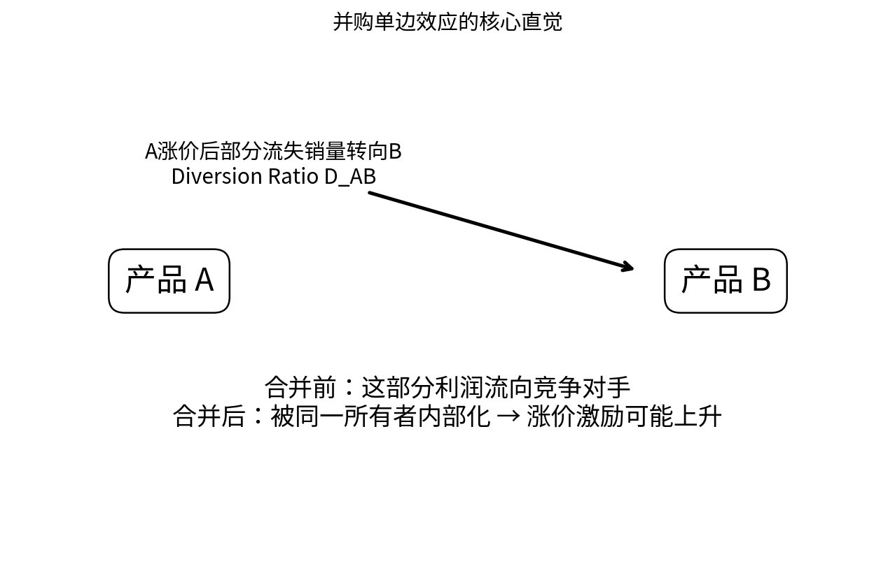

# Chapter 08 · 产业组织、反垄断与经济咨询

> 从 relevant market、diversion、GUPPI、cartel 到 but-for analysis，训练真正的经济咨询 case 思维。

## FLOW TARGET

完成本章后，你应该能够：

- 从相关市场和竞争接近度形成 theory of harm
- 掌握 HHI、diversion、GUPPI 与 pass-through 的筛查直觉
- 把 merger/cartel 问题转化为 but-for counterfactual 与证据设计


**统一解题流水线**：market → rivalry → theory of harm → counterfactual → evidence → robustness



## 题目索引

| 题号 | 问题 | 难度 | 来源类型 | Core 20 |
|---|---|---|---|---|
| [Q073](Q073.md) | 什么是 relevant market？ | ★★★★ | 经典高仿真面试题 | ⭐ |
| [Q074](Q074.md) | 什么是 SSNIP / hypothetical monopolist test？ | ★★★★ | 经典高仿真面试题 |  |
| [Q075](Q075.md) | 什么是 HHI？ | ★★★ | 经典高仿真面试题 |  |
| [Q076](Q076.md) | 为什么 merger 后 HHI 上升不能自动证明消费者受损？ | ★★★★ | 经典高仿真面试题 |  |
| [Q077](Q077.md) | 两家电动车相关企业合并，你首先研究什么？ | ★★★★ | 公开面经高频题型 |  |
| [Q078](Q078.md) | 什么是 diversion ratio？ | ★★★★ | 经典高仿真面试题 |  |
| [Q079](Q079.md) | 为什么 diversion ratio 对 merger 很重要？ | ★★★★ | 经典高仿真面试题 |  |
| [Q080](Q080.md) | GUPPI 的直觉是什么？ | ★★★★★ | 公开面经高频题型 |  |
| [Q081](Q081.md) | 你如何判断一个 cartel 是否存在？ | ★★★★ | 公开面经高频题型 | ⭐ |
| [Q082](Q082.md) | cartel 时期价格上涨20%，能否直接说损害是20%？ | ★★★★ | 经典高仿真面试题 |  |
| [Q083](Q083.md) | 某时期价格明显上涨，但同时发生自然灾害，你怎么分析？ | ★★★★ | Bates White 官方 case 衍生 |  |
| [Q084](Q084.md) | 上游企业价格上涨，下游消费者一定受损吗？ | ★★★★ | Bates White 官方 case 衍生 |  |

## 本章完成标准

- 能在不看答案的情况下完成所有 30 秒版本；
- 至少 70% 的题能完成关键白板公式；
- Core 20 题（如本章有）能承受 2-3 次条件变化；
- 至少做 2 道迁移题，并明确数据/反事实。


## 本章专业深化地图

### 1. 理论主线

```text
market → substitution → concentration → diversion → margin → theory of harm → but-for → evidence → damages
```

不要把本章题目看成孤立知识点。面试官改变一个条件时，应沿这条主线判断：**哪个目标函数、约束、均衡条件或识别假设被改变了？**

### 2. 必须会写的白板公式

- `HHI=Σs_i²`
- `D_AB=switched A→B / lost A sales`
- `GUPPI_A≈D_AB(P_B-MC_B)/P_A`

目标不是背符号，而是能解释：每个式子的选择变量是什么、哪些变量内生、哪些参数外生、什么假设让该式子成立。

### 3. 高频认知瓶颈

- 市场份额/HHI 当作自动结论
- GUPPI 当价格预测
- actual-before 直接当 but-for

如果在本章连续两题出现同一类错误，应回到相关前置题，而不是继续刷更多相似题。

### 4. 推荐训练顺序

**第一遍｜Recognition → Recall**：按题号完成所有 30 秒答案。

**第二遍｜Derivation**：只做公式与图，不看 3 分钟答案。

**第三遍｜Stress Test**：每题至少接受一次参数变化或假设变化。

**第四遍｜Case Transfer**：把本章模型迁移到一个陌生行业或政策。

### 5. 本章模拟面试链

Q073：市场界定 → Q080：GUPPI → Q081–Q084：cartel/pass-through

建议连续完成，不在题与题之间查资料。每题 3–5 分钟，面试官只追问一个最薄弱环节。

### 6. 跨章节连接

本章是经济咨询面试核心，要求把微观模型与数据、反事实和稳健性真正连接起来。

- **向前追溯**：若推导卡住，优先回到最优化/供需/成本等基础节点；
- **向后迁移**：若标准题已自动化，立即转到政策、产业组织、信息或因果识别场景。

### 7. 本章 Mastery Gate

- [ ] 每题 30 秒版本能不看提示输出；
- [ ] 80% 题目能写核心方程并解释符号；
- [ ] 至少 3 题能完成完整 comparative statics；
- [ ] 至少 2 题能提出可证伪预测与识别证据；
- [ ] 至少 1 题能主动指出静态模型、局部均衡或完全信息假设的边界；
- [ ] Core 20：Q073, Q081 能承受连续 3 次追问。

### 8. 推荐交叉参考

- [Advanced Micro Interview Methods](../../reference/advanced-methods.md)
- [微观面试中的因果识别与计量工具](../../reference/econometrics-for-micro-interviews.md)
- [白板图形 Playbook](../../reference/diagram-playbook.md)
