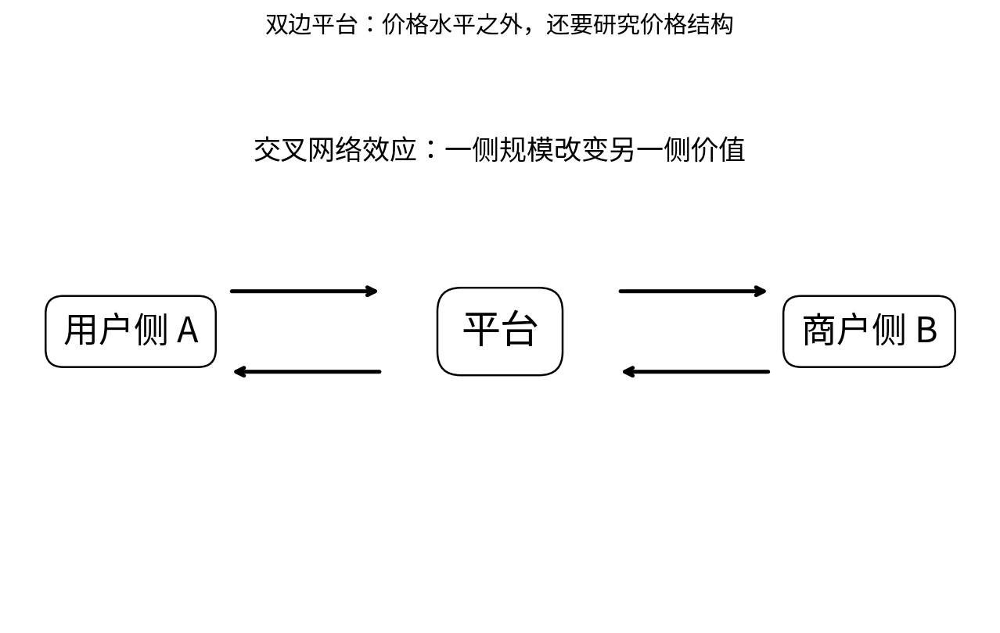

# Chapter 09 · 劳动、平台、行为与现代微观

> 把劳动供给、买方垄断、网络效应、双边平台与 present bias 纳入统一的激励框架。

## FLOW TARGET

完成本章后，你应该能够：

- 用劳动供给与 monopsony 理解工资和就业
- 识别网络效应、跨边效应与零价格市场
- 用跨期偏好解释 present bias 与承诺机制


**统一解题流水线**：决策者 → 激励 → 反馈效应 → equilibrium → policy/design



## 题目索引

| 题号 | 问题 | 难度 | 来源类型 | Core 20 |
|---|---|---|---|---|
| [Q085](Q085.md) | 为什么劳动供给曲线可能向后弯曲？ | ★★★ | 经典高仿真面试题 |  |
| [Q086](Q086.md) | monopsony 为什么会导致工资低于劳动边际产值？ | ★★★★ | 经典高仿真面试题 |  |
| [Q087](Q087.md) | 为什么最低工资在 monopsony 中可能提高就业？ | ★★★★ | 经典高仿真面试题 |  |
| [Q088](Q088.md) | 什么是 network effect？ | ★★★ | 经典高仿真面试题 |  |
| [Q089](Q089.md) | 双边市场为什么不能单独看某一侧价格？ | ★★★★ | 经典高仿真面试题 |  |
| [Q090](Q090.md) | 为什么“免费”并不意味着消费者福利最大？ | ★★★★ | 经典高仿真面试题 |  |
| [Q091](Q091.md) | 什么是 present bias？ | ★★★ | 经典高仿真面试题 |  |
| [Q092](Q092.md) | 一个人明知明天应该学习，却今天一直拖延，经济学如何建模？ | ★★★ | 经典高仿真面试题 |  |

## 本章完成标准

- 能在不看答案的情况下完成所有 30 秒版本；
- 至少 70% 的题能完成关键白板公式；
- Core 20 题（如本章有）能承受 2-3 次条件变化；
- 至少做 2 道迁移题，并明确数据/反事实。


## 本章专业深化地图

### 1. 理论主线

```text
额外状态变量 → 最优化 → 市场势力/网络反馈 → comparative statics → policy/behavioral response
```

不要把本章题目看成孤立知识点。面试官改变一个条件时，应沿这条主线判断：**哪个目标函数、约束、均衡条件或识别假设被改变了？**

### 2. 必须会写的白板公式

- `MCL=w+L·dw/dL`
- `nA=D_A(pA,nB)`
- `U_t=u_t+βΣδ^k u_{t+k}`

目标不是背符号，而是能解释：每个式子的选择变量是什么、哪些变量内生、哪些参数外生、什么假设让该式子成立。

### 3. 高频认知瓶颈

- 把竞争劳动力市场当唯一模型
- 平台只看单边价格
- present bias 与普通高折现率混淆

如果在本章连续两题出现同一类错误，应回到相关前置题，而不是继续刷更多相似题。

### 4. 推荐训练顺序

**第一遍｜Recognition → Recall**：按题号完成所有 30 秒答案。

**第二遍｜Derivation**：只做公式与图，不看 3 分钟答案。

**第三遍｜Stress Test**：每题至少接受一次参数变化或假设变化。

**第四遍｜Case Transfer**：把本章模型迁移到一个陌生行业或政策。

### 5. 本章模拟面试链

Q086：monopsony → Q089：双边市场 → Q091：present bias

建议连续完成，不在题与题之间查资料。每题 3–5 分钟，面试官只追问一个最薄弱环节。

### 6. 跨章节连接

本章展示如何在标准模型上加入摩擦、网络与动态不一致，是现代应用微观的重要迁移训练。

- **向前追溯**：若推导卡住，优先回到最优化/供需/成本等基础节点；
- **向后迁移**：若标准题已自动化，立即转到政策、产业组织、信息或因果识别场景。

### 7. 本章 Mastery Gate

- [ ] 每题 30 秒版本能不看提示输出；
- [ ] 80% 题目能写核心方程并解释符号；
- [ ] 至少 3 题能完成完整 comparative statics；
- [ ] 至少 2 题能提出可证伪预测与识别证据；
- [ ] 至少 1 题能主动指出静态模型、局部均衡或完全信息假设的边界；
- [ ] Core 20：本章无 Core 20，选择难度最高的两题替代 能承受连续 3 次追问。

### 8. 推荐交叉参考

- [Advanced Micro Interview Methods](../../reference/advanced-methods.md)
- [微观面试中的因果识别与计量工具](../../reference/econometrics-for-micro-interviews.md)
- [白板图形 Playbook](../../reference/diagram-playbook.md)
