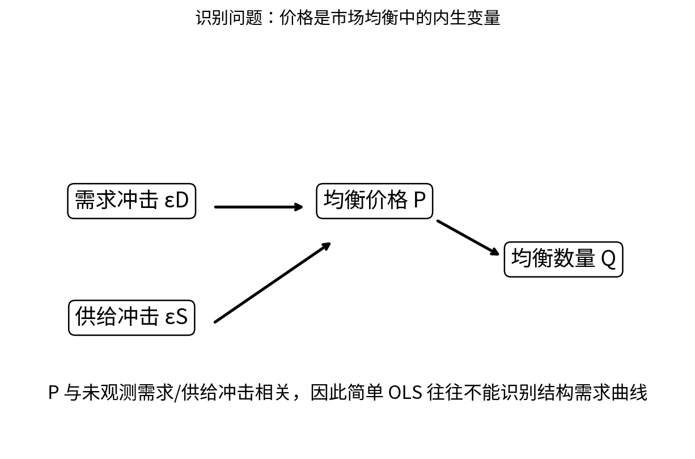

# Chapter 10 · 综合 Case 与因果识别

> 面对陌生行业，能从决策者、约束、均衡、反事实和识别开始，建立可检验的经济学分析。

## FLOW TARGET

完成本章后，你应该能够：

- 在陌生行业中快速建立最小经济模型
- 明确 benchmark/but-for 并识别共同冲击
- 把模型预测连接到回归、IV、事件研究等识别思路


**统一解题流水线**：问题定义 → 最小模型 → 均衡 → comparative statics → counterfactual → identification



## 题目索引

| 题号 | 问题 | 难度 | 来源类型 | Core 20 |
|---|---|---|---|---|
| [Q093](Q093.md) | 出租车牌照原本免费发放但数量固定，为什么牌照仍可能价值很高？ | ★★★★ | 公开面经经典案例型 | ⭐ |
| [Q094](Q094.md) | 政府突然增加20%出租车牌照，旧牌照价格会怎样？ | ★★★★ | 经典高仿真面试题 |  |
| [Q095](Q095.md) | 两家超市准备合并，你只有30分钟判断是否可能损害消费者，怎么做？ | ★★★★★ | 经典高仿真面试题 |  |
| [Q096](Q096.md) | 一家咖啡店价格上涨后销量反而增加，是否违反需求定律？ | ★★★★ | 经典高仿真面试题 |  |
| [Q097](Q097.md) | 企业降价10%，销量增加20%，可以直接说需求弹性是-2吗？ | ★★★★ | 经典高仿真面试题 |  |
| [Q098](Q098.md) | “需求量对价格做回归”有什么问题？ | ★★★★★ | 公开面经高频题型 |  |
| [Q099](Q099.md) | 企业利润下降30%，竞争对手曾侵犯专利，30%都是损害吗？ | ★★★★★ | 经典高仿真面试题 |  |
| [Q100](Q100.md) | 给你一个完全陌生的行业，你如何开始微观经济分析？ | ★★★★★ | 经典高仿真面试题 | ⭐ |

## 本章完成标准

- 能在不看答案的情况下完成所有 30 秒版本；
- 至少 70% 的题能完成关键白板公式；
- Core 20 题（如本章有）能承受 2-3 次条件变化；
- 至少做 2 道迁移题，并明确数据/反事实。


## 本章专业深化地图

### 1. 理论主线

```text
问题定义 → hypothesis tree → 最小模型 → counterfactual → estimand → endogeneity → identification → robustness → recommendation
```

不要把本章题目看成孤立知识点。面试官改变一个条件时，应沿这条主线判断：**哪个目标函数、约束、均衡条件或识别假设被改变了？**

### 2. 必须会写的白板公式

- `observed dQ/dP ≠ structural ∂Qd/∂P`
- `Cov(P,uD)≠0`
- `Damages=π_butfor-π_actual`

目标不是背符号，而是能解释：每个式子的选择变量是什么、哪些变量内生、哪些参数外生、什么假设让该式子成立。

### 3. 高频认知瓶颈

- 相关性直接写成因果
- 先选回归再定义 estimand
- 没有明确 but-for 就计算损害

如果在本章连续两题出现同一类错误，应回到相关前置题，而不是继续刷更多相似题。

### 4. 推荐训练顺序

**第一遍｜Recognition → Recall**：按题号完成所有 30 秒答案。

**第二遍｜Derivation**：只做公式与图，不看 3 分钟答案。

**第三遍｜Stress Test**：每题至少接受一次参数变化或假设变化。

**第四遍｜Case Transfer**：把本章模型迁移到一个陌生行业或政策。

### 5. 本章模拟面试链

Q095：30 分钟 merger screen → Q098：需求回归内生性 → Q100：陌生行业建模

建议连续完成，不在题与题之间查资料。每题 3–5 分钟，面试官只追问一个最薄弱环节。

### 6. 跨章节连接

本章把前九章整合成面试中的“建模—反事实—证据”完整工作流。

- **向前追溯**：若推导卡住，优先回到最优化/供需/成本等基础节点；
- **向后迁移**：若标准题已自动化，立即转到政策、产业组织、信息或因果识别场景。

### 7. 本章 Mastery Gate

- [ ] 每题 30 秒版本能不看提示输出；
- [ ] 80% 题目能写核心方程并解释符号；
- [ ] 至少 3 题能完成完整 comparative statics；
- [ ] 至少 2 题能提出可证伪预测与识别证据；
- [ ] 至少 1 题能主动指出静态模型、局部均衡或完全信息假设的边界；
- [ ] Core 20：Q093, Q100 能承受连续 3 次追问。

### 8. 推荐交叉参考

- [Advanced Micro Interview Methods](../../reference/advanced-methods.md)
- [微观面试中的因果识别与计量工具](../../reference/econometrics-for-micro-interviews.md)
- [白板图形 Playbook](../../reference/diagram-playbook.md)
