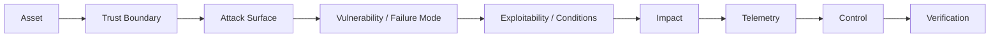

# 网络安全面试宝典 · 100 题（2026）

> 一套按“题目 -> 思路 -> 标准答案 -> 追问 -> 易错点 -> 工程实践 -> 验证”组织的网络安全面试题库。仓库内容基于同名 117 页 PDF 拆分，并为每道题增加更详细的工程化扩展。

## 仓库特性

- **100 道题 = 100 个 Markdown**，便于单题复习、链接、提交 Issue 和 PR。
- **10 大章节**：网络、Web、API/身份、主机、企业身份、AppSec/供应链、蓝队/IR、云原生、密码学/架构、终面系统设计。
- **保留 PDF baseline**：每题明确区分 PDF 原有内容与扩展内容。
- **更深的面试结构**：每题都有 30 秒回答、2-3 分钟回答、面试官意图、边界条件、证据、工程 checklist、追问回答框架、复习卡片。
- **Professional v2 深化层**：100 题逐题补充机制模型、典型失效模式、工程控制面、Detection & Evidence、修复后验证、追问树、真实工作交付物和一页纸复盘；不再使用通用模板替代题目专属分析。
- **2026 口径**：对标 OWASP Top 10:2025、ASVS 5.0.0、NIST CSF 2.0、NIST SP 800-61r3、MITRE ATT&CK、CISA KEV 等。
- **可维护**：统一 YAML front matter、question-index.json、自动完整性检查、MkDocs/GitHub Pages 配置。

## 快速开始

| 目标 | 建议 |
|---|---|
| 3 天打基础 | Q01-Q30：网络 + Web + API/身份 |
| 蓝队 / SOC | Q31-Q50 + Q61-Q70 |
| AppSec | Q11-Q30 + Q51-Q60 + Q91-Q100 |
| Cloud Security | Q41-Q50 + Q61-Q100 |
| 高级安全工程师 | 全量，重点 Q91-Q100 |

## 目录

- [第 1 章 · 计算机网络与协议安全](chapters/01-network-protocols/README.md) - Q01-Q10
- [第 2 章 · Web 安全核心漏洞](chapters/02-web-security/README.md) - Q11-Q20
- [第 3 章 · 高级 Web、API 与身份安全](chapters/03-api-identity/README.md) - Q21-Q30
- [第 4 章 · Linux、Windows、主机与中间件安全](chapters/04-host-middleware/README.md) - Q31-Q40
- [第 5 章 · 内网、身份与 Active Directory](chapters/05-enterprise-identity/README.md) - Q41-Q50
- [第 6 章 · 代码审计、漏洞研究与软件供应链](chapters/06-appsec-supply-chain/README.md) - Q51-Q60
- [第 7 章 · 蓝队、安全运营与应急响应](chapters/07-blue-team-ir/README.md) - Q61-Q70
- [第 8 章 · Cloud、Container、Kubernetes 与 DevSecOps](chapters/08-cloud-native/README.md) - Q71-Q80
- [第 9 章 · 密码学、安全架构与治理](chapters/09-crypto-architecture/README.md) - Q81-Q90
- [第 10 章 · 高级场景、工程能力与终面题](chapters/10-system-design/README.md) - Q91-Q100


## 核心答题模型



遇到陌生题，不要急着背结论。优先问：**资产是什么、谁在访问、信任边界在哪里、数据/状态被谁解释、哪些证据能证明、什么控制可以验证**。

## PDF

- [《网络安全面试宝典_100题_2026.pdf》](pdf/网络安全面试宝典_100题_2026.pdf) - 117 页原始排版版。

## 重要文档

- [使用说明与 PDF 资料口径](docs/00-pdf-basis.md)
- [12 天复习路线](docs/01-study-roadmap.md)
- [统一答题框架](docs/02-answer-framework.md)
- [岗位路线](docs/03-role-roadmaps.md)
- [官方标准映射](docs/04-standards-map.md)
- [术语表](docs/05-glossary.md)
- [面试评分 Rubric](docs/06-interview-rubric.md)
- [面试前最后 30 分钟](docs/07-last-30-minutes.md)
- [统一安全模型](docs/08-unified-model.md)
- [官方参考资料](references/official-standards.md)

## 内容边界

本仓库面向**合法授权的网络安全学习、面试、检测、架构与防守工程**。攻击相关主题重点解释漏洞成立条件、信任边界、检测证据、修复与回归验证；不收录面向真实目标的利用 payload、规避检测、持久化隐藏或武器化操作步骤。

## 本地校验

```bash
python scripts/verify_repo.py
```

仓库应输出：100 个题目文件、连续 Q01-Q100、所有章节 10 题、front matter 与 question-index 一致。

## 文档站点

仓库附带 `mkdocs.yml`。安装依赖后可在本地浏览：

```bash
pip install -r requirements-docs.txt
mkdocs serve
```

## 资料口径与版权

- “真题”指公开面经中长期重复出现并经过重构的高频问法，不声称是任何公司内部题库或逐字原题。
- 《剑指 Offer》仅作为“题解式编排”的结构灵感，不复制其原文、题目、插图或专有版式。
- 本仓库没有替仓库所有者自动选择开源许可证；公开发布前请根据你的使用目标自行添加合适许可证。
