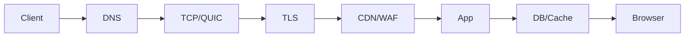

# 第 1 章：计算机网络与协议安全

> 从 TCP/IP 到 HTTP/TLS：安全面试的底层语言

**关键词：** 协议状态机 / DNS 与路由 / HTTP/2/3 / TLS/PKI / 代理/WAF/CDN

## 本章学习目标

- 判断候选人是否真正理解协议状态机、网络分层和组件可见性，而不是只会背端口号或工具参数。
- 面试时先回答“原理和边界”，再回答“检测、修复与验证”。
- 所有攻防相关内容均以授权测试、蓝队分析和工程防护为目的。

## 本章统一分析框架

- 数据从哪里来、经过哪一层？
- 哪一方维护状态？
- 安全控制能看到哪些字段或语义？
- 加密、代理或协议转换后可见性发生了什么变化？

> 本章主线：一次请求跨越的协议与安全控制。

## 题目索引

- [Q01 OSI 七层模型与 TCP/IP 模型分别是什么？安全设备工作在哪一层？](../../questions/01-network-protocols/q01-network-fundamentals.md) - 难度 2/5 - Network Fundamentals
- [Q02 TCP 为什么三次握手，而不是两次？](../../questions/01-network-protocols/q02-tcp-ip.md) - 难度 2/5 - TCP/IP
- [Q03 TCP 如何保证可靠传输？](../../questions/01-network-protocols/q03-tcp-ip.md) - 难度 2/5 - TCP/IP
- [Q04 TCP 与 UDP 的区别？为什么 DNS、QUIC 等会使用 UDP？](../../questions/01-network-protocols/q04-tcp-udp-quic.md) - 难度 2/5 - TCP/UDP/QUIC
- [Q05 DNS 完整解析过程是什么？DNS 有哪些安全问题？](../../questions/01-network-protocols/q05-dns.md) - 难度 3/5 - DNS
- [Q06 HTTP/1.1、HTTP/2、HTTP/3 的主要区别，以及安全影响是什么？](../../questions/01-network-protocols/q06-http.md) - 难度 3/5 - HTTP
- [Q07 从输入 https://example.com 到页面出现，中间发生了什么？](../../questions/01-network-protocols/q07-end-to-end-web-request.md) - 难度 3/5 - 综合网络栈
- [Q08 HTTP 与 HTTPS 的区别是什么？](../../questions/01-network-protocols/q08-tls.md) - 难度 2/5 - TLS
- [Q09 CDN、反向代理、Load Balancer、WAF 分别解决什么问题？](../../questions/01-network-protocols/q09-edge-architecture.md) - 难度 3/5 - Edge Architecture
- [Q10 ARP 的工作原理是什么？ARP 欺骗为什么成立？](../../questions/01-network-protocols/q10-lan-security.md) - 难度 2/5 - LAN Security

<!-- BEGIN CHAPTER_V2_MATRIX -->
## 高级工程师复习矩阵（v2）

这一矩阵用于二刷：不要只背定义，要能把每题压缩为 **机制 → 控制 → 证据**。面试追问时再展开边界和验证。

| 题目 | 根因/机制 | 主要控制 | 关键证据 |
|---|---|---|---|
| [Q01](../../questions/01-network-protocols/q01-network-fundamentals.md) | 分层模型描述通信抽象；安全能力取决于实际可见和可控语义。 | 按目标组合网络、应用、身份与端点控制。 | packet/flow + L7 + identity/endpoint telemetry。 |
| [Q02](../../questions/01-network-protocols/q02-tcp-ip.md) | 双方需要确认彼此序列空间与双向通信能力。 | 连接资源治理 + 边界防护 + 容量设计。 | SYN/ACK、半连接、overflow、新建连接率。 |
| [Q03](../../questions/01-network-protocols/q03-tcp-ip.md) | 序列、确认、重传、窗口和拥塞控制共同提供可靠字节流。 | 端到端 timeout/retry/idempotency 设计。 | RTT/重传 + 应用 timeout/retry。 |
| [Q04](../../questions/01-network-protocols/q04-tcp-udp-quic.md) | TCP 与 UDP 提供不同传输语义；QUIC 在 UDP 上重建高级传输能力。 | 按业务语义选型并补齐协议级滥用防护。 | 连接/数据报/QUIC/DNS 指标。 |
| [Q05](../../questions/01-network-protocols/q05-dns.md) | DNS 通过递归解析、缓存和权威委派完成名称到数据的解析。 | 身份/变更保护 + 资产生命周期 + DNS telemetry。 | resolver/authoritative/registrar 日志。 |
| [Q06](../../questions/01-network-protocols/q06-http.md) | 三代 HTTP 在 framing/传输上演进，应用安全语义仍需显式实现。 | 协议等价控制 + 资源治理 + parser 一致性。 | 协议/stream/edge-origin 对齐数据。 |
| [Q07](../../questions/01-network-protocols/q07-end-to-end-web-request.md) | 端到端请求跨越多层协议与多个信任边界。 | 按每个边界放置身份、加密、授权、隔离与观测。 | browser + edge + trace + app + data telemetry。 |
| [Q08](../../questions/01-network-protocols/q08-tls.md) | TLS 为 HTTP 提供传输机密性、完整性与身份认证。 | 安全 TLS + 证书生命周期 + 应用层安全。 | 握手/证书/redirect/HSTS/edge-origin。 |
| [Q09](../../questions/01-network-protocols/q09-edge-architecture.md) | 四类组件职责不同，关键在代理链与责任边界。 | 受信入口、header 重建、纵深控制、可关联日志。 | edge/WAF/LB/origin 全链日志。 |
| [Q10](../../questions/01-network-protocols/q10-lan-security.md) | ARP 是缺乏强认证的本地邻居解析机制。 | 分段 + 交换机防护 + 端到端加密。 | ARP/MAC/DHCP/网关变化。 |

<!-- END CHAPTER_V2_MATRIX -->

## 推荐复习方法

1. 第一遍只读每题的“30 秒回答”和“一句话记忆”。
2. 第二遍遮住答案，口述 2-3 分钟，并回答追问。
3. 第三遍把自己的项目或实验经历映射到“证据 - 根因 - 修复 - 验证”。
