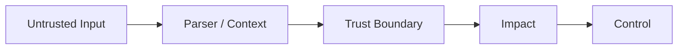

# 第 2 章：Web 安全核心漏洞

> 用“数据 -> 解释器/执行上下文”理解注入、XSS、CSRF、SSRF

**关键词：** SQL 注入 / XSS / CSRF / SSRF / XXE / 文件上传

## 本章学习目标

- 考察候选人能否用“Source -> Propagation -> Parser/Sink -> Impact”解释漏洞根因，并给出可验证的修复。
- 面试时先回答“原理和边界”，再回答“检测、修复与验证”。
- 所有攻防相关内容均以授权测试、蓝队分析和工程防护为目的。

## 本章统一分析框架

- 不可信数据从哪里进入？
- 最终进入什么解析/执行上下文？
- 数据与代码/结构是否真正分离？
- 根治控制与纵深防御分别是什么？

> 本章主线：多数 Web 漏洞都能抽象成数据与解释器的边界问题。

## 题目索引

- [Q11 给你一个 Web 系统，你的安全测试总体思路是什么？](../../questions/02-web-security/q11-owasp-wstg-asvs.md) - 难度 3/5 - OWASP WSTG / ASVS
- [Q12 SQL 注入的本质是什么？](../../questions/02-web-security/q12-owasp-a05-injection.md) - 难度 2/5 - OWASP A05 Injection
- [Q13 使用 Prepared Statement 后是否绝对没有 SQL 注入？](../../questions/02-web-security/q13-owasp-a05-asvs.md) - 难度 4/5 - OWASP A05 / ASVS
- [Q14 XSS 的本质与三种主要类型是什么？](../../questions/02-web-security/q14-owasp-injection-browser-security.md) - 难度 2/5 - OWASP Injection / Browser Security
- [Q15 CSP 能不能彻底解决 XSS？](../../questions/02-web-security/q15-csp-defense-in-depth.md) - 难度 3/5 - CSP / Defense in Depth
- [Q16 CSRF 的本质是什么？如何修复？](../../questions/02-web-security/q16-owasp-a01-browser-security.md) - 难度 2/5 - OWASP A01 / Browser Security
- [Q17 SSRF 的本质是什么？](../../questions/02-web-security/q17-owasp-a01-2025-api7-2023.md) - 难度 3/5 - OWASP A01 2025 / API7:2023
- [Q18 SSRF 为什么不能只过滤 127.0.0.1？](../../questions/02-web-security/q18-ssrf-defense.md) - 难度 4/5 - SSRF Defense
- [Q19 XXE 是什么？为什么现代环境中出现得比以前少？](../../questions/02-web-security/q19-xml-parser-security.md) - 难度 3/5 - XML Parser Security
- [Q20 文件上传漏洞应该如何分析？](../../questions/02-web-security/q20-file-handling.md) - 难度 3/5 - File Handling

<!-- BEGIN CHAPTER_V2_MATRIX -->
## 高级工程师复习矩阵（v2）

这一矩阵用于二刷：不要只背定义，要能把每题压缩为 **机制 → 控制 → 证据**。面试追问时再展开边界和验证。

| 题目 | 根因/机制 | 主要控制 | 关键证据 |
|---|---|---|---|
| [Q11](../../questions/02-web-security/q11-owasp-wstg-asvs.md) | 安全测试是围绕信任边界和安全要求验证，而非工具扫描。 | WSTG 方法 + ASVS 要求 + 风险排序。 | 请求/身份/对象日志 + 代码/配置。 |
| [Q12](../../questions/02-web-security/q12-owasp-a05-injection.md) | 数据被 SQL 解析器当成结构而非值。 | 参数化 + 固定映射 + 最小权限。 | query template/DB audit/应用异常。 |
| [Q13](../../questions/02-web-security/q13-owasp-a05-asvs.md) | 预编译只隔离参数值，不自动约束所有 SQL 结构。 | 枚举映射 + AST/query builder + API 治理。 | 代码与 ORM trace。 |
| [Q14](../../questions/02-web-security/q14-owasp-injection-browser-security.md) | 不可信数据被浏览器解析为可执行内容。 | 上下文编码/安全 DOM + sanitizer + CSP 纵深。 | response/DOM/code/CSP reports。 |
| [Q15](../../questions/02-web-security/q15-csp-defense-in-depth.md) | CSP 限制浏览器允许执行/加载的资源，是纵深防线。 | 强策略 + nonce/hash + reporting + 安全编码。 | CSP violation reports 与实际响应头。 |
| [Q16](../../questions/02-web-security/q16-owasp-a01-browser-security.md) | 浏览器自动携带身份，但服务端缺少请求真实性验证。 | CSRF token + SameSite + 高风险动作验证。 | Origin/session/action 日志。 |
| [Q17](../../questions/02-web-security/q17-owasp-a01-2025-api7-2023.md) | 不可信输入控制服务器的网络请求能力。 | destination policy + isolated fetcher + egress + least-privilege identity。 | 出站 DNS/flow/proxy 与应用映射。 |
| [Q18](../../questions/02-web-security/q18-ssrf-defense.md) | 字符串校验与实际网络 destination 不一致。 | 标准解析 + 解析后分类 + egress 默认拒绝。 | normalized URL/resolved IP/redirect/flow。 |
| [Q19](../../questions/02-web-security/q19-xml-parser-security.md) | 解析器对外部实体/DTD 的能力被不可信 XML 触发。 | 禁用不必要特性 + 限制资源 + 隔离。 | parser errors + egress/file telemetry。 |
| [Q20](../../questions/02-web-security/q20-file-handling.md) | 不可信文件跨越存储、解析、执行和浏览器边界。 | 隔离上传 + allowlist + 安全处理 + 授权下载。 | 上传/对象/解析/下载全链审计。 |

<!-- END CHAPTER_V2_MATRIX -->

## 推荐复习方法

1. 第一遍只读每题的“30 秒回答”和“一句话记忆”。
2. 第二遍遮住答案，口述 2-3 分钟，并回答追问。
3. 第三遍把自己的项目或实验经历映射到“证据 - 根因 - 修复 - 验证”。
