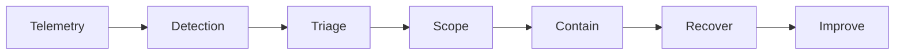

# 第 7 章：蓝队、安全运营与应急响应

> Telemetry -> Detection -> Investigation -> Response

**关键词：** SIEM / IOC/IOA/TTP / 事件响应 / 时间线 / 漏洞优先级 / MITRE ATT&CK

## 本章学习目标

- 考察是否能把单条告警转化为“证据 -> 时间线 -> 范围 -> 决策”，并形成检测和响应闭环。
- 面试时先回答“原理和边界”，再回答“检测、修复与验证”。
- 所有攻防相关内容均以授权测试、蓝队分析和工程防护为目的。

## 本章统一分析框架

- 告警是否真实？
- 影响了哪个身份/资产/业务？
- 当前活动是否仍在继续？
- containment 的收益和业务代价是什么？

> 本章主线：从告警到改进闭环。

## 题目索引

- [Q61 收到一个 SIEM 高危告警，你怎么处理？](../../questions/07-blue-team-ir/q61-soc-triage.md) - 难度 4/5 - SOC Triage
- [Q62 IOC、IOA、TTP 有什么区别？](../../questions/07-blue-team-ir/q62-detection-concepts.md) - 难度 3/5 - Detection Concepts
- [Q63 SIEM 的基本数据链路是什么？](../../questions/07-blue-team-ir/q63-siem-architecture.md) - 难度 3/5 - SIEM Architecture
- [Q64 Incident Response 的核心阶段是什么？](../../questions/07-blue-team-ir/q64-nist-sp-800-61r3-csf-2-0.md) - 难度 3/5 - NIST SP 800-61r3 / CSF 2.0
- [Q65 公司遭遇勒索事件，第一小时你做什么？](../../questions/07-blue-team-ir/q65-ransomware-ir.md) - 难度 5/5 - Ransomware IR
- [Q66 Web 服务器疑似被入侵，你如何构建时间线？](../../questions/07-blue-team-ir/q66-timeline-analysis.md) - 难度 4/5 - Timeline Analysis
- [Q67 钓鱼邮件告警如何分析？](../../questions/07-blue-team-ir/q67-phishing-triage.md) - 难度 4/5 - Phishing Triage
- [Q68 漏洞优先级应该只看 CVSS 吗？](../../questions/07-blue-team-ir/q68-cisa-kev-risk.md) - 难度 4/5 - CISA KEV / Risk
- [Q69 什么日志最有价值？](../../questions/07-blue-team-ir/q69-telemetry-strategy.md) - 难度 4/5 - Telemetry Strategy
- [Q70 MITRE ATT&CK 在蓝队中怎么使用？](../../questions/07-blue-team-ir/q70-mitre-att-and-ck.md) - 难度 4/5 - MITRE ATT&CK

<!-- BEGIN CHAPTER_V2_MATRIX -->
## 高级工程师复习矩阵（v2）

这一矩阵用于二刷：不要只背定义，要能把每题压缩为 **机制 → 控制 → 证据**。面试追问时再展开边界和验证。

| 题目 | 根因/机制 | 主要控制 | 关键证据 |
|---|---|---|---|
| [Q61](../../questions/07-blue-team-ir/q61-soc-triage.md) | 告警只是信号，需要上下文验证和范围判断。 | 标准 triage + enrichment + case governance。 | raw alert + identity/asset/multi-source context。 |
| [Q62](../../questions/07-blue-team-ir/q62-detection-concepts.md) | 从具体 artifact 到行为模式有不同抽象层。 | IOC 快速处置 + behavior/TTP 长期检测。 | match/prevalence + behavior sequence。 |
| [Q63](../../questions/07-blue-team-ir/q63-siem-architecture.md) | 检测质量受数据链路完整性直接约束。 | data contracts + health + enrichment + tiering。 | ingest/parser/schema/detection metrics。 |
| [Q64](../../questions/07-blue-team-ir/q64-nist-sp-800-61r3-csf-2-0.md) | IR 是贯穿风险管理生命周期的组织能力。 | governance + telemetry + playbooks + recovery validation。 | readiness/case/decision/recovery。 |
| [Q65](../../questions/07-blue-team-ir/q65-ransomware-ir.md) | 高影响破坏常伴随身份滥用与横向扩散。 | control-plane protection + segmented containment + trusted recovery。 | EDR/identity/backup/egress。 |
| [Q66](../../questions/07-blue-team-ir/q66-timeline-analysis.md) | 多源事件需按时间与实体关联形成因果链。 | UTC/time sync + correlation ID + centralized logs。 | edge/app/EDR/identity/data。 |
| [Q67](../../questions/07-blue-team-ir/q67-phishing-triage.md) | 恶意邮件可能诱导身份或终端被滥用。 | mail→IdP→EDR 联动处置。 | headers/click/session/rules/endpoint。 |
| [Q68](../../questions/07-blue-team-ir/q68-cisa-kev-risk.md) | 单一技术分数不能代表组织真实风险。 | CVSS+exposure+KEV+business context。 | finding/asset/threat/deploy context。 |
| [Q69](../../questions/07-blue-team-ir/q69-telemetry-strategy.md) | 日志价值取决于能否回答具体安全问题。 | use-case driven data contracts + health/retention。 | field completeness 与 investigation gap。 |
| [Q70](../../questions/07-blue-team-ir/q70-mitre-att-and-ck.md) | ATT&CK 提供行为分类，不直接提供组织控制。 | threat-informed mapping + tested detections。 | data/rule/test/incident mapping。 |

<!-- END CHAPTER_V2_MATRIX -->

## 推荐复习方法

1. 第一遍只读每题的“30 秒回答”和“一句话记忆”。
2. 第二遍遮住答案，口述 2-3 分钟，并回答追问。
3. 第三遍把自己的项目或实验经历映射到“证据 - 根因 - 修复 - 验证”。
