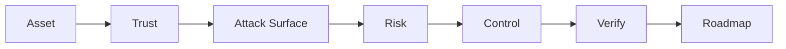

# 第 10 章：高级场景、工程能力与终面题

> 把“会找漏洞”升级成“会设计安全系统、会管理风险”

**关键词：** 登录/重置 / API Gateway / 安全上传 / SDLC / 漏洞管理 / Postmortem / 30 天安全规划

## 本章学习目标

- 考察候选人能否把安全知识转成架构、路线图、指标和跨团队可执行方案。
- 面试时先回答“原理和边界”，再回答“检测、修复与验证”。
- 所有攻防相关内容均以授权测试、蓝队分析和工程防护为目的。

## 本章统一分析框架

- 保护的关键资产是什么？
- 最重要信任边界和 attack path 是什么？
- 什么控制能真正降低风险？
- 如何验证控制有效并向业务解释优先级？

> 本章主线：从单点漏洞升级为安全工程与风险决策。

## 题目索引

- [Q91 如果目标只有一个登录页面，你会怎么评估安全性？](../../questions/10-system-design/q91-authentication-surface.md) - 难度 5/5 - Authentication Surface
- [Q92 让你设计“忘记密码”功能，如何确保安全？](../../questions/10-system-design/q92-account-recovery.md) - 难度 5/5 - Account Recovery
- [Q93 设计一个 API Gateway 安全体系，你会考虑什么？](../../questions/10-system-design/q93-api-security.md) - 难度 5/5 - API Security
- [Q94 设计一个安全文件上传系统。](../../questions/10-system-design/q94-secure-upload-architecture.md) - 难度 5/5 - Secure Upload Architecture
- [Q95 你如何把安全加入 SDLC？](../../questions/10-system-design/q95-nist-ssdf-secure-sdlc.md) - 难度 5/5 - NIST SSDF / Secure SDLC
- [Q96 如果让你设计企业漏洞管理平台，你怎么设计？](../../questions/10-system-design/q96-risk-based-vm.md) - 难度 5/5 - Risk-based VM
- [Q97 面试现场让你写一个日志分析脚本，重点考什么？](../../questions/10-system-design/q97-python-data-processing.md) - 难度 4/5 - Python / Data Processing
- [Q98 安全事故复盘应该包含什么？](../../questions/10-system-design/q98-postmortem.md) - 难度 4/5 - Postmortem
- [Q99 “讲一个你发现过的漏洞/安全问题”应该怎么回答？](../../questions/10-system-design/q99-behavioral-technical.md) - 难度 5/5 - Behavioral + Technical
- [Q100 终极综合题：你入职一家 3000 人互联网公司负责安全，前 30 天做什么？](../../questions/10-system-design/q100-security-program-csf-2-0.md) - 难度 5/5 - Security Program / CSF 2.0

<!-- BEGIN CHAPTER_V2_MATRIX -->
## 高级工程师复习矩阵（v2）

这一矩阵用于二刷：不要只背定义，要能把每题压缩为 **机制 → 控制 → 证据**。面试追问时再展开边界和验证。

| 题目 | 根因/机制 | 主要控制 | 关键证据 |
|---|---|---|---|
| [Q91](../../questions/10-system-design/q91-authentication-surface.md) | 身份生命周期的多入口决定真实认证攻击面。 | MFA/abuse controls + secure session + recovery。 | IdP/login/reset/session/API。 |
| [Q92](../../questions/10-system-design/q92-account-recovery.md) | 恢复流程可绕过正常认证，因此必须同等级保护。 | 高熵单次短期 token + rate limit + revoke。 | reset/session/abuse audit。 |
| [Q93](../../questions/10-system-design/q93-api-security.md) | 共享 API 边界需统一控制但业务授权仍在资源层。 | authn/rate/schema + backend authz + private origin。 | gateway/backend/config。 |
| [Q94](../../questions/10-system-design/q94-secure-upload-architecture.md) | 不可信文件跨越解析、存储和浏览器边界。 | quarantine + isolation + private storage + authorized serving。 | upload/process/storage/download。 |
| [Q95](../../questions/10-system-design/q95-nist-ssdf-secure-sdlc.md) | 安全若不进入软件生命周期，会在发布末端高成本发现。 | requirements→build→runtime 全链安全。 | pipeline/finding/fix/escape metrics。 |
| [Q96](../../questions/10-system-design/q96-risk-based-vm.md) | finding 缺上下文无法转化为真实风险和行动。 | normalize+enrich+prioritize+owner+verify。 | finding/asset/remediation lineage。 |
| [Q97](../../questions/10-system-design/q97-python-data-processing.md) | 安全数据需在不可靠输入和大规模条件下稳定聚合。 | streaming + normalization + explicit error policy。 | processing metrics/output samples。 |
| [Q98](../../questions/10-system-design/q98-postmortem.md) | 事件来自系统性条件组合，不应止于个体错误。 | evidence-based RCA + owned measurable actions。 | timeline/control gaps/decisions。 |
| [Q99](../../questions/10-system-design/q99-behavioral-technical.md) | 面试考察从问题识别到工程闭环的真实能力。 | 结构化案例 + root cause + collaboration + verification。 | 事实/日志/代码/修复结果。 |
| [Q100](../../questions/10-system-design/q100-security-program-csf-2-0.md) | 缺乏事实底座和风险排序会导致安全投入失焦。 | business-first discovery + critical-path quick wins + governed roadmap。 | asset/identity/exposure/control/readiness metrics。 |

<!-- END CHAPTER_V2_MATRIX -->

## 推荐复习方法

1. 第一遍只读每题的“30 秒回答”和“一句话记忆”。
2. 第二遍遮住答案，口述 2-3 分钟，并回答追问。
3. 第三遍把自己的项目或实验经历映射到“证据 - 根因 - 修复 - 验证”。
